# Posterizarr

Automate artwork creation and management for Plex, Jellyfin, and Emby. Posterizarr combines configurable artwork search and styling with a Web UI for testing, curation, server uploads, and automation. Silo support is experimental and does not have full feature parity.

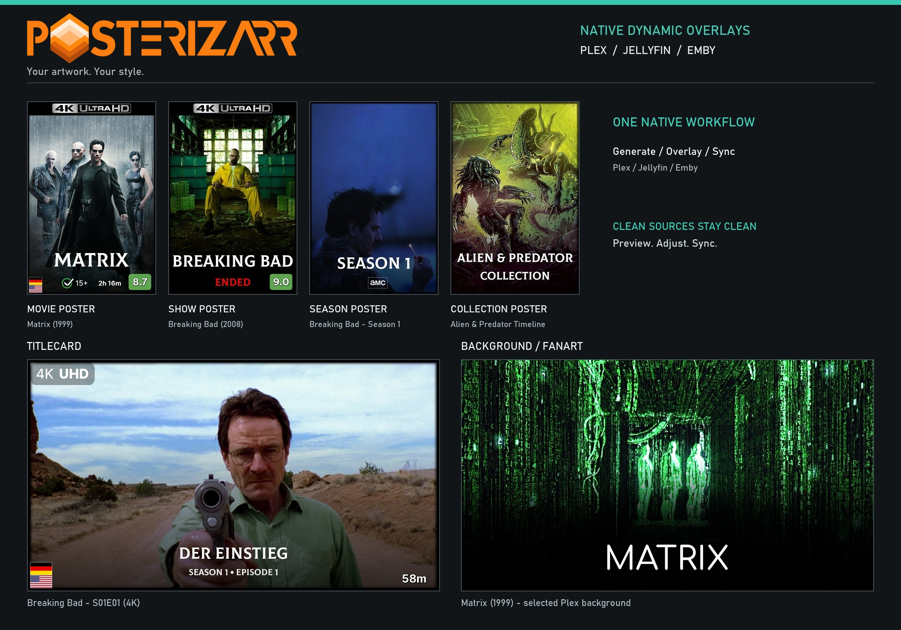

**New here?** Follow [First-time setup](docs/getting_started.md), then use the [Web UI map](docs/ui_guide.md) to find each screen.

## 1. Overview & Key Features

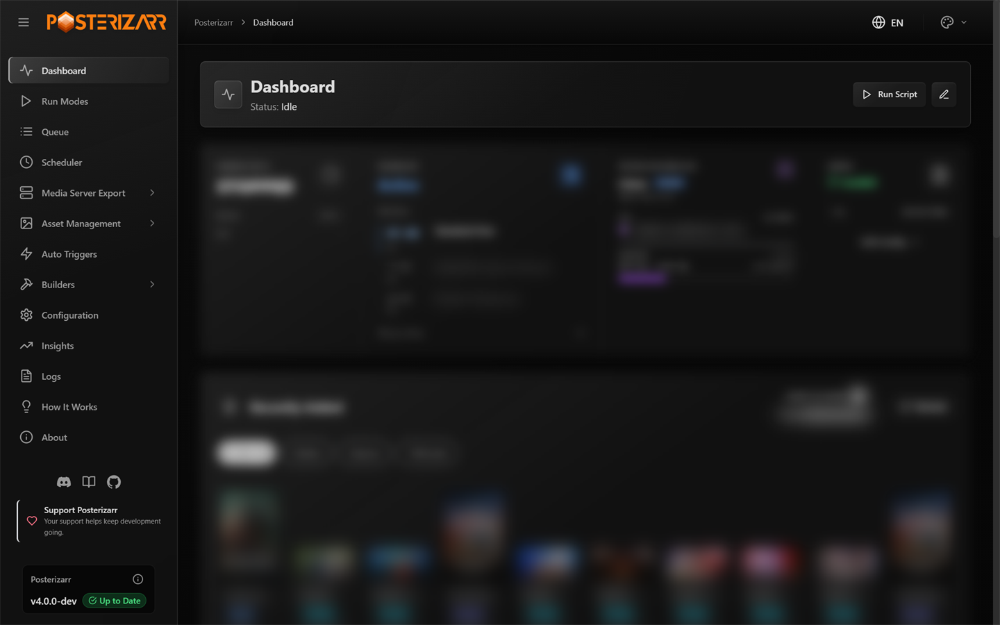

*Navigate to **Dashboard** in the left sidebar to check engine status, scheduler activity, configuration state, recent assets, and logs.*

- Generate posters, season posters, backgrounds, title cards, and collection artwork using provider, language, image-size, and styling preferences.
- Preserve clean source artwork while using native Dynamic Overlays to render supported ratings, resolution, language, and other metadata badges in memory.
- Connect Plex, Jellyfin, or Emby; manage logos and assets; review suggested artwork issues; and upload or synchronize artwork.
- Test styling without uploading, then run manually, schedule jobs, or respond to Tautulli and Sonarr/Radarr events.
- Use local assets, templates, backups, restore workflows, notifications, and optional integrations such as Kometa, Agregarr, and the Jellyfin/Emby plugins.

## 2. Quick Start / Installation

Docker Compose is the recommended path for most users. Docker and Unraid include the Web UI; you do not need to install it separately.

1. Review [requirements](docs/requirements.md) and choose [an installation method](docs/installation.md).
2. For Docker, create writable persistent folders for `/config` and `/assets`, publish host port `8000` to container port `8000`, and set the container time zone. The complete Compose example also mounts `/assetsbackup` and `/manualassets`.
3. Start the container, then open `http://localhost:8000` on the host or `http://YOUR_SERVER_IP:8000` from another device. If you changed the host port, use that port in the URL.
4. Continue with the [first-time setup walkthrough](docs/getting_started.md). Keep `RUN_TIME=disabled` when using the Web UI Scheduler.

The installation guide covers updates, stopping the container, external Docker networks, Unraid, and manual PowerShell installs. See [Networking](docs/networking.md) if the UI is not reachable.

## 3. First-Time UI Walkthrough & Initial Setup

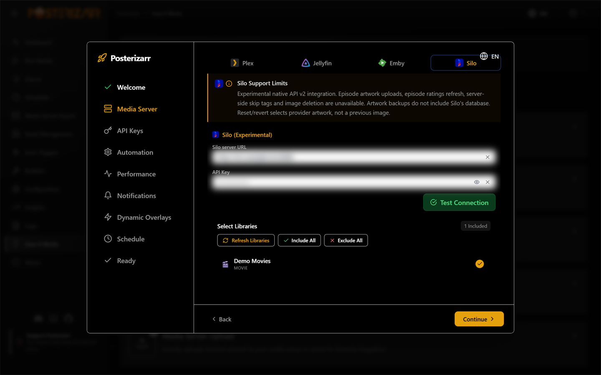

*The first-run wizard opens automatically for an incomplete configuration. It guides server, provider, automation, optional Dynamic Overlays, notification, and schedule setup.*

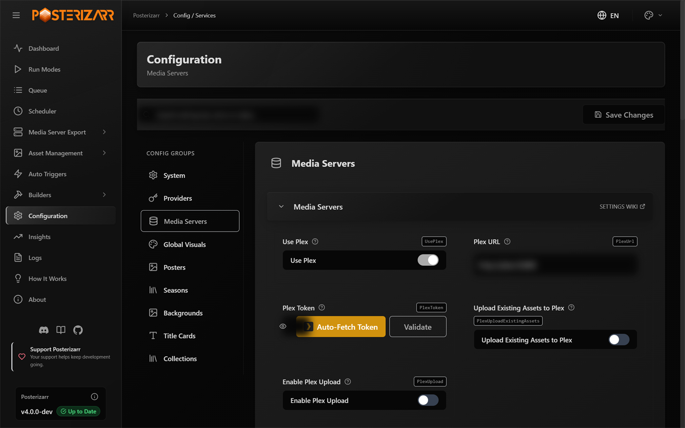

*Navigate to **Configuration** in the left sidebar, then choose **Media Servers** to connect Plex, Jellyfin, or Emby and select libraries.*

1. Add the URL and API credential for one media server, validate the connection, and choose one test library.
2. Open **Configuration > Providers** and add keys for the artwork providers you plan to use. TMDb, Fanart.tv, and TheTVDB are optional individually; configure only the providers you intend to use.
3. Review the asset path, upload behavior, and enabled artwork types. Search settings by name and save changes in the UI.
4. Use **Run Modes > Testing Mode** to check artwork styling without uploading. For Dynamic Overlays, use its Setup Wizard and keep Dry Run enabled; this checks overlay rules separately.
5. Run a small, targeted job and inspect its output and logs before enabling broader uploads or automation.

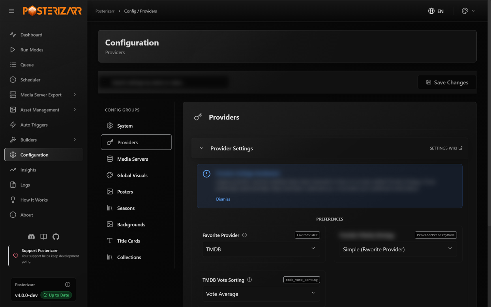

*Navigate to **Configuration > Providers** to enter artwork-provider credentials and set provider priority.*

The UI also has **Global Visuals**, **Posters**, **Seasons**, **Backgrounds**, **Title Cards**, and **Collections** groups. The [Configuration reference](docs/configuration.md) retains the full field-by-field settings and JSON examples.

## 4. Core Features & Sections

### Run Modes and Queue

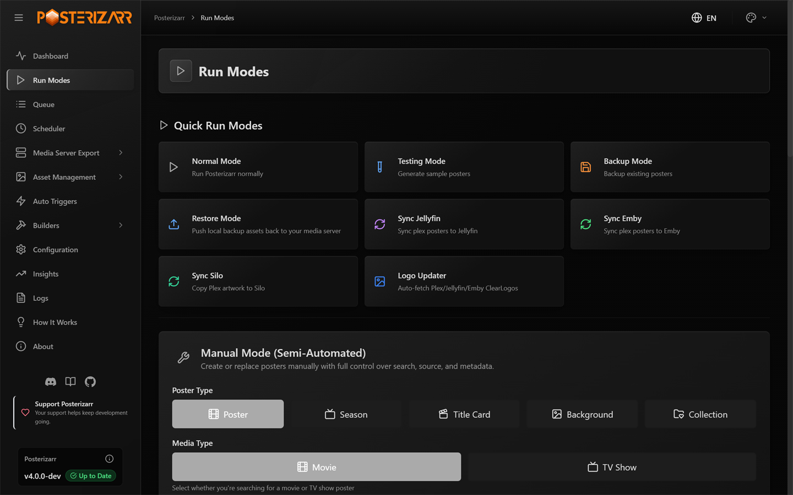

*Navigate to **Run Modes** in the left sidebar to start a normal run, test, backup, restore, sync, logo update, or manual asset job.*

Use **Testing Mode** before a full run. **Queue** shows pending, running, and completed manual or overlay work. See [Run Modes and automation](docs/modes.md) for mode behavior, safety notes, manual CLI switches, and webhook instructions.

### Asset Management

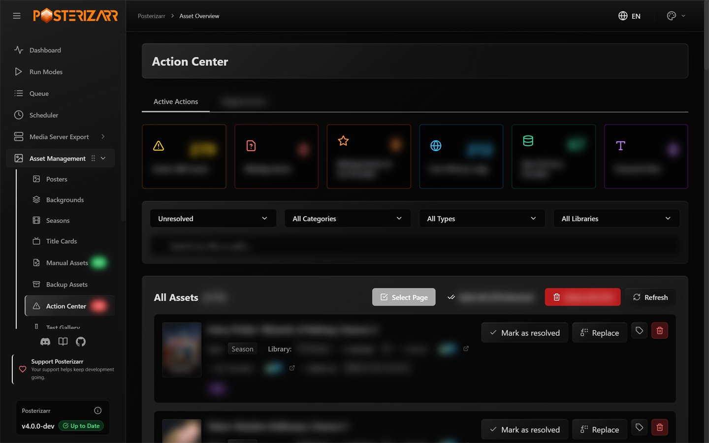

*Navigate to **Asset Management > Action Center** to filter flagged assets, mark them resolved, replace an image, or remove a tracking record.*

Asset Management also contains poster/background/season/title-card galleries, **Manual Assets**, **Backup Assets**, **Test Gallery**, and (when available) **Plex Image Quarantine**. Action Center items are curation suggestions, not necessarily failed jobs. Read the [Action Center guide](docs/action_center.md), [manual naming rules](docs/namingconvention.md), and [Plex Image Cleanup guide](docs/plex_image_cleanup.md) before using destructive cleanup actions.

### Media Server Export

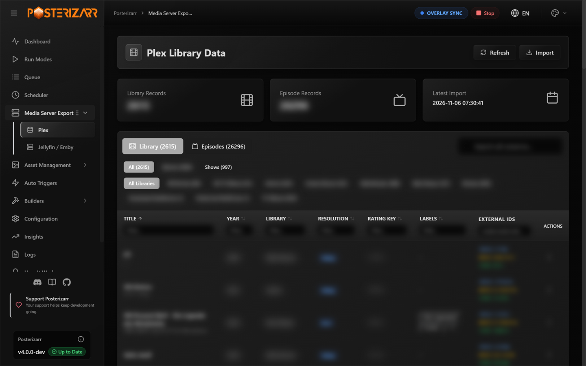

*Navigate to **Media Server Export > Plex** to browse cached Plex library and episode records; choose **Jellyfin / Emby** for those server exports.*

Exports and refresh/import operations are separate from artwork generation. See the [API and endpoint reference](docs/endpoints.md) for supported data operations.

### Builders

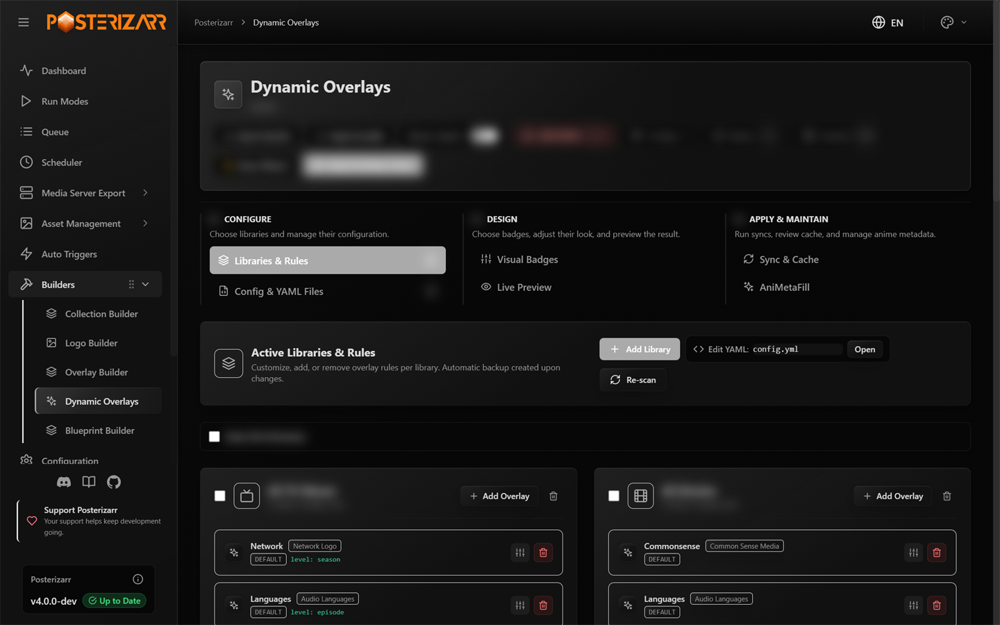

*Navigate to **Builders > Dynamic Overlays** to configure rules, edit badges, preview changes, and run a sync.*

Start with **Dry Run**. It renders and evaluates changes without uploading artwork. Kometa-style YAML import supports a subset of Kometa configuration; Posterizarr does not run Kometa and does not provide complete Kometa feature parity. The detailed [Dynamic Overlays guide](docs/dynamic_overlays.md) covers bundle sharing, provider ratings, local IMDb data, cache behavior, Anime ratings, and compatibility limits.

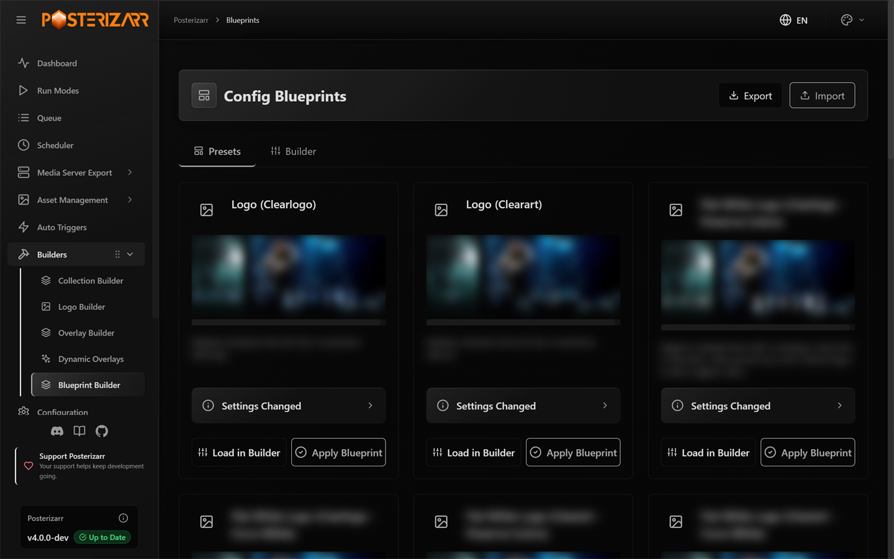

*Navigate to **Builders > Blueprint Builder** to preview and apply reusable artwork presets.*

Other builders include Collection Builder, Logo Builder, and Overlay Builder. See [Blueprints and recipes](docs/blueprints.md) for examples and the [artwork showcase](docs/showcase.md) for samples.

### Insights and Logs

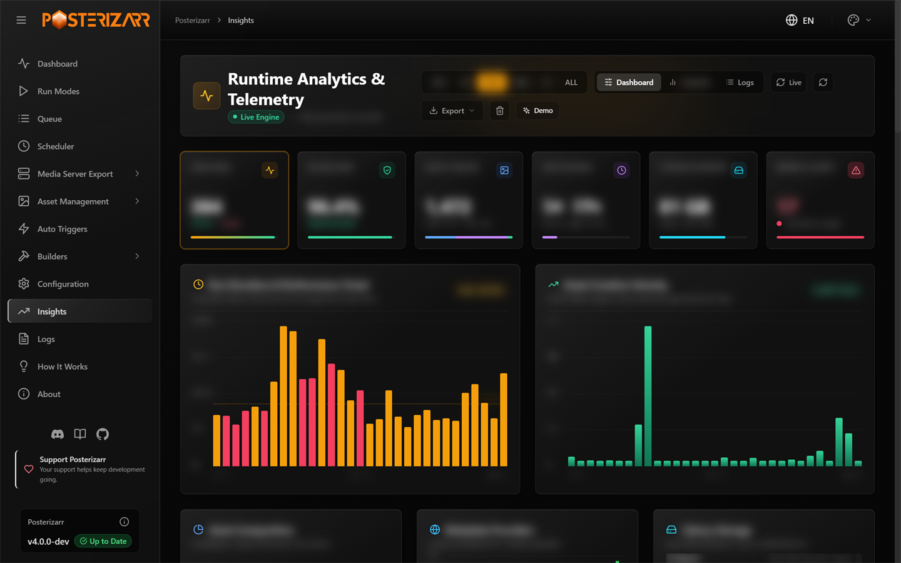

*Navigate to **Insights** in the sidebar for run history, filters, charts, exports, and optional demo data.*

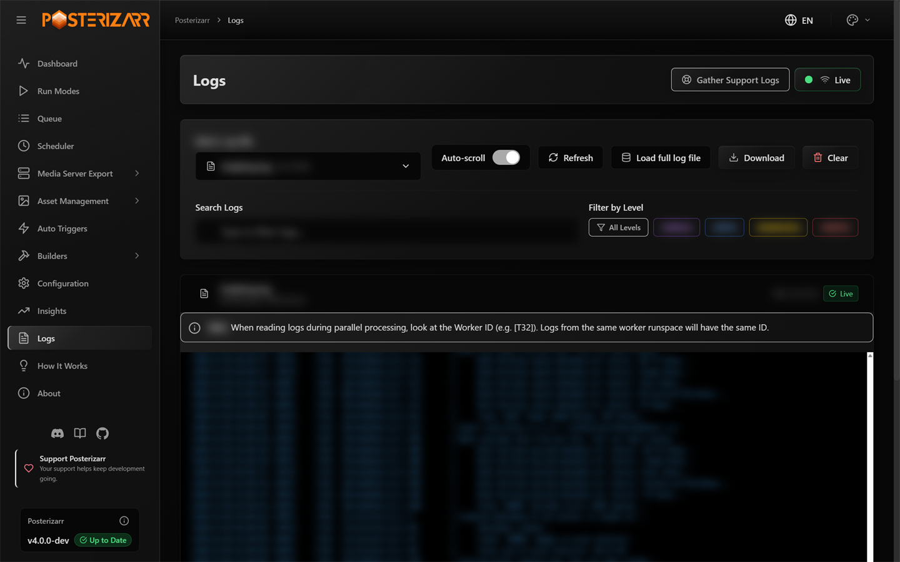

*Navigate to **Logs** to search and filter log files, download them, or gather a support bundle.*

## 5. Automation, Scheduling & Advanced Usage

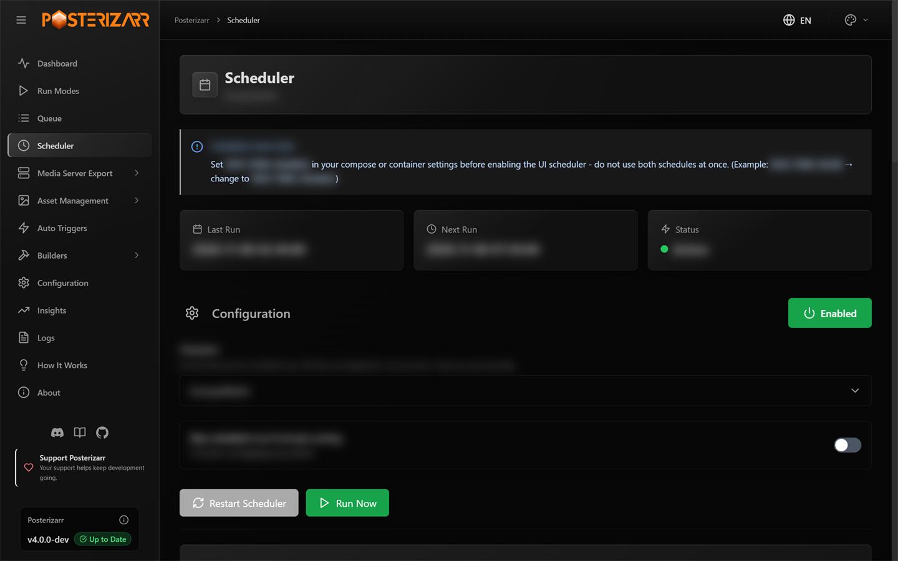

*Navigate to **Scheduler** to create, enable, and run scheduled jobs. In Docker, set `RUN_TIME=disabled` first so the container timer and UI Scheduler do not compete.*

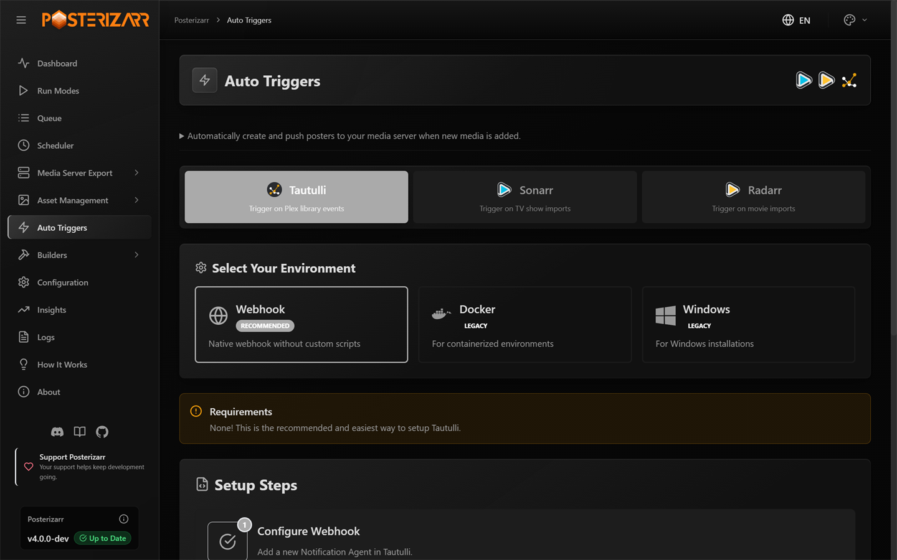

*Navigate to **Auto Triggers** to configure native webhooks; the Docker and Windows methods are retained for legacy setups.*

- Configure schedules and external triggers after you have checked a small test run. See [Run Modes and automation](docs/modes.md), [Agregarr](docs/agregarrintegration.md), and the [FAQ](docs/faqs.md).
- Container variables include `RUN_TIME`, `APP_PORT`, `DISABLE_UI`, and `ARR_WAIT_TIME`; advanced container startup supports `--run` for one-shot jobs. Details and Docker exec commands remain in [Platform & Tools](docs/platformandtools.md).
- PowerShell users can use the [manual walkthrough](docs/walkthrough.md) and the optional CLI instructions in [Run Modes](docs/modes.md). The Web UI is the recommended everyday workflow.
- See [provider search order](docs/searchorder.md), [telemetry and privacy](docs/telemetry.md), [Homepage integration](docs/homepage.md), [optional Kometa compatibility](docs/kometaintegration.md), and the [Jellyfin](docs/jellyfin_plugin.md) and [Emby](docs/emby_plugin.md) plugins for specialist workflows.

## Documentation Map

| Topic | Guides |
|---|---|
| Setup | [First-time setup](docs/getting_started.md), [requirements](docs/requirements.md), [installation](docs/installation.md), [PowerShell walkthrough](docs/walkthrough.md), [source Web UI](docs/uiinstallation.md) |
| Web UI | [UI map](docs/ui_guide.md), [configuration](docs/configuration.md), [run modes](docs/modes.md), [Action Center](docs/action_center.md), [API endpoints](docs/endpoints.md) |
| Artwork | [Capabilities](docs/capabilities.md), [showcase](docs/showcase.md), [Dynamic Overlays](docs/dynamic_overlays.md), [Blueprints](docs/blueprints.md), [manual naming](docs/namingconvention.md), [Plex cleanup](docs/plex_image_cleanup.md) |
| Servers and integrations | [Agregarr](docs/agregarrintegration.md), [Jellyfin plugin](docs/jellyfin_plugin.md), [Emby plugin](docs/emby_plugin.md), [Homepage](docs/homepage.md), [Kometa](docs/kometaintegration.md) |
| Reference and troubleshooting | [search order](docs/searchorder.md), [platforms and tools](docs/platformandtools.md), [networking](docs/networking.md), [FAQs](docs/faqs.md), [telemetry](docs/telemetry.md) |
| Developers | [documentation preview](docs/docs_preview.md), [PowerShell architecture](docs/powershell_scripts.md), [backend](docs/backend_python.md), [frontend](docs/frontend_components.md), [LLM architecture](docs/llms.md) |

## Supported Platforms

Docker, Unraid, Linux, Windows, macOS, and ARM deployments are covered in the [installation and platform guides](docs/installation.md).

## Privacy & Telemetry

Telemetry is optional and can be disabled with `"telemetry": false` in the configuration. The complete payload, retention behavior, and opt-out instructions are documented in [Telemetry & Privacy](docs/telemetry.md). The worker implementation is in [telemetry-worker/worker.js](telemetry-worker/worker.js).

## Contributing

Please review the [Contributing Guidelines](.github/CONTRIBUTING.md) and [Code of Conduct](.github/CODE_OF_CONDUCT.md) before submitting a pull request. Keep `$CurrentScriptVersion` in `Posterizarr.ps1` and [Release.txt](Release.txt) synchronized as required by the contribution guide. Version synchronization is used for update detection. The existing PR checklist also says not to include images; confirm the maintainer's current policy for documentation screenshot changes. The project maintainer reviews and tests AI-assisted UI and web changes before they are committed.

<!-- sponsors --><!-- sponsors -->

Made by [fscorrupt](https://github.com/fscorrupt) and the [open source community](https://github.com/fscorrupt/posterizarr/graphs/contributors). Join the [Discord](https://discord.gg/fYyJQSGt54), [report a bug or request a feature](https://github.com/fscorrupt/posterizarr/issues), or [support Posterizarr](https://ko-fi.com/R6R81S6SC).
