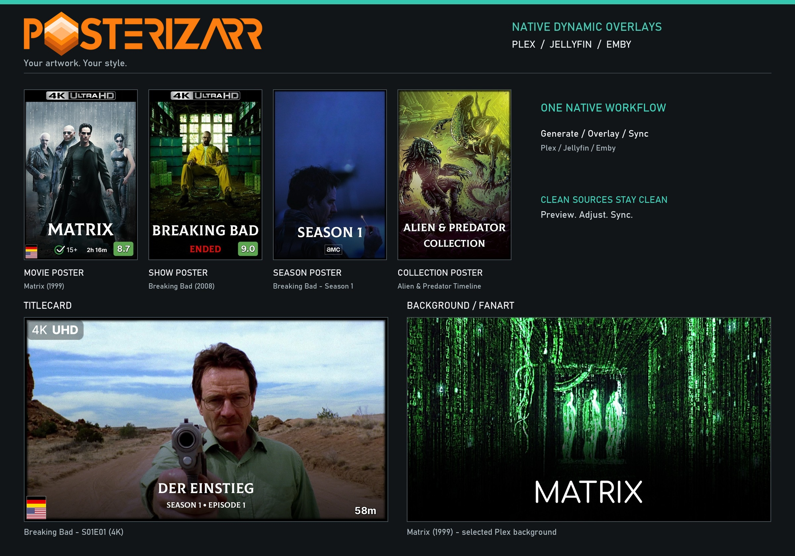

  

  <h3>Automated Artwork &amp; Native Dynamic Overlays for Plex, Jellyfin &amp; Emby</h3>
  

    Generate consistent posters, seasons, backgrounds, title cards, and collections — while keeping your clean source artwork untouched on disk.
  

  

    &nbsp;
    &nbsp;
    &nbsp;
    &nbsp;
    
  

  

    <a href="https://fscorrupt.github.io/posterizarr/"><strong>Documentation »</strong></a> &nbsp;·&nbsp;
    <a href="https://fscorrupt.github.io/posterizarr/installation/">Installation</a> &nbsp;·&nbsp;
    <a href="https://fscorrupt.github.io/posterizarr/dynamic_overlays/">Dynamic Overlays</a> &nbsp;·&nbsp;
    <a href="https://fscorrupt.github.io/posterizarr/showcase/">Artwork Showcase</a>
  

   

  

 

<table width="100%">
  <tr>
    <td width="50%" valign="top">
      <strong>🎨 Automated Artwork</strong> 
      Generate matching posters, seasons, title cards, backgrounds, collections, and clearlogos via TMDb, TheTVDB, Fanart.tv, and Plex.
    </td>
    <td width="50%" valign="top">
      <strong>✨ Native Dynamic Overlays</strong> 
      Import Kometa-style YAML, preview badges live, share portable bundles, and composite in memory — no extra container, clean sources untouched.
    </td>
  </tr>
  <tr>
    <td width="50%" valign="top">
      <strong>📺 Plex, Jellyfin &amp; Emby</strong> 
      Direct sync, real-time WebSocket plugins with optional Plex Direct Sync, AniMetaFill, Asset Title Review, local IMDb ratings, and Plex Image Cleanup. <em>(Silo: experimental)</em>
    </td>
    <td width="50%" valign="top">
      <strong>⚡ Web UI &amp; Automation</strong> 
      All-in-one Web UI with guided setup, built-in Scheduler, native Tautulli, Sonarr, and Radarr webhooks, Testing Mode, and safe Dry Run.
    </td>
  </tr>
</table>

 

  <h3>🚀 Get Started</h3>
  

    Docker Compose, Unraid, PowerShell guides, Web UI walkthroughs, and API references live on the dedicated docs site.
  

  

    
  

  

    &nbsp;
    &nbsp;
    &nbsp;
    &nbsp;
    &nbsp;
    
  

  

    <a href="https://fscorrupt.github.io/posterizarr/getting_started/">First-Time Setup</a> &nbsp;·&nbsp;
    <a href="https://fscorrupt.github.io/posterizarr/ui_guide/">Web UI Guide</a> &nbsp;·&nbsp;
    <a href="https://fscorrupt.github.io/posterizarr/jellyfin_plugin/">Jellyfin</a> &amp; <a href="https://fscorrupt.github.io/posterizarr/emby_plugin/">Emby Plugins</a> &nbsp;·&nbsp;
    <a href="https://fscorrupt.github.io/posterizarr/plex_image_cleanup/">Plex Cleanup</a> &nbsp;·&nbsp;
    <a href="https://fscorrupt.github.io/posterizarr/endpoints/">API Docs</a> &nbsp;·&nbsp;
    <a href="https://fscorrupt.github.io/posterizarr/faqs/">FAQs</a>
  

   

  <h3>💖 Sponsors</h3>
  

  Posterizarr is free, open source, and solo-developed, thank you to everyone supporting the project!
  

  <!-- sponsors --><!-- sponsors -->

   
  

  Optional anonymous telemetry, disable anytime with <code>"telemetry": false</code> (<a href="https://fscorrupt.github.io/posterizarr/telemetry/">details</a> · <a href="telemetry-worker/worker.js">source</a>) 
  Built by <a href="https://github.com/fscorrupt">fscorrupt</a> ·
  <a href=".github/CONTRIBUTING.md">Contributing</a> ·
  <a href="https://discord.gg/fYyJQSGt54">Discord</a> ·
  <a href="https://ko-fi.com/R6R81S6SC">Ko-fi</a>

