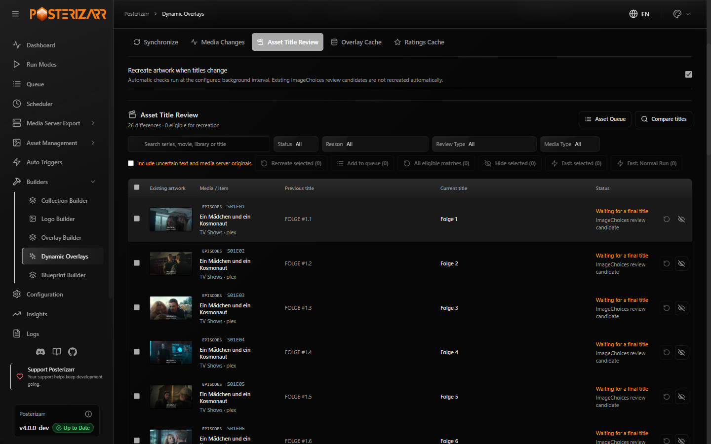
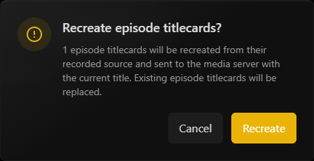
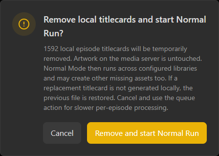
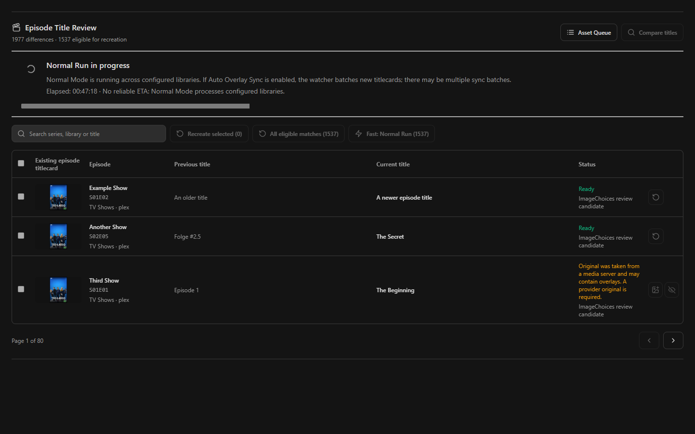

# Asset Title Review

**Asset Management > Asset Title Review** (`/asset-title-review`) detects renamed
movies, shows, seasons, and episode titlecards against **Plex**, **Jellyfin**,
and **Emby**, and rebuilds affected text-enabled artwork without needing Dynamic
Overlays enabled.

## Overview

**Asset Management > Asset Title Review** (`/asset-title-review`) is a standalone
feature and works even when Dynamic Overlays is off and no overlay rules are
configured. **Recreate artwork when titles change** is optional and off by default.
When turned on, it checks titles automatically at its own configured interval
(default **60 minutes**, with the first check waiting one interval), independent of
the Dynamic Overlays Master Switch, Background Checking, and **Automatic Overlay Resync**.
Turn on the page's standalone **Dry Run** switch to log eligible changes without
recreating files or uploading artwork; keep it off to apply changes. When Dynamic
Overlays is enabled and the library has overlay rules configured, recreated assets
automatically run through targeted overlay sync before upload; otherwise they are
uploaded directly to Plex, Jellyfin, or Emby.

The monitor checks existing text-enabled artwork on Plex, Jellyfin, and Emby
according to `config.json`: episode titlecards (when `TitleCards` and episode
title/number text are enabled), season posters (when `SeasonPosters` and
`AddText` are enabled and `SeasonPosterOverrideSeasonName`/`OverrideSeasonName`
is off), and movie/show posters (when `Posters` and `AddText` are enabled).
Backgrounds and collection posters are excluded from title-change automation;
their normal generation and overlay workflows are unchanged. The monitor uses
stable server item IDs after the initial match, so a title change does not rename
asset folders. Initial matching uses the library (and season/episode coordinates
where applicable) together with the media server's folder name or provider IDs,
including tags such as `[tvdb-452595]` in asset folder names. Plex show
locations are fetched when bulk listings omit them; different mount prefixes and
localized display titles do not prevent folder matching. Ambiguous matches are
skipped. No previous overlay sync is required. The first successful scan also
compares the title recorded in ImageChoices with the current server title.
Existing differences become historical review candidates, including when an
older version already established a baseline. The scan itself never recreates
historical artwork automatically.

## Running a Comparison Scan

Open **Asset Management > Asset Title Review** (`/asset-title-review`) and select **Compare titles**
for an initial, read-only artwork audit (scans can also run during an active
overlay sync). The table shows the existing image, media item (`Media / Item`),
previous title, current title, and eligibility across movies, shows, seasons,
and episodes. Historical rows are explicitly review candidates: ImageChoices is
not an exact rendering log, and unknown or truncated historical text cannot be
safely recreated automatically. Missing sources, textful sources, and placeholder
titles remain visible with a blocking reason. Unmatched items and missing image
files are not guessed. Use the status, blocking-reason, review-type, and
media-type (`All Types`, `Episodes`, `Seasons`, `Movies`, `Shows`) filters
together with the search field to narrow results across all pages. The eligible
count and bulk actions use the active filters, not only the rows currently
visible on screen.

## Media-Server Originals, Asset Replacer, and Dismissals

Images originally taken from a media server are never reused for recreation,
even when their URL is public or their stored language is Textless. The server
may now return artwork with existing overlays rather than the original image.
These rows show **Original was taken from a media server** and are excluded from
normal, bulk, automatic, force, and resumed-queue recreation. The backend logs
that a provider original is required; it does not fetch another media-server
thumbnail or silently perform a provider search.

For **media-server source** and **missing-source** entries, use the row's
**Choose a provider image in Asset Replacer** action. It opens the existing
Asset Replacer on its provider tab with the item, library, folder, season,
episode, and current title prefilled as applicable. Available provider IDs are
carried into an automatic, read-only provider lookup when opened from this
review. For episodes, the provider previews and modal header show the target
`SxxExx` coordinates as UI labels only; they are not added to the image. Choose a
result to continue with the modal's normal replacement or queue workflow. The
original media-server URL is never preselected as the new source.
Opening or queueing a replacement does not acknowledge the review entry as
completed. A successful processed artwork replacement from a URL, upload, or
the normal asset queue acknowledges only the matching file and rendered title.
Failed processes and mismatching titles leave the review entry intact.
The entry disappears on the next review refresh (normally within 15 seconds).
For replacements completed before this acknowledgment was available, **Compare
titles** also reconciles the baseline when ImageChoices records the current
title without truncation. A missing original download URL does not keep an
already confirmed current title in the review. This confirms the local artwork;
when Dynamic Overlays is enabled, final media-server upload remains a separate overlay-sync step.
The standalone **Dry Run** toggle on the Asset Title Review page must be off to open this replacement workflow from the review.
Use **Permanently hide this review entry** on any blocked row (for example a
media-server source or an image that already contains text) to dismiss it, or
select multiple rows and use **Hide selected** to dismiss them together and
accept their current artwork text. The dismissal persists across scans for that
same title and source; a later title or source change can create a new review
entry.

## Uncertain Historical Text

If only the previous image text is unknown, the row can offer **Fast: Normal Run
for this item** (with media-specific labels for shows, seasons, movies, and
episodes). It temporarily removes the local artwork file and starts the ordinary
Normal Mode, just like the bulk Fast action. Artwork on the media server is
untouched, and Normal Mode applies its usual source and EXIF checks. If no
replacement is generated locally, the previous file is restored. Unknown-text
rows remain excluded from automatic recreation and ordinary selected/all-eligible
actions.

Enable **Include uncertain text and media server originals** to include these
forceable rows in page selection and bulk processing. Queue and Fast actions
work on the selected items or on all matching candidates across pages, using
the current search and filters. A separate bulk warning confirms replacement
despite uncertain old text. Missing sources, sources that already contain text,
and placeholder titles stay blocked.
For uncertain rows that cannot safely be forced, the status also shows the
additional blocking reason. Their action opens **Choose a provider image in
Asset Replacer** instead of leaving a disabled recreate button. This allows an
explicit replacement with a new original without reusing an unsafe source.
Titles such as `Folge 7` and `Episode 2` remain placeholders for automatic and
forced source reuse. Comparison and recreation diagnostics are recorded in the
dedicated `EpisodeTitleChanges.log`, not the backend/browser UI logs.
The explicit override is retained in the existing queue if the job is resumed.
After updating from an earlier version, run **Compare titles** once to refresh
source eligibility for already cached review entries.

## Recreating Artwork (Queue and Fast Normal Run)

*Asset Title Review compares existing text-enabled artwork against current
media-server titles across episodes, seasons, movies, and shows, with filters
for eligibility, blocking reason, review type, and media type.*

Title comparisons ignore uppercase/lowercase differences, including accented
characters. Existing case-only candidates are hidden and removed by the next
successful scan without rendering or uploading artwork. Displayed titles and
the original text in ImageChoices are preserved; actual wording changes still
remain review candidates.

Use the row's recreate action (labeled for the item's media type) for one item,
select several entries with the checkboxes, or choose **All eligible matches**.
The all action includes every eligible result of the current search and active
filters, not just the current page. Each action requires confirmation (with
media-specific titles and prompts for single-item rebuilds). Manual recreation
does not require the automatic title option, Background Checking, or the Dynamic
Overlays Master Switch, as long as the Asset Title Review **Dry Run** toggle is off.

**Recreate selected** is only available while no other Posterizarr run is active. Use
**Add to queue** instead to queue the selected items immediately, even while a
run, overlay sync, or cleanup is active. The queued entries start automatically
when everything else has finished. Only these entries are started; other pending
queue items still wait for a manual queue start.

For a one-time bulk rebuild, **Fast: Normal Run** temporarily backs up and removes
the eligible local artwork files matching the current search, then starts the
ordinary parallel Normal Mode. Artwork on the media server is not deleted. The
normal run scans configured libraries, so it may also create other missing assets.
If the run fails or does not generate a replacement file, the previous local
artwork is restored. The existing queue action remains available for slower,
per-item processing without a full Normal Mode run.
While it runs, the review shows preparation, Normal Mode, and local-file
finalization phases with elapsed time. Normal Mode does not report per-review-item
progress, so the display uses an indeterminate bar and does not invent an ETA.
The fast-run status ends after local generation and restoration; it does not wait
for separately triggered Dynamic Overlay Sync jobs to finish.
When **Auto Overlay Sync** is enabled, the ImageChoices watcher batches generated
rows after a short quiet period and flushes pending rows at run completion. A long
run can therefore produce multiple overlay-sync batches rather than one sync for
the entire set. With Auto Overlay Sync disabled, that follow-up sync is not started.

*With Dry Run off, single, selected, and all-eligible recreation actions require
confirmation. This screenshot shows the dialog only; the example job was cancelled.*

*The fast action is limited to eligible local review assets. Media-server artwork
is retained; the normal run may process other missing assets in configured libraries.*

*The status reports elapsed time and the current phase. Normal Mode does not expose
per-item progress; final counts report recreated artwork and local originals restored.*

Confirmed recreation uses the existing **Asset Queue** and queue processor,
not a separate rendering worker. The queue contains a dedicated title-change
operation referencing the persisted review candidate. Pending/processing
duplicates are reused. Only the selected queue IDs are started; unrelated
pending replacements are not processed. Progress and failures are visible in
the review and the ordinary queue. Cancelling stops before the next item;
remaining queue entries stay pending and can be resumed from the queue. Failed
entries retain their review candidate for retry. A successful render and server
upload acknowledge the new title and remove its review entry.

Queue-owned title recreation also owns its overlay handoff. Its runtime metadata
marks that ownership and identifies the completed ImageChoices CSV, so the log
watcher still imports/broadcasts the generated asset but does not start a second
competing sync, including delayed file notifications. Ordinary manual runs keep
their existing automatic overlay handoff.

## Source Reuse, Placeholders, and Logging

Only title metadata is stored in `overlay_cache.db`; no additional original-image
cache or image backup is created. For an eligible change, the existing manual
generator downloads the recorded `DownloadSource` again and uses the current
rendering settings. The source must be a public provider HTTP(S) URL recorded as
**Textless** in ImageChoices. Missing/local sources, sources with existing text,
ambiguous matches, and missing asset files are skipped. This is not a new artwork
search and cannot translate text already baked into a provider image. Custom
per-asset edits or previously used one-off blueprint overrides are not restored;
the current generator configuration governs the rebuilt asset.

Generic episode placeholders such as `Episode 2`, `Folge #2.2`, `TBA`, and
`Untitled` (and `TBA`/`TBD`/`To Be Announced`/`Untitled` for movies, shows, and
seasons) are not treated as finished replacement titles. Artwork that was never
created still needs the ordinary generation workflow. Only the affected artwork
item (movie poster, show poster, season poster, or episode titlecard) is rebuilt.
When Dynamic Overlays is enabled and the library has overlay rules, it is
passed to a targeted overlay sync; otherwise the rebuilt asset is sent directly
to its exact media-server item. A
failed generation or upload leaves the title change pending. Historical
candidates remain manual-only across subsequent scans; only later title changes
on otherwise reconciled items qualify for the optional automatic workflow. A
series-title change alone does not recreate its episodes.
The setting key `regenerate_assets_on_title_change` applies across all
configured text-enabled artwork types (episodes, seasons, movies, and shows).
Progress is logged under `[TitleChanges]` in the backend log;
rendering uses the existing manual-run log and targeted overlays use
`DynamicOverlaysSync.log`.
