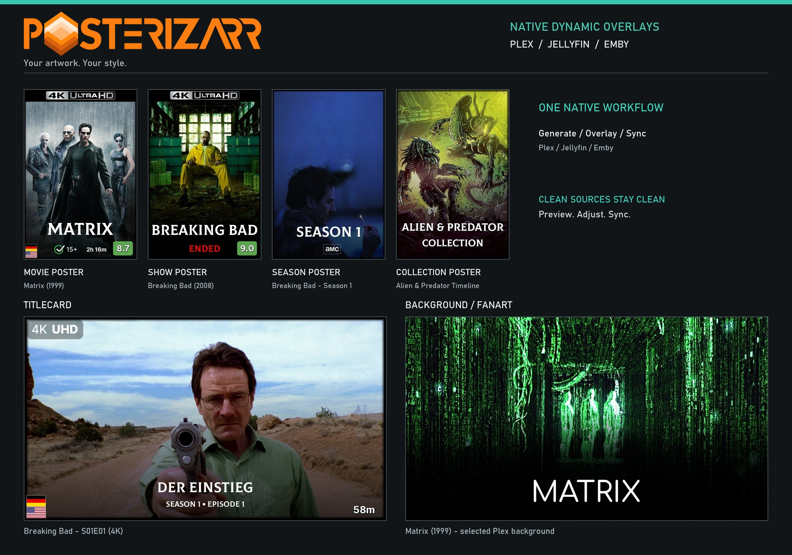
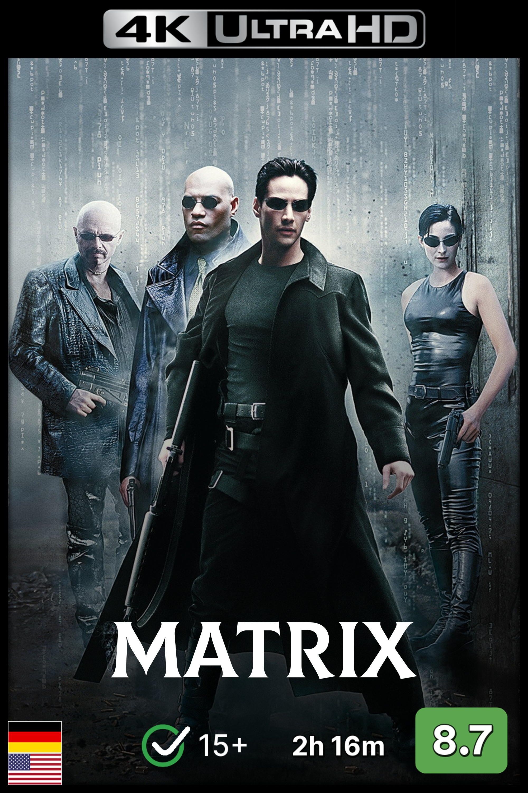
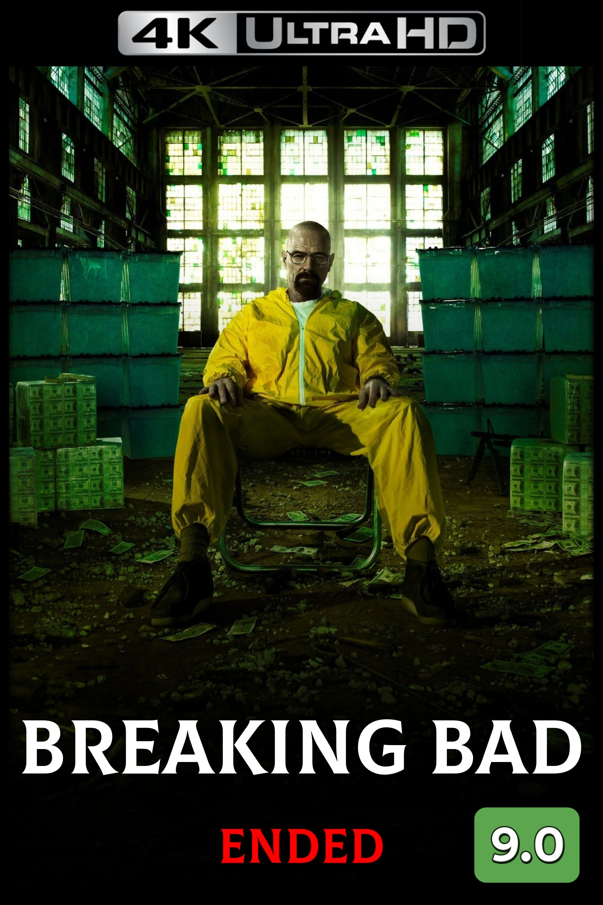
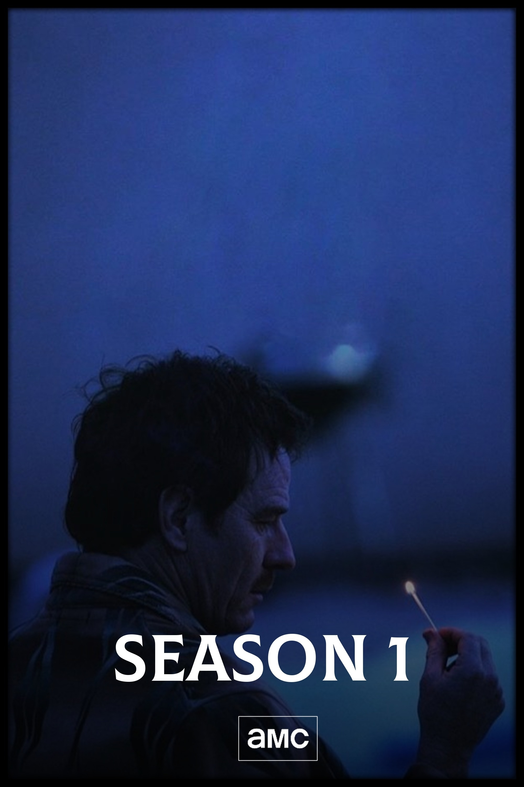
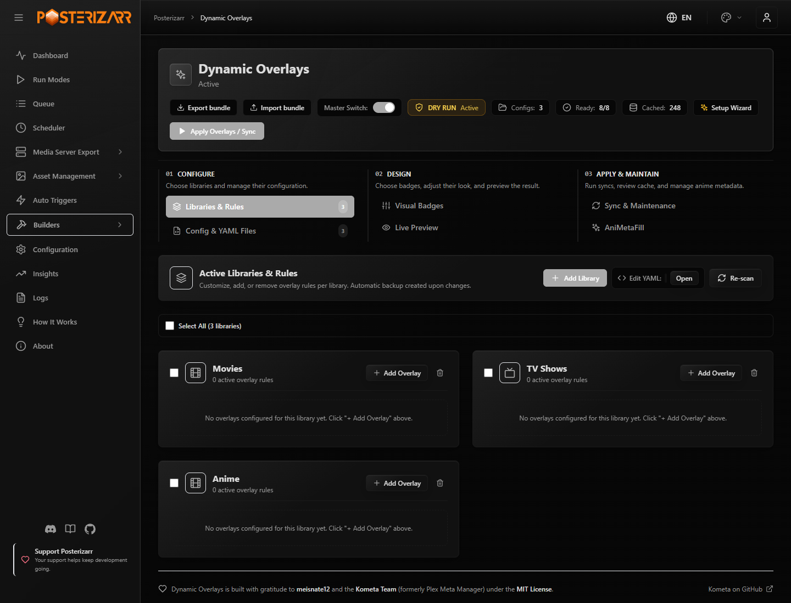
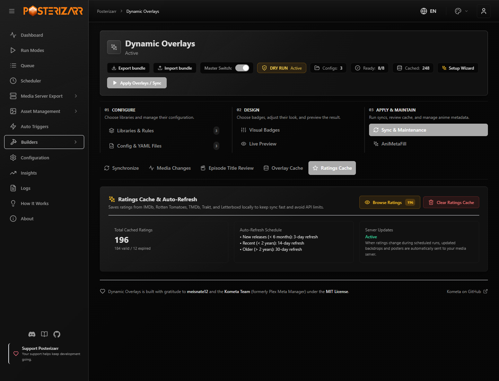
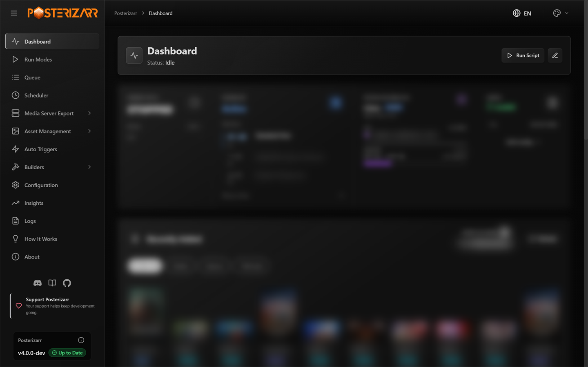
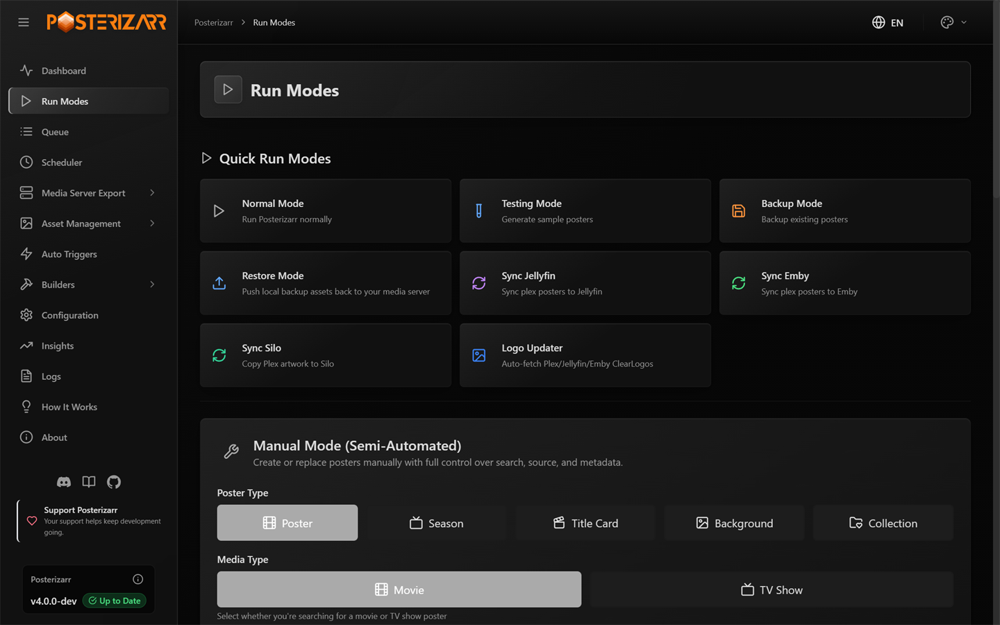
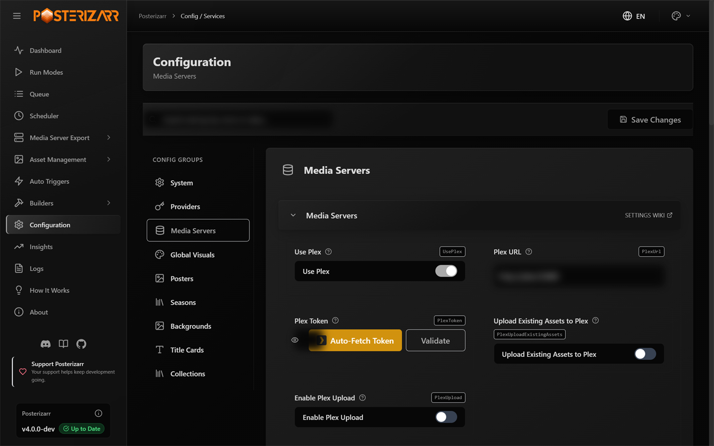

# What Posterizarr Can Do

	
A COMPLETE ARTWORK WORKFLOW

	
Set the look you want for each artwork type. Posterizarr keeps creating it for your library, then adds native Dynamic Overlays when you want extra information.

<figure class="pz-capabilities-banner">
	
	<figcaption>Examples of artwork created or managed with Posterizarr.</figcaption>
</figure>

Everyday setup and operation happen in the Web UI. Choose the media server and
libraries, set the artwork style you want, and use the UI to test, run, review,
and automate. **You do not need a command line for everyday use.**

## Set up the artwork style once

Choose how posters, season posters, backgrounds, and titlecards should look.
Posterizarr applies your provider order, language preferences, image-quality
rules, text, logos, borders, and templates to the asset types you enable. You
can tune each type or library independently, reuse local assets, and choose a
Blueprint when you want a ready-made setup.

<figure><figcaption>Movie poster</figcaption></figure>
<figure><figcaption>Show poster</figcaption></figure>
<figure><figcaption>Season poster</figcaption></figure>

[Explore the artwork showcase](showcase.md) ·
[Configure artwork preferences](configuration.md) ·
[Browse Blueprints and recipes](blueprints.md)

## Add Dynamic Overlays on top

The native Dynamic Overlays builder adds supported metadata badges to posters,
season artwork, titlecards, and backgrounds. Set rules per library and artwork
type, arrange badges in the visual editor, and preview or Dry Run before
uploading. Overlay compositing happens in memory, so clean source artwork stays
unchanged on disk. A separate Kometa installation is optional, not required.

*Navigate to **Builders > Dynamic Overlays** in the sidebar to configure rules, preview badges, or run a sync.*

[Open the Dynamic Overlays guide](dynamic_overlays.md) ·
[Browse the artwork gallery](showcase.md) ·
[Read about optional Kometa compatibility](kometaintegration.md)

## Keep IMDb Lookups Local

Import IMDb's official ratings, episode, and title dumps into a local database.
Posterizarr can fill missing IMDb ratings from that index, match episodes
conservatively, and let you correct episode IDs or season numbering locally.
Successful local lookups avoid per-item provider requests; other sources and
unresolved items can still need external providers.

*Navigate to **Builders > Dynamic Overlays > Sync & Maintenance > Ratings Cache**, then choose **Browse Ratings** to open the local IMDb dataset and ratings cache. The screenshot uses illustrative cache counts.*

[Set up the local IMDb dataset](dynamic_overlays.md#local-imdb-dataset).
The datasets are optional, require disk space for indexing, and are licensed by
IMDb for non-commercial use only.

## Manage and automate from the Web UI

Use the dashboard to monitor runs, the Action Center to review assets, and
Testing Mode to check sample output before changing a live library. The Web UI
also includes manual asset creation, backups and restores, logs, scheduled
runs, and supported Tautulli or Sonarr/Radarr webhooks.

*Navigate to **Dashboard** in the sidebar to check status, schedules, configuration, recent assets, and logs.*

[See all Run Modes](modes.md) · [Review assets in Action Center](action_center.md) ·
[Set up your first run](getting_started.md)

*Navigate to **Run Modes** to test, run, back up, restore, sync, or create one asset manually.*

## Configure each artwork type

The Web UI groups settings by purpose instead of presenting one giant form:
system, providers, media servers, global visuals, posters, seasons, backgrounds,
title cards, and collections. Search by setting name or value, open a settings
card for its controls, then save changes in the UI.

*Navigate to **Configuration** and choose a settings group; use the search field to find a specific option.*

[Open the configuration guide](configuration.md)

## Use your preferred media server

Posterizarr supports Plex, Jellyfin, and Emby for its main artwork workflows.
Silo support is **experimental** and does not yet have full feature parity.
Optional plugins and integrations extend how local assets or server events are
handled. Select only the workflows you use; Kometa, Agregarr, and the media
server plugins are optional.

[Jellyfin Plugin](jellyfin_plugin.md) · [Emby Plugin](emby_plugin.md) ·
[Agregarr Integration](agregarrintegration.md)

## More useful tools

- **Choose artwork sources and quality:** provider priority, language order,
	minimum image sizes, automatic resizing, and handling for multiple media
	versions.
- **Shape each asset type:** text, logos, borders, gradients, RTL fonts,
	title-card fallbacks, and title line-break rules.
- **Reuse local work:** manual asset preference, Season/Episode templates, and
	existing assets instead of downloading a new source.
- **Protect and maintain libraries:** exclusions, `skip_posterizarr` tags,
	change detection, backups/restores, and optional cleanup of obsolete assets.
- **Review and diagnose:** Action Center, searchable logs, CSV exports, and
	notifications through Discord, Apprise, or Uptime Kuma.
- **Automate and integrate:** schedules, Tautulli and Sonarr/Radarr webhooks,
	Plex sync, and optional Agregarr, Jellyfin/Emby plugins, or Kometa workflows.

## Full feature reference

Show the full capability list

| **Feature**                              | **Description**                                                                                                                                                                                                                                                                                                                                                                                                                                |
| ---------------------------------------- | ---------------------------------------------------------------------------------------------------------------------------------------------------------------------------------------------------------------------------------------------------------------------------------------------------------------------------------------------------------------------------------------------------------------------------------------------- |
| **Native Dynamic Overlays**              | - Preview and render supported metadata-driven badges for posters, season artwork, titlecards, and backgrounds in memory. - Upload directly to **Plex, Jellyfin, or Emby** while preserving clean source artwork. - Use per-library rules, visual controls, readiness checks, Dry Run, targeted sync, and cache inspection. See the **[Dynamic Overlays Guide](dynamic_overlays.md)**. |
| **Direct Upload to Media Servers**       | - Posterizarr uploads generated artwork directly to **Plex**, **Jellyfin**, and **Emby**. No separate artwork or overlay application is required for supported native workflows. |
| **Upload Existing Assets**               | - Configure whether to **upload pre-existing assets** to Plex, Jellyfin, or Emby, saving time by skipping redundant uploads for libraries with complete artwork.                                                                                                                                                                                                                                                                               |
| **Backup Functionality**                 | - Downloads artwork from **Plex** to a configured **backup share**, using an organized library/title layout for local storage and restore workflows. |
| **Manual Asset Path (Local Assets)**     | - **Local Asset Preference**: Prioritizes assets from a **manual asset path** if present. Skips download if local assets are available. - **Path Configuration**: Specify the folder structure in the configuration, saving time and bandwidth by using pre-existing images.                                                                                                                                                                |
| **Resizing**                             | - Automatically resizes all **poster images** to **2000x3000** for optimized media server use.                                                                                                                                                                                                                                                                                                                                                 |
| **Preferred Language Selection**         | - Configure **language preferences** for media metadata, supporting multi-language ordering.  &nbsp; - **Season-specific language preferences** allow finer control over metadata for localized season information.                                                                                                                                                                                                                         |
| **Poster and Background Minimum Size**   | - Set minimum dimensions for **posters** (2000x3000) and **backgrounds/title cards** (3840x2160), ensuring only high-quality images are used.                                                                                                                                                                                                                                                                                                  |
| **Overlay Effects**                      | - Applies optional **overlays** to downloaded images:  &nbsp; - **Borders**: Adds polished framing.  &nbsp; - **Text**: Customizable title text.  &nbsp; - **Gradient Overlay**: Stylish gradient effect (custom options via **[gradient pack](https://raw.githubusercontent.com/fscorrupt/posterizarr/refs/heads/main/Overlayfiles/gradient_background_poster_overlays.zip)**).                                                                                                                                           |
| **Automatic Library Search**             | - Autonomously scans **Plex**, **Jellyfin**, or **Emby** server for libraries, simplifying setup.                                                                                                                                                                                                                                                                                                                                              |
| **Handling Multiple Versions**           | - Manages **multiple versions** of movies/shows (e.g., theatrical cuts, director’s cuts), ensuring complete coverage for all available versions.                                                                                                                                                                                                                                                                                               |
| **CSV Export**                           | - Generates a **CSV file** with queried movie/show data:  &nbsp; - **Plex**: `$ScriptRoot\logs\PlexLibexport.csv`  &nbsp; - **Other Media Servers (Jellyfin/Emby)**: `$ScriptRoot\logs\OtherMediaServerLibExport.csv`                                                                                                                                                                                                                    |
| **Logging Capabilities**                 | - Creates logs for **troubleshooting** and **analysis**:  &nbsp; - General script log: `$ScriptRoot\logs\Scriptlog.log`  &nbsp; - ImageMagick commands log: `$ScriptRoot\logs\ImageMagickCommands.log`  &nbsp; - Choices log: `ImageChoices.csv`                                                                                                                                                                                      |
| **Uptime-Kuma**                          | - Sends notifications to Uptime Kuma to monitor script activity for success and failure.                                                                                                                                                                                                                                                                                                                                                       |
| **Notifications**                        | - Sends notifications about script activity using **Apprise** or **Discord**. - **Configuration**: See notification settings in the **[Configuration Guide](configuration.md#notification)**. |
| **Cross-Platform Compatibility**         | - Runs on **Linux**, **Docker**, and **Windows** (Plex, Jellyfin, and Emby compatible), ensuring versatile usage in various environments.                                                                                                                                                                                                                                                                                                      |
| **Poster/Background/TitleCard Creation** | - Searches for high-quality artwork from **Fanart**, **TMDb**, **TVDb**, **Plex** (fallback: **IMDb**). - Resizes to:  &nbsp; - **3840x2160** for backgrounds and title cards.  &nbsp; - **2000x3000** for posters.                                                                                                                                                                                                                   |
| **Library Exclusions**                   | - Specify libraries to **exclude from processing** on Plex, Jellyfin, and Emby servers, helping to avoid unnecessary processing for selected content categories (e.g., YouTube, Audiobooks).                                                                                                                                                                                                                                                   |
| **Clearlogo Management**                 | - Browse libraries and search for clearlogos by title or ID (TMDB/TVDB) directly from the WebUI. - Fetch clearlogos from Fanart, TMDB, or TVDB and seamlessly push them directly into the connected media server.                                                                                                                                                                                           |
| **Skip Items in Libraries**              | - Exclude items from processing by adding the **"skip_posterizarr"** label/tag to any item, preventing downloads and uploads for those items.                                                                                                                                                                                                                                                                                                  |
| **Manual Asset Template**              | - Place `SeasonTemplate.ext` or `EpisodeTemplate.ext` in your `ManualAssets/Show` directory, and the script will use this template file for all season and episode images during a posterizarr run.                                                                                                                                                                                                                                                                                                 |
| **Auto-Update Options**                  | - Supports **auto-update settings** for both Posterizarr and ImageMagick, keeping tools up to date with minimal manual intervention. (Not on Docker)                                                                                                                                                                                                                                                                                           |
| **Asset Cleanup**                        | - Automatic asset cleanup removes Posterizarr-created assets when corresponding media is deleted from the media server, ensuring storage efficiency.                                                                                                                                                                                                                                                                                           |
| **RTL (Right-to-Left) Font Support**     | - Supports **right-to-left (RTL) fonts** for media titles, making it more accessible for non-Latin-based languages such as Arabic or Hebrew.                                                                                                                                                                                                                                                                                                   |
| **New Line on Specific Symbols**         | - Automatically adds a **new line on specific symbols** (e.g., hyphen or colon) within text to enhance visual aesthetics on overlays.                                                                                                                                                                                                                                                                                                          |
| **Fallback Options for Title Cards**     | - Uses **background images as title cards** if title-specific artwork is unavailable.                                                                                                                                                                                                                                                                                                                                                          |
| **Overlay Reset**                        | - Reset all posters in a library of your choice to the Plex default.                                                                                                                                                                                                                                                                                                                                                                           |
| **Plex Collection Diff & Sync**          | - Visual diffing of local collection artwork (Assets/Collections/) against Plex server collections in real-time. - Displays status badges (In Sync, Update Ready, Missing on Plex, No Local Asset). - Allows interactive Local vs Server artwork inspection, 1-click single-collection push, and batch pushing.                                           |
| **Plex Asset Sync Scheduler**            | - Lightweight, pure Python background sync engine for Plex. - Selectively push artwork (collections, posters, seasons, title cards, backgrounds) directly to Plex on a schedule without running full image generation scripts. - Built-in SQLite change tracking prevents duplicate uploads.                                                                              |
| **Optional External Asset Compatibility** | - Existing external tools can consume the local library/title artwork layout. - **[Optional Kometa compatibility](kometaintegration.md)** remains documented for users who choose to keep a separate Kometa installation; it is not required by the native overlay engine. |
| **Optional External Asset Compatibility** | - Existing external tools can consume the local library/title artwork layout. - **[Optional Kometa compatibility](kometaintegration.md)** remains documented for users who choose to keep a separate Kometa installation; it is not required by the native overlay engine. |

