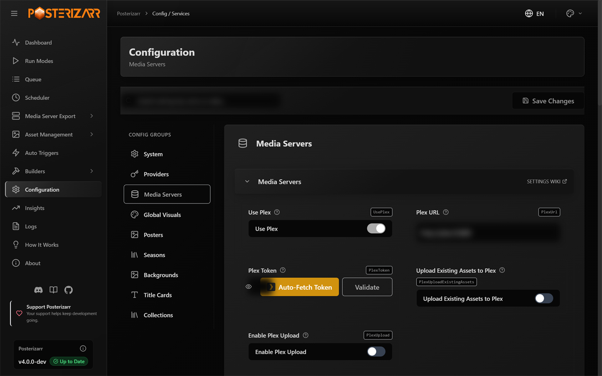

# Configure Posterizarr

For normal use, configure Posterizarr in **Configuration** in the Web UI. You do
not need to edit `config.json` or use the command line for routine setup.



*Choose **Configuration** in the sidebar, then select a group such as **Media Servers** or **Providers** to find its controls.*

*Current Web UI capture; no API keys or personal media titles are shown.*

## Find and change a setting

1. Open **Configuration** from the left sidebar.
2. Choose a group: **System**, **Providers**, **Media Servers**, **Global
    Visuals**, **Posters**, **Seasons**, **Backgrounds**, **Title Cards**, or
    **Collections**.
3. Use **Search settings by name or value** to find a specific option, or open a
    settings card to see its controls and explanation.
4. Make changes, then select **Save Changes**. Use **Settings Wiki** on a card
    when you need its detailed behavior or examples.

## Suggested setup order

- **System:** choose where assets and backups are stored and check Web UI options.
- **Providers:** add the services and credentials used to search for artwork.
- **Media Servers:** connect Plex, Jellyfin, or Emby and choose included
  libraries.
- **Global Visuals:** set shared language, image processing, text, logo, border,
  and overlay preferences.
- **Posters, Seasons, Backgrounds, Title Cards, Collections:** tune each output
  type separately. Different asset types can use different layouts and language
  priorities.

Start with one library and the normal Web UI workflow in the
[first-time setup guide](getting_started.md). Keep a backup before importing or
editing raw configuration data.

## Detailed `config.json` reference

Most users will not need this field-by-field reference. Expand it when editing
the underlying file directly or when a Settings Wiki link points here.

<details markdown="1">
<summary>Open advanced configuration fields and examples</summary>

Do not replace an existing configuration with a partial example. Merge only the
settings you intend to change, and keep a backup before editing manually.

## Silo (Experimental)

Silo support targets the native `/api/v2` API, not the Jellyfin compatibility listener.
The initial integration was checked against server build `bb1ee435` using a movie,
a series, three episodes and two seasons. Silo is pre-release: pin a tested build
and back up its configuration, database and encryption key before updating.

In Configuration > Media Servers, enable **Use Silo (Experimental)**, enter
**Silo URL** and **Silo API Key**, validate, choose included libraries and save.
Only one primary server may be enabled. Existing configurations receive disabled
Silo fields in the editor; Silo is never enabled automatically.

Silo-only capability notices appear in configuration/onboarding, run dialogs,
Logo Browser, Collection Explorer, Dynamic Overlays, AniMetaFill, Ratings Cache,
the scheduler and Asset Overview. Unsupported and partially supported actions are
explained in English, German, French, Italian and Portuguese. Technical logs and
PowerShell output keep their existing English format.

- `SiloPart.UseSilo`: `"true"` to select Silo as the primary server.
- `SiloPart.SiloUrl`: Native server URL, preserving any reverse-proxy path prefix.
    For containers sharing a network, an internal address such as `http://silo:8080`
    avoids interactive Authelia authentication. Host ports may differ.
- `ApiPart.SiloAPIKey`: A key with catalog/file read access and artwork-edit authority.
    Keep it out of URLs and public diagnostics.
- `SiloPart.SiloProfileId`: Optional primary household profile ID; auto-discovered
    when blank. Account/profile restrictions still apply.
- `SiloPart.LibstoExclude`: Library names excluded from generation and overlay sync.

Normal generation uses existing provider and naming settings. The existing global
`PrerequisitePart.PlexUpload` setting also controls direct Silo uploads despite its
historical name. When Dynamic Overlays is enabled, generation keeps clean assets
and the separate overlay sync performs the upload instead.

Supported initial workflows are movie/show posters and backdrops, season posters,
targeted overlay sync, and movie/show change detection. Technical overlay inputs
come from the selected file's actual audio/video/subtitle tracks. Explicitly scoped
show/season rules can aggregate episode stream metadata.

AniMetaFill's **Media Server & Integration Settings** also supports Silo. Select
Silo, choose the target anime show libraries, and save. Credentials come from the
same Silo configuration above; switching servers clears the previous library
selection. Show discovery and native episode-coordinate matching are read-only.
Ratings Cache refresh uses native Silo metadata for movies, shows, and opted-in
anime seasons. Silo episode ratings refresh is excluded for now.

Additional native Silo workflows are available in PowerShell and the UI:

- Radarr/Sonarr triggers select catalog movies/shows and seasons without using the
    Jellyfin compatibility API. Ambiguous external IDs or paths are not guessed.
- Logo Browser and Logo Updater list movie/show logos and upload selected PNGs.
- Collection Explorer lists existing collections in included libraries and uploads
    posters. Manual collection generation can upload to a unique existing collection.
- Backup/Restore downloads and restores movie/show posters, backgrounds, logos,
    season posters and collection posters/backgrounds using the configured backup
    layout and library/item/type filters.
- Poster Reset and Logo Revert select the first matching provider image returned by
    Silo. They do not delete uploaded images or recover an unknown previous selection.
    If no provider candidate exists, the current image is retained.
- **Sync Silo** in Run Modes, or `Posterizarr.ps1 -SyncSilo`, mirrors Plex artwork to
    matched Silo movies/shows/seasons. Configure Plex URL/token while leaving Silo as
    the enabled primary server. Matches require a unique external ID; identical bytes
    are skipped. This can replace existing Silo artwork and is also schedulable.

Episode artwork uploads and episode ratings refresh remain excluded; locally
generated titlecards remain local. Native episode metadata is read only for anime
matching and show/season aggregation. Silo has no native image-delete or full-server
backup endpoint in the checked contract; artwork backup is not a Silo database backup.
The Asset Overview server-side skip-tag action is unavailable for Silo because the
native metadata contract has no writable tags field.

Uploads use multipart image data, at most 10 MiB, and are not automatically retried
after a connection failure with an uncertain outcome. Silo applies its artwork
selection/lock behavior; season image changes can lock images on the parent series.
Artwork URLs can expire and are fetched fresh rather than used as persistent IDs.
Dynamic Overlays dry-run mode renders without making artwork writes.

Validation included live read-only discovery in both Python and PowerShell and one
live movie-poster upload using the existing image, followed by selected-image and
pixel checks. Series/season upload routing is covered by isolated worker tests,
not live writes. A complete scheduled PowerShell generation run was not executed
against the test server. The additional workflows above are covered by isolated
HTTP and executable PowerShell tests, not live Silo artwork mutations. Their native
routes were checked against the upstream API v2 contract; pre-release API changes
may require adapter updates.

## Settings

1. Open `config.example.json` located in the script directory.
2. Update the following variables with your API keys and preferences [my personal config](https://github.com/fscorrupt/posterizarr/blob/main/MyPersonalConfig.json):

    #### WebUI

    - `basicAuthEnabled`: When set to `true`, the UI requires a username and password for access. (Default: `false`)
    - `basicAuthUsername`: The username for UI authentication. (Default: `admin`)
    - `basicAuthPassword`: The password for UI authentication. (Default: `posterizarr`)

    #### ApiPart

    - `tvdbapi`: Your TVDB Project API key.
        - If you are a TVDB subscriber, you can append your PIN to the end of your API key in the format `YourApiKey#YourPin`. (It is important to include a `#` between the API key and the PIN.)
    - `tmdbtoken`: Your TMDB API Read Access Token.
    - `FanartTvAPIKey`: Your Fanart personal API key.
    - `PlexToken`: Your Plex token (Leave empty if not applicable).
    - `JellyfinAPIKey`: Your Jellyfin API key. (You can create an API key from inside Jellyfin at Settings > Advanced > Api Keys.)
    - `EmbyAPIKey`: Your Emby API key. (You can create an API key from inside Emby at Settings > Advanced > Api Keys.)
    - `SiloAPIKey`: A Silo API key with catalog/file read access and artwork-edit authority. Silo support is experimental and uses the native `/api/v2` API.
    - `FavProvider`: Set your preferred provider (default is `tmdb`).

        - possible values are:

        - `tmdb` (recommended)
        - `fanart`
        - `tvdb`
        - `plex` (Not recommended)
            - if you prefer textless, do not set plex as fav provider as i cannot query if it has text or not.
            - that beeing said, plex should act as last resort like IMDB does for Movies and not as fav provider.

        [Search order in script](searchorder.md)

    - `ProviderPriorityMode`: Select the strategy Posterizarr uses when searching for artwork.
        - `Simple`: Starts with your `FavProvider`, followed by the remaining providers (Legacy default).
        - `Global`: Strictly follows the custom array you define in `ProviderOrder`.
        - `PerMediaType`: Strictly follows the `MovieProviderOrder` array for Movies and `ShowProviderOrder` for TV Shows.
        - **Note:** You can still override any of these strategies on a per-library basis using the `EnableProviderOrderOverride` and `ProviderOrder` fields within `PlexLibraries` or `JellyfinLibraries`.
    - `ProviderOrder`: A list specifying the exact sequential order for artwork when `ProviderPriorityMode` is `Global`.
        - Possible values: `"TMDB"`, `"TVDB"`, `"Fanart"`, `"Plex"` (Note: "Plex" refers to whichever media server you have connected, including Emby or Jellyfin).
        - Example: `["TMDB", "TVDB", "Fanart", "Plex"]`
    - `MovieProviderOrder`: A list specifying the exact sequential order for Movie artwork when `ProviderPriorityMode` is `PerMediaType`.
    - `ShowProviderOrder`: A list specifying the exact sequential order for TV Show artwork when `ProviderPriorityMode` is `PerMediaType`.


    - `WidthHeightFilter`: If set to `true`, an additional resolution filter will be applied to Posters/Backgrounds (TMDB and TVDB) and Titlecards (only on TMDB) searches.
    - `PosterMinWidth`: Minimum poster width filter—greater than or equal to: `2000` (default value)
    - `PosterMinHeight`: Minimum poster height filter—greater than or equal to: `3000` (default value)
    - `BgTcMinWidth`: Minimum background/titlecard width filter—greater than or equal to: `3840` (default value)
    - `BgTcMinHeight`: Minimum background/titlecard height filter—greater than or equal to: `2160` (default value)
    - `tmdb_vote_sorting`: Picture sorting via TMDB api, either by `vote_average`, `vote_count` or by `primary` (Default value is: `vote_average`).
        - `primary` = default tmdb view (like on the website)
    - `PreferredLanguageOrder`: Specify language preferences. Default is `xx,en,de` (`xx` is Textless). Example configurations can be found in the config file. 2-digit language codes can be found here: [ISO 3166-1 Lang Codes](https://en.wikipedia.org/wiki/ISO_3166-1_alpha-2).
        - If you set it to `xx` you tell the script it should only search for textless, posters with text will be skipped.
    - `PreferredSeasonLanguageOrder`: Specify language preferences for seasons. Default is `xx,en,de` (`xx` is Textless). Example configurations can be found in the config file. 2-digit language codes can be found here: [ISO 3166-1 Lang Codes](https://en.wikipedia.org/wiki/ISO_3166-1_alpha-2).
    - `PreferredBackgroundLanguageOrder`: Specify language preferences for backgrounds. Default is `PleaseFillMe` ( It will take your poster lang order / `xx` is Textless). Example configurations can be found in the config file. 2-digit language codes can be found here: [ISO 3166-1 Lang Codes](https://en.wikipedia.org/wiki/ISO_3166-1_alpha-2).
        - If you set it to `xx` you tell the script it should only search for textless, posters with text will be skipped.
    - `PreferredTCLanguageOrder`: Specify language preferences for TCs. Default is `PleaseFillMe` ( It will take your poster lang order / `xx` is Textless). Example configurations can be found in the config file. 2-digit language codes can be found here: [ISO 3166-1 Lang Codes](https://en.wikipedia.org/wiki/ISO_3166-1_alpha-2).
        - If you set it to `xx` you tell the script it should only search for textless, posters with text will be skipped.
    - `LogoLanguageOrder`: Specify language preferences for Logos. Default is `en,de`. Example configurations can be found in the config file. 2-digit language codes can be found here: [ISO 3166-1 Lang Codes](https://en.wikipedia.org/wiki/ISO_3166-1_alpha-2).
    - `LibraryLanguageOverrides`: Override the language order and provider order on a per-library basis, for libraries where the server-wide settings don't fit (e.g. a single French or German library on an otherwise English server). Keyed by exact media server library name; each entry sets one `PreferredLanguageOrder` that can be applied to that library's posters, season posters and backgrounds using the `ApplyTo` flags. You can also define an optional separate `PreferredBackgroundLanguageOrder` (e.g. textless `xx` first) by enabling `EnableBackgroundLanguageOrderOverride`. Title cards keep their own textless-first (`xx`) lead automatically unless the override itself already starts with `xx`. You can also configure a specific `ProviderOrder` for the library by setting `EnableProviderOrderOverride` to `true`. Libraries not listed here are unaffected and keep using the server-wide or media-type settings.
        ```json
        "LibraryLanguageOverrides": {
          "German Movies": {
            "PreferredLanguageOrder": ["de", "en"],
            "ApplyToPoster": true,
            "ApplyToSeason": true,
            "ApplyToBackground": true,
            "ApplyToLogo": true,
            "EnableBackgroundLanguageOrderOverride": false,
            "PreferredBackgroundLanguageOrder": ["xx", "de"],
            "EnableProviderOrderOverride": true,
            "ProviderOrder": ["TMDB", "TVDB", "Fanart", "Plex"]
          }
        }
        ```

    - `TmdbLanguageMappings`: Map standard language codes to specific TMDB regional locale codes. For example, if you prefer European French posters, you can map `fr` to `fr-FR` so that TMDB queries specifically target that region, while Fanart and TVDB continue to use the standard `fr` code.
        ```json
        "TmdbLanguageMappings": {
          "fr": "fr-FR",
          "de": "de-DE",
          "es": "es-ES"
        }
        ```


    #### PlexPart

    - `LibstoExclude`: Libraries, by name, to exclude from processing.
    - `PlexUrl`: Plex server URL (i.e. "http://192.168.1.1:32400" or "http://myplexserver.com:32400").
    - `UsePlex`: If set to `true`, you tell the script to use a Plex Server (Default value is: `true`)
    - `UploadExistingAssets`: If set to `true`, the script will check local assets and upload them to Plex, but only if Plex does not already have EXIF data from Posterizarr, Kometa, or TCM for the artwork being uploaded.


    #### JellyfinPart

    - `LibstoExclude`: Libraries, by local folder name, to exclude from processing.
    - `JellyfinUrl`: Jellyfin server URL (i.e. "http://192.168.1.1:8096" or "http://myplexserver.com:8096").
    - `UseJellyfin`: If set to `true`, you tell the script to use a Jellyfin Server (Default value is: `false`)
        - Also have a look at the hint: [Jellyfin CSS](platformandtools.md#jellyfin)
    - `UploadExistingAssets`: If set to `true`, the script will check local assets and upload them to Jellyfin, but only if Jellyfin does not already have EXIF data from Posterizarr, Kometa, or TCM for the artwork being uploaded.
    - `ReplaceThumbwithBackdrop`: If set to `true` (Default value is: false), the script will replace the `Thumb` picture with the `backdrop` image. This will only occur if `BackgroundPosters` is also set to `true`.
    - `ReplaceThumbwithBackdropExclusively`: If set to `true` (Default value is: false), the script will upload the `backdrop` image to `Thumb` ONLY, skipping the actual `backdrop` upload. This prevents overwriting your media server's default background art. Requires `ReplaceThumbwithBackdrop` to be `true`.

    #### EmbyPart

    - `LibstoExclude`: Libraries, by local folder name, to exclude from processing.
    - `EmbyUrl`: Emby server URL (i.e. "http://192.168.1.1:8096/emby" or "http://myplexserver.com:8096/emby").
    - `UseEmby`: If set to `true`, you tell the script to use a Emby Server (Default value is: `false`)
    - `UploadExistingAssets`: If set to `true`, the script will check local assets and upload them to Emby, but only if Emby does not already have EXIF data from Posterizarr, Kometa, or TCM for the artwork being uploaded.
    - `ReplaceThumbwithBackdrop`: If set to `true` (Default value is: false), the script will replace the `Thumb` picture with the `backdrop` image. This will only occur if `BackgroundPosters` is also set to `true`.
    - `ReplaceThumbwithBackdropExclusively`: If set to `true` (Default value is: false), the script will upload the `backdrop` image to `Thumb` ONLY, skipping the actual `backdrop` upload. This prevents overwriting your media server's default background art. Requires `ReplaceThumbwithBackdrop` to be `true`.

    #### Notification

    - `SendNotification`: Set to `true` if you want to send notifications via discord or apprise, else `false`.
    - `AppriseUrl`: **Only possible on Docker** -Url for apprise provider -> [See Docs](https://github.com/caronc/apprise/wiki).
    - `Discord`: Discord Webhook Url.
    - `DiscordUserName`: Username for the discord webhook, default is `Posterizarr`
    - `UptimeKumaUrl`: Uptime-Kuma Webhook Url.
    - `UseUptimeKuma`: Set to `true` if you want to send webhook to Uptime-Kuma.
    - `AgregarrTriggerEnabled`: Set to `true` to notify Agregarr after an Arr-triggered job successfully uploads artwork to Plex. *(Note: Requires the [bitr8/agregarr](https://github.com/bitr8/agregarr-dev) fork with [PR #103](https://github.com/bitr8/agregarr-dev/pull/103), using Docker image `bitr8/agregarr:develop`. Standard `agregarr/agregarr` releases do not have this endpoint).*
    - `AgregarrUrl`: Base URL that Posterizarr can use to reach Agregarr (for example, `http://agregarr:7171`).
    - `AgregarrApiKey`: API key configured in Agregarr and sent in the `X-Api-Key` header. See the [Agregarr integration guide](agregarrintegration.md).
    - `AgregarrRetryTimeout`: Maximum time in seconds to retry sending callbacks to Agregarr when busy (default: `60`, set to `0` to disable retries).

    #### PrerequisitePart

    - `telemetry`: Set to `false` to opt-out of anonymous usage data collection. See [Telemetry Details](telemetry.md) for more info. (Default value is: `true`)
    - `AssetPath`: Path to store generated posters.
    - `BackupPath`: Path to store/download Plex posters when using the [backup switch](modes.md#backup-mode).
    - `ManualAssetPath`: If assets are placed in this directory with the **exact** [naming convention](namingconvention.md#manual-assets-naming), they will be preferred. (it has to follow the same naming convention as you have in `/assets`)
    - `SkipAddText`: If set to `true`, Posterizarr will skip adding text/logo to the poster if it is flagged as a `Poster with text` by the provider.
    - `SkipLocalPosterTextAdd`: If set to `true`, Posterizarr will skip adding text to the local poster.
    - `SkipLocalBackgroundTextAdd`: If set to `true`, Posterizarr will skip adding text to the local background poster.
    - `SkipLocalSeasonTextAdd`: If set to `true`, Posterizarr will skip adding text to the local season poster.
    - `SkipLocalTCTextAdd`: If set to `true`, Posterizarr will skip adding text to the local TC.
    - `SkipAddTextAndOverlay`: If set to `true`, Posterizarr will skip adding text/overlay to the poster if it is flagged as a `Poster with text` by the provider.
    - `SkipAddTextAndBorder`: If set to `true`, Posterizarr will skip adding text/border to the poster if it is flagged as a `Poster with text` by the provider.
    - `FollowSymlink`: If set to `true`, Posterizarr will follow symbolic links in the specified directories during hashtable creation, allowing it to process files and folders pointed to by the symlinks. This is useful if your assets are organized with symlinks instead of duplicating files.
    - `PlexUpload`: If set to `true`, Posterizarr will directly upload the artwork to Plex during scheduled and normal batch runs (handy if you do not use Kometa).
        - **Important for Kometa & Trigger Users:** When set to `false`, regular and scheduled runs will only generate assets in `/assets` without uploading them to Plex, allowing Kometa to apply overlays and upload the final artwork. However, **real-time trigger runs (Tautulli Mode and *Arr Webhooks) always enforce immediate direct upload to Plex** (`Upload2Plex = true`) so newly added items are styled instantly in your media server upon arrival. If you want zero direct uploads from Posterizarr so only Kometa touches Plex, use scheduled Posterizarr batch runs instead of real-time triggers.
    - `ForceRunningDeletion`: If set to `true`, Posterizarr will automatically delete the Running File.
        - **Warning:** This may result in multiple concurrent runs sharing the same temporary directory, potentially causing image artifacts or unexpected behavior during processing.
    - `AutoUpdatePosterizarr`: If set to `true`, Posterizarr will update itself to latest version. (Only for non docker systems).
    - `show_skipped`: If set to `true`, verbose logging of already created assets will be displayed; otherwise, they will be silently skipped - On large libraries, this may appear as if the script is hanging.
    - `magickinstalllocation`: The path to the ImageMagick installation where `magick.exe` is located. (If you prefer using a portable version, leave the value as `"./magick"`.)
        - The container manages this automatically, so you can leave the default value in the configuration.
    - `maxLogs`: Number of Log folders you want to keep in `RotatedLogs` Folder (Log History).
    - `logLevel`: Sets the verbosity of logging. 1 logs Warning/Error messages. Default is 2 which logs Info/Warning/Error messages. 3 captures Info/Warning/Error/Debug messages and is the most verbose.
    - `ParallelJobs`: Determines how many poster creations run concurrently. Default is 5.
        - **Warning:** ImageMagick is highly CPU/RAM intensive. Do not set higher than your logical CPU cores. If running on low-power NAS or Raspberry Pi, lower to 1 or 2 to avoid running out of memory.
    - `font`: Font file name for standard posters.
    - `collectionfont`: Font file name for collection posters.
    - `RTLfont`: RTL Font file name for right-to-left scripts.
    - `backgroundfont`: Background font file name.
    - `titlecardfont`: Title Card font file name.
    - `overlayfile`: Default poster overlay file name.
    - `showoverlayfile`: Show Overlay file name.
    - `seasonoverlayfile`: Season overlay file name.
    - `collectionoverlayfile`: Collection overlay file name.
    - `backgroundoverlayfile`: Background overlay file name.
    - `showbackgroundoverlayfile`: Show Background overlay file name.
    - `titlecardoverlayfile` : Title Card overlay file name.
    - `poster4k`: 4K Poster overlay file name. (overlay has to match the Poster dimensions 2000x3000)
    - `Poster1080p` : 1080p Poster overlay file name. (overlay has to match the Poster dimensions 2000x3000)
    - `Background4k`: 4K Background overlay file name. (overlay has to match the Background dimensions 3840x2160)
    - `Background1080p` : 1080p Background overlay file name. (overlay has to match the Background dimensions 3840x2160)
    - `TC4k`: 4K TitleCard overlay file name. (overlay has to match the Poster dimensions 3840x2160)
    - `TC1080p` : 1080p TitleCard overlay file name. (overlay has to match the Poster dimensions 3840x2160)
    - `4KDoVi`: Specific overlay for 4K Dolby Vision posters. (2000x3000)
    - `4KHDR10`: Specific overlay for 4K HDR10 & HDR10+ posters. (2000x3000)
    - `4KDoViHDR10`: Specific overlay for 4K DoVi & HDR10/HDR10+ posters. (2000x3000)
    - `4KDoViBackground`: Specific overlay for 4K Dolby Vision backgrounds. (3840x2160)
    - `4KHDR10Background`: Specific overlay for 4K HDR10 & HDR10+ backgrounds. (3840x2160)
    - `4KDoViHDR10Background`: Specific overlay for 4K DoVi & HDR10/HDR10+ backgrounds. (3840x2160)
    - `4KDoViTC`: Specific overlay for 4K Dolby Vision TitleCards. (3840x2160)
    - `4KHDR10TC`: Specific overlay for 4K HDR10 & HDR10+ TitleCards. (3840x2160)
    - `4KDoViHDR10TC`: Specific overlay for 4K DoVi & HDR10/HDR10+ TitleCards. (3840x2160)
    - `UsePosterResolutionOverlays`: Set to `true` to apply specific overlay with resolution for 4k/1080p posters [4K Example](https://github.com/fscorrupt/posterizarr/blob/main/docs/images/poster-4k.png)/[1080p Example](https://github.com/fscorrupt/posterizarr/blob/main/docs/images/poster-1080p.png).
        - if you only want 4k just add your default overlay file also for `Poster1080p`.
    - `UseBackgroundResolutionOverlays`: Set to `true` to apply specific overlay with resolution for 4k/1080p posters [4K Example](https://github.com/fscorrupt/posterizarr/blob/main/docs/images/background-4k.png)/[1080p Example](https://github.com/fscorrupt/posterizarr/blob/main/docs/images/background-1080p.png).
        - if you only want 4k just add your default overlay file also for `Background1080p`.
    - `UseTCResolutionOverlays`: Set to `true` to apply specific overlay with resolution for 4k/1080p posters [4K Example](https://github.com/fscorrupt/posterizarr/blob/main/docs/images/background-4k.png)/[1080p Example](https://github.com/fscorrupt/posterizarr/blob/main/docs/images/background-1080p.png).
        - if you only want 4k - add your default (without an resolution) overlay file for `TC1080p`.
    - `LibraryFolders`: Set to `false` for asset structure in one flat folder or `true` to split into library media folders like [Kometa](https://kometa.wiki/en/latest/kometa/guides/assets/#image-asset-directory-guide) needs it.
    - `Posters`: Set to `true` to create movie/show posters.
    - `NewLineOnSpecificSymbols`: Set to `true` to enable automatic insertion of a newline character at each occurrence of specific symbols in `NewLineSymbols` within the title text.
    - `NewLineSymbols`: A list of symbols that will trigger a newline insertion when `NewLineOnSpecificSymbols` is set to `true`. Separate each symbol with a comma (e.g., " - ", ":").
    - `SymbolsToKeepOnNewLine`: A list of symbols that trigger a newline insertion but are not replaced by the newline character. This only applies if the symbol is also included in `NewLineSymbols`. Separate each symbol with a comma (e.g., "-", ":").
    - `NewLineOnSpecificWords`: Set to true to enable the automatic replacement of specific words with formatted versions (such as hyphenated breaks) as defined in `NewLineWords`.
    - `NewLineWords`: A mapping of specific words to their desired replacement format. Each entry consists of a "Key": "Value" pair (e.g., "FEUERZANGENBOWLE": "FEUERZANGEN-\nBOWLE"). This is used to manually force newlines or hyphens into long words for better visual layout.
    - `SeasonPosters`: Set to `true` to also create season posters.
    - `BackgroundPosters`: Set to `true` to also create background posters.
    - `TitleCards` : Set to `true` to also create title cards.
    - `SkipTBA` : If set to `true`, TitleCard creation is skipped when the title starts with a plain `SkipWords` entry or matches a regex entry wrapped in slashes, such as `/^TBA$/`. See the `SkipWords` examples below.
        !!! note "Regex in config.json"
            If you are manually editing `config.json` instead of using the Web UI, you must double-escape any backslashes in your regex (e.g. use `"/\\d+/"` instead of `/\d+/`).
    - `SkipJapTitle` : Set to `true` to skip TitleCard creation if the Titletext is `Jap or Chinese`.
    - `AssetCleanup` : Set to `true` to cleanup Assets that are no longer in Plex.

        !!! danger "Risk of Data Loss from excluded Libraries"

            When you exclude libraries, any assets within these locations may be inadvertently deleted.

            This happens because the script interprets these assets as "not needed anymore" during its execution since they are not found or listed as part of the active scan.

            Ensure that all active asset libraries are included when using that setting on true to prevent unintended deletions.

    - `UseLogo` : Set to `true` to apply logos instead of title text to Posters.
    - `UseBGLogo` : Set to `true` to apply logos instead of title text to Backgrounds.
    - `UseOriginalTitle`: Set to `true` to use the original title instead of the localized version.
    - `UseClearlogo` : Set to `true` to use `Clearlogo`.
        - `What it is:` A Clearlogo is a transparent PNG image that contains only the title text (logo) of a movie or show - no characters, no background, no extra artwork.
        - `Example:` https://artworks.thetvdb.com/banners/v4/movie/165/clearlogo/61249c87cb251.png
        - `What the setting does:` When set to `true`, the system will use the Clearlogo image instead of the standard title text.
    - `UseClearart` : Set to `true` to use `Clearart`.
        - `What it is:` Clearart is a transparent PNG image that contains the logo *plus* additional artwork (e.g., characters or promotional art) - still fully transparent with no background.
        - `Example:` https://artworks.thetvdb.com/banners/v4/movie/165/clearart/61249caa0924f.png
        - `What the setting does:` When set to `true`, the system will use the Clearart image instead of the standard title text.
    - `LogoTextFallback` : Set to `true` to fallback to `Text` if no logos are found.
    - `LogoExifCheck` : Set to `true` to only force replace existing logos in Logo Updater mode if they lack Posterizarr EXIF metadata (e.g. default/unwanted logos selected by Plex). Logos already created/uploaded by Posterizarr are skipped. (Default value is: `false`).
    - `TextlessPosterBypass` : Set to `true` to bypass 'Prefer Textless' and download a standard Text Poster if no logos are found.
    - `ConvertLogoColor` : Set to `true` to transform the fetched logo into a monochrome solid silhouette/flat color.
    - `LogoFlatColor` : The target solid color when `ConvertLogoColor` is enabled (e.g. `"white"` or `"#FFFFFF"`). Default is `"white"`.
    - `PreserveMultiColorLogos` : When `ConvertLogoColor` is enabled, set to `true` to preserve multi-colored logos in their original hues rather than flattening them to a single solid color. Default is `true`.
    - `AutoUpdateIM` : Set to `true` to AutoUpdate Imagemagick Portable Version (Does not work with Docker/Unraid).
        - Doing this could break things, cause you then uses IM Versions that are not tested with Posterizarr.
    - `DisableHashValidation` : Set to `true` to skip hash validation (Default value is: false).
        - _Note: This may produce bloat, as every item will be re-uploaded to the media servers._
    - `DisableOnlineAssetFetch` : Set to `true` to skip all online lookups and use only locally available assets. (Default value is: false).
    - `DisableOnlineTitleCardFetch` : Set to `true` to skip online lookups for Titlecards and use only locally available assets. (Default value is: false).
    - `DisableOnlinePosterFetch` : Set to `true` to skip online lookups for Posters and use only locally available assets. (Default value is: false).
    - `DisableOnlineBackgroundFetch` : Set to `true` to skip online lookups for Backgrounds and use only locally available assets. (Default value is: false).
    - `DisableOnlineSeasonFetch` : Set to `true` to skip online lookups for Seasons and use only locally available assets. (Default value is: false).
    - `AutoCreateSeasonTemplate` : Set to `true` to automatically create and update `SeasonTemplate` in `ManualAssets` when a TV show poster is downloaded or replaced via AssetReplacer. This enables all seasons of the show to automatically use the show poster as their template. (Default value is: false).
    - `AutoUpdateExistingSeasonPosters` : Used together with `AutoCreateSeasonTemplate`. When set to `true`, replacing or updating a TV show poster also automatically replaces and re-renders all existing season posters for that show. When set to `false`, only the `SeasonTemplate` is updated so existing season posters remain untouched until explicitly replaced. (Default value is: false).
    - `FileTestOnTrigger` : On trigger run, checks whether the file is present locally. If set to $false, the test will be skipped and all images will be overwritten.

    #### OverlayPart

    - `ImageProcessing`: Set to `true` if you want the ImageMagick part (text, overlay and/or border); if `false`, it only downloads the posters.
    - `outputQuality`: Image output quality, default is `92%` if you set it to `100%` the image size gets doubled.

    #### PosterOverlayPart

    - `fontAllCaps`: Set to `true` for all caps text, else `false`.
    - `AddBorder`: Set to `true` to add a border to the image.
    - `AddText`: Set to `true` to add text/logo to the image.
    - `AddTextStroke`: Set to `true` to add stroke to text.
    - `strokecolor`: Color of text stroke.
    - `strokewidth`: Stroke width.
    - `AddOverlay`: Set to `true` to add the defined overlay file to the image.
    - `fontcolor`: Color of font text.
    - `bordercolor`: Color of border.
    - `minPointSize`: Minimum size of text in poster.
    - `maxPointSize`: Maximum size of text in poster.
    - `borderwidth`: Border width.
    - `MaxWidth`: Maximum width of text box.
    - `MaxHeight`: Maximum height of text box.
    - `text_offset`: Text box offset from the bottom of the picture.
    - `lineSpacing`: Adjust the height between lines of text (Default is `0`)
    - `TextGravity`: Specifies the text alignment within the textbox (Default is `south`)

    #### SeasonPosterOverlayPart

    - `ShowFallback`: Set to `true` if you want to fallback to show poster if no season poster was found.
    - `fontAllCaps`: Set to `true` for all caps text, else `false`.
    - `AddBorder`: Set to `true` to add a border to the image.
    - `AddText`: Set to `true` to add text to the image.
    - `AddTextStroke`: Set to `true` to add stroke to text.
    - `strokecolor`: Color of text stroke.
    - `strokewidth`: Stroke width.
    - `AddOverlay`: Set to `true` to add the defined overlay file to the image.
    - `fontcolor`: Color of font text.
    - `bordercolor`: Color of border.
    - `minPointSize`: Minimum size of text in poster.
    - `maxPointSize`: Maximum size of text in poster.
    - `borderwidth`: Border width.
    - `MaxWidth`: Maximum width of text box.
    - `MaxHeight`: Maximum height of text box.
    - `text_offset`: Text box offset from the bottom of the picture.
    - `lineSpacing`: Adjust the height between lines of text (Default is `0`)
    - `TextGravity`: Specifies the text alignment within the textbox (Default is `south`)
    - `OverrideSeasonName`: Set to `true` to override the default season poster title with a custom name.
    - `SeasonOverrideText`: The custom default text to use for regular seasons when Override Season Name is enabled (e.g., `Staffel`).
    - `SpecialSeasonOverrideText`: The custom default text to use for Special seasons (Season 00) when Override Season Name is enabled (e.g., `Spezial`).

    #### ShowTitleOnSeasonPosterPart

    - `fontAllCaps`: Set to `true` for all caps text, else `false`.
    - `AddShowTitletoSeason`: if set to `true` it will add show title/logo to season poster (Default Value is: `false`)
    - `AddTextStroke`: Set to `true` to add stroke to text.
    - `strokecolor`: Color of text stroke.
    - `strokewidth`: Stroke width.
    - `fontcolor`: Color of font text.
    - `minPointSize`: Minimum size of text in poster.
    - `maxPointSize`: Maximum size of text in poster.
    - `MaxWidth`: Maximum width of text box.
    - `MaxHeight`: Maximum height of text box.
    - `text_offset`: Text box offset from the bottom of the picture.
    - `lineSpacing`: Adjust the height between lines of text (Default is `0`)
    - `TextGravity`: Specifies the text alignment within the textbox (Default is `south`)

    #### BackgroundOverlayPart

    - `fontAllCaps`: Set to `true` for all caps text, else `false`.
    - `AddBorder`: Set to `true` to add a border to the background image.
    - `AddText`: Set to `true` to add text/logo to the background image.
    - `AddTextStroke`: Set to `true` to add stroke to text.
    - `strokecolor`: Color of text stroke.
    - `strokewidth`: Stroke width.
    - `AddOverlay`: Set to `true` to add the defined background overlay file to the background image.
    - `fontcolor`: Color of font text.
    - `bordercolor`: Color of border.
    - `minPointSize`: Minimum size of text in background image.
    - `maxPointSize`: Maximum size of text in background image.
    - `borderwidth`: Border width.
    - `MaxWidth`: Maximum width of text box in background image.
    - `MaxHeight`: Maximum height of text box in background image.
    - `text_offset`: Text box offset from the bottom of the background image.
    - `lineSpacing`: Adjust the height between lines of text (Default is `0`)
    - `TextGravity`: Specifies the text alignment within the textbox (Default is `south`)

    #### TitleCardOverlayPart

    - `UseBackgroundAsTitleCard`: Set to `true` if you prefer show background as TitleCard, default is `false` where it uses episode image as TitleCard.
    - `BackgroundFallback`: Set to `false` if you want to skip Background fallback for TitleCard images if no TitleCard was found.
    - `AddOverlay`: Set to `true` to add the defined TitleCard overlay file to the TitleCard image.
    - `AddBorder`: Set to `true` to add a border to the TitleCard image.
    - `borderwidth`: Border width.
    - `bordercolor`: Color of border.
        - `SkipWords`: Title prefixes or regex expressions that skip TitleCard generation. `SkipTBA` must be `true`. Wrap each regex in `/slashes/` and add it as a separate list entry. `(?i)` makes matching case-insensitive.

                Enter these examples exactly as shown in the Web UI:

                ```text
                /(?i)^\s*tba\s*$/
                /(?i)^(?:folge|episode)\s*#?\s*[0-9]+(?:\.[0-9]+)?\s*$/
                ```

                The first matches only `TBA`, allowing surrounding whitespace. The second matches placeholders such as `Folge 12`, `Episode #12`, and `Episode 12.5`, but not `Episode 12 - A Real Title`. These are optional examples, not additional default skip rules. Successful skip logs show the matched title text rather than the regex pattern.

        !!! note
                        The Web UI accepts single backslashes and handles JSON escaping when saving. When editing `config.json` manually, double each backslash. Merge the following example into the corresponding sections of your existing configuration; do not replace the entire file:

                        ```json
                        {
                            "PrerequisitePart": {
                                "SkipTBA": "true"
                            },
                            "TitleCardOverlayPart": {
                                "SkipWords": [
                                    "/(?i)^\\s*tba\\s*$/",
                                    "/(?i)^(?:folge|episode)\\s*#?\\s*[0-9]+(?:\\.[0-9]+)?\\s*$/"
                                ]
                            }
                        }
                        ```

        - **Any already created TitleCards that match these words will be deleted.**

    #### TitleCardTitleTextPart

    - `AddEPTitleText`: Set to `true` to add episode title text to the TitleCard image.
    - `AddTextStroke`: Set to `true` to add stroke to text.
    - `strokecolor`: Color of text stroke.
    - `strokewidth`: Stroke width.
    - `fontAllCaps`: Set to `true` for all caps text, else `false`.
    - `fontcolor`: Color of font text.
    - `minPointSize`: Minimum size of text in TitleCard image.
    - `maxPointSize`: Maximum size of text in TitleCard image.
    - `MaxWidth`: Maximum width of text box in TitleCard image.
    - `MaxHeight`: Maximum height of text box in TitleCard image.
    - `text_offset`: Text box offset from the bottom of the TitleCard image.
    - `lineSpacing`: Adjust the height between lines of text (Default is `0`)
    - `TextGravity`: Specifies the text alignment within the textbox (Default is `south`)

    #### TitleCardEpisodeTextPart
    - `SeasonTCText`: You can Specify the default text for `Season` that appears on TitleCard.
        - Example: `STAFFEL 1 • EPISODE 5` or `"SÄSONG 1 • EPISODE 1"`
    - `EpisodeTCText`: You can Specify the default text for `Episode` that appears on TitleCard.
        - Example: `SEASON 1 • EPISODE 5` or `"SEASON 1 • AVSNITT 1"`
    - `fontAllCaps`: Set to `true` for all caps text, else `false`.
    - `AddEPText`: Set to `true` to add episode text to the TitleCard image.
    - `AddTextStroke`: Set to `true` to add stroke to text.
    - `strokecolor`: Color of text stroke.
    - `strokewidth`: Stroke width.
    - `fontcolor`: Color of font text.
    - `minPointSize`: Minimum size of text in TitleCard image.
    - `maxPointSize`: Maximum size of text in TitleCard image.
    - `MaxWidth`: Maximum width of text box in TitleCard image.
    - `MaxHeight`: Maximum height of text box in TitleCard image.
    - `text_offset`: Text box offset from the bottom of the TitleCard image.
    - `lineSpacing`: Adjust the height between lines of text (Default is `0`)
    - `TextGravity`: Specifies the text alignment within the textbox (Default is `south`)

    #### CollectionPosterOverlayPart

    - `fontAllCaps`: Set to `true` for all caps text, else `false`.
    - `AddBorder`: Set to `true` to add a border to the image.
    - `AddText`: Set to `true` to add text to the image.
    - `AddTextStroke`: Set to `true` to add stroke to text.
    - `strokecolor`: Color of text stroke.
    - `strokewidth`: Stroke width.
    - `AddOverlay`: Set to `true` to add the defined overlay file to the image.
    - `fontcolor`: Color of font text.
    - `bordercolor`: Color of border.
    - `minPointSize`: Minimum size of text in poster.
    - `maxPointSize`: Maximum size of text in poster.
    - `borderwidth`: Border width.
    - `MaxWidth`: Maximum width of text box.
    - `MaxHeight`: Maximum height of text box.
    - `text_offset`: Text box offset from the bottom of the picture.
    - `lineSpacing`: Adjust the height between lines of text (Default is `0`)
    - `TextGravity`: Specifies the text alignment within the textbox (Default is `south`)

    #### CollectionTitlePosterPart

    - `fontAllCaps`: Set to `true` for all caps text, else `false`.
    - `AddCollectionTitle`: if set to `true` it will add collectiontitle to collection poster (Default Value is: `true`)
    - `CollectionTitle`: Extra text that gets added to the collection poster (Default is `Collection`)
    - `AddTextStroke`: Set to `true` to add stroke to text.
    - `strokecolor`: Color of text stroke.
    - `strokewidth`: Stroke width.
    - `fontcolor`: Color of font text.
    - `minPointSize`: Minimum size of text in poster.
    - `maxPointSize`: Maximum size of text in poster.
    - `MaxWidth`: Maximum width of text box.
    - `MaxHeight`: Maximum height of text box.
    - `text_offset`: Text box offset from the bottom of the picture.
    - `lineSpacing`: Adjust the height between lines of text (Default is `0`)
    - `TextGravity`: Specifies the text alignment within the textbox (Default is `south`)


3. Rename the config file to `config.json`.
4. Place your overlay images (e.g. `overlay-innerglow.png` defined in `overlayfile`) and font files (e.g. `Colus-Regular.ttf` defined in `font`) into `Overlayfiles/` (or the script root if running bare-metal). Docker containers already bundle default overlays and fonts in `/app/Overlayfiles`.

</details>
