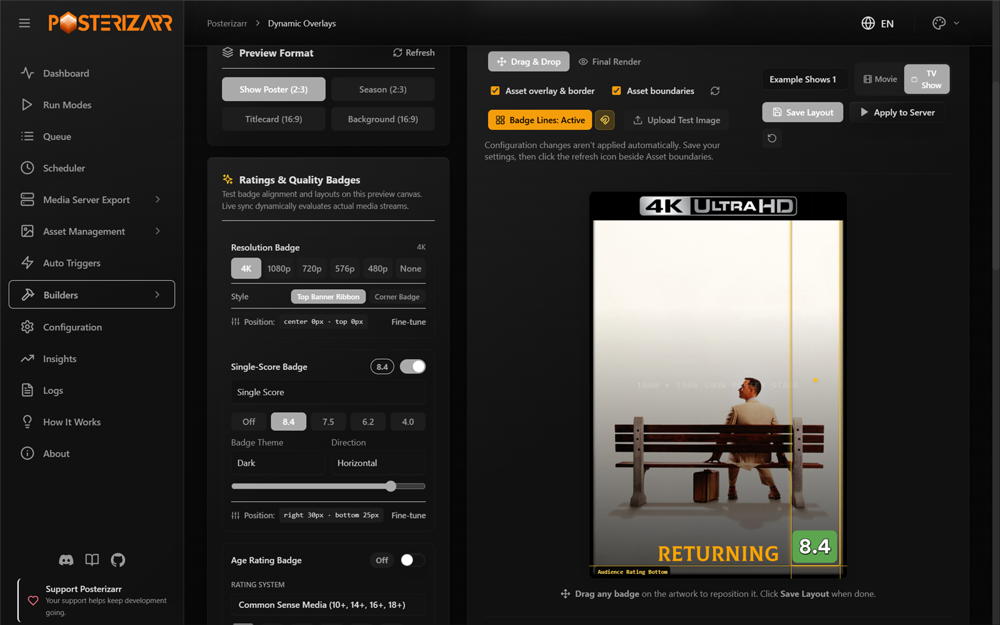

# Dynamic Overlays (Kometa-Compatible)

**Posterizarr's native in-memory dynamic overlay engine.**
It uses a Pillow (`PIL`) compositor and can read a supported subset of Kometa-compatible configuration and assets. It does not run Kometa.

---

## Overview

Kometa (formerly Plex Meta Manager) is a separate application. Posterizarr's Dynamic Overlays provides a native alternative for supported overlay rules, without requiring a Kometa container or routing artwork through Plex.

**Dynamic Overlays** in Posterizarr solves this natively:

1. **In-Memory Compositing (Clean Assets Preserved):**
   Clean posters and titlecards stored in `/assets` remain **100% untouched and clean on disk**. Compositing happens entirely in RAM before pushing directly to the media server API.
2. **True Multi-Media Server Support:**
   Pushes overlaid artwork directly to **Plex**, **Jellyfin**, and **Emby** via their respective REST APIs.
3. **Change-Detection Fingerprint Cache:**
   Tracks clean artwork, metadata, overlay recipes, and verified artwork identity to avoid unnecessary renders and uploads. Incremental runs still enumerate items, evaluate rules, and may perform media-server verification requests. Changed metadata, rules, artwork selection, and explicit full/forced runs can require rendering or uploads.
4. **Predictable File Layout:**
   Configurations, downloaded defaults, and custom overlay assets are stored under `Overlayfiles/dynamic_overlays/` in the writable application data directory.

---

## Quick Start From the Web UI

1. Open **Builders > Dynamic Overlays**. Use **Setup Wizard** for a guided first
   setup, or import your supported Kometa-style YAML in **Config & YAML Files**.
2. Keep **Dry Run** enabled while testing. Check the Master Switch and confirm
   which libraries and artwork formats are in scope before running a sync.
3. In **Libraries & Rules**, review the imported rules. Check readiness and fetch
   any required official templates, fonts, or images before previewing.
4. Open **Visual Badges** or **Live Preview**, choose the library and format, and
   adjust the badges. **Save Layout** persists the layout; a preview alone does
   not update media-server artwork.
5. Run a dry-run sync in **Sync & Cache** and review the log and cache results.
   Turn off Dry Run only when you intend to upload artwork to the selected server.
6. For a smaller test, use **Select Movie / Show** in **Sync & Cache** instead of
   processing an entire library. Avoid **Force Reapply** unless you deliberately
   want to reapply artwork.



*Development-build screenshot with example library names. The artwork and badge
metadata are preview samples, not the result of a media-server sync. The visible
configuration is an example, not the installation defaults.*

!!! warning "Kometa compatibility is selective"
    Importing a syntactically valid Kometa configuration does not mean every
    Kometa builder, collection rule, or overlay is implemented. Review imported
    rules and readiness before applying them. Posterizarr renders supported
    overlays itself; it does not start Kometa.

### Importing an Existing Configuration

Upload `config.yml` or `config.yaml` together with any referenced custom overlay
YAML files. Readiness reports missing dependencies separately from YAML syntax
errors. Blank optional `libraries`, `overlay_files`, and `template_variables`
sections are accepted by the current importer as empty containers. Existing
nonempty values are retained, and uploading does not rewrite the YAML bytes.

If an older build reports `argument of type 'NoneType' is not iterable`, upgrade
the backend. As a workaround for a blank variables block, use
`template_variables: {}`. Never replace a populated variables block with an empty
one; its values define the overlay's behavior.

### Provider Ratings and Score Layout

Provider badges support IMDb (`imdb`), Rotten Tomatoes critics (`tomatoes`),
Rotten Tomatoes audience (`tomatoesaudience`), TMDb (`tmdb`), Trakt (`trakt`),
Metacritic (`metacritic`), and Letterboxd (`letterboxd`). Choose providers in
**Visual Badges** or **Live Preview**. The initial IMDb/RT Critics/TMDb selection
is a default, not a three-provider limit. Cached ratings are independent of this
selection; having seven cached values does not automatically enable seven badges.
Live Preview uses sample values, not the selected item's cached ratings.
When provider ratings are available, the built-in provider layout suppresses the
legacy `rating_high` / `user_rating` audience badges from imported overlay files,
so the old audience score is not drawn a second time.

Provider score controls are saved with the library and artwork-format layout:

| Setting | Behavior |
|---|---|
| Automatic fixed slots (`score_size_mode: auto`) | Reserve provider-specific score space so changing scores does not move the logo. |
| Custom fixed width (`score_size_mode: fixed`) | Set `score_width` from 16 to 600 reference-canvas pixels; narrower slots shrink only the number to fit. |
| Fit score content (`score_size_mode: content`) | Fit the backdrop to the current score while keeping the logo anchored. |
| Number side (`score_position`) | Place the number to the `left` or `right` of its provider logo. |
| Number alignment (`score_alignment`) | Align the number `left`, `center`, or `right` within automatic/custom fixed slots. Not used in content mode. |

Widths scale from the portrait 1000 x 1500 or landscape 1920 x 1080 reference
canvas to the output artwork. These controls affect multi-provider badges, not
the compact single-score badge. Previewing and saving do not upload artwork;
existing configurations without the new fields retain their legacy rendering.

## Folder Layout

The canonical location is `Overlayfiles/dynamic_overlays/` under the writable application data directory. In Docker this is normally `/config/Overlayfiles/dynamic_overlays/`; local installations use the application data/project root.

```text
Overlayfiles/
├── (asset-creation fonts and frame overlays, when configured)
└── dynamic_overlays/
   ├── configs/        # YAML configuration files (config.yml, anime_overlays.yml, etc.)
   ├── defaults/       # Downloaded Kometa-compatible YAML templates
   │   └── images/     # Images downloaded for those templates
   ├── assets/         # Custom/local overlay images
   └── fonts/          # Custom/local overlay fonts
```

Place Dynamic Overlays configuration and assets in `Overlayfiles/dynamic_overlays/`.

## Kometa Compatibility and Attribution

**Is Kometa built into Posterizarr as a plugin? No.** Dynamic Overlays is implemented and run by Posterizarr. It does not embed, launch, or require Kometa, and it is not a Kometa plugin. Posterizarr parses supported Kometa-style YAML itself and renders overlays through its own code. This is compatibility with selected configuration formats and rendering behavior, not full Kometa feature parity.

| Area | Posterizarr implementation | Kometa source / relationship |
|---|---|---|
| Coordinate placement and text/backdrop composition | [`overlay_engine.py`](https://github.com/fscorrupt/posterizarr/blob/main/webui/backend/overlay_engine.py) (`get_coordinates`, `draw_backdrop_and_text`) | Adapted from the coordinate and backdrop-rendering methods in [Kometa `modules/overlay.py`](https://github.com/Kometa-Team/Kometa/blob/master/modules/overlay.py). The Posterizarr module is an adaptation, not Kometa's runtime or a copy of the complete module. |
| Kometa-style config and defaults | [`overlay_resolver.py`](https://github.com/fscorrupt/posterizarr/blob/main/webui/backend/overlay_resolver.py) | Posterizarr reads and validates YAML itself. Downloaded default templates are upstream data from [Kometa `defaults/overlays`](https://github.com/Kometa-Team/Kometa/tree/master/defaults/overlays); they are not executable Kometa code. |
| Default overlay artwork and fonts | [`overlay_resolver.py`](https://github.com/fscorrupt/posterizarr/blob/main/webui/backend/overlay_resolver.py), [`overlay_engine.py`](https://github.com/fscorrupt/posterizarr/blob/main/webui/backend/overlay_engine.py) | Images and official fonts may be fetched from [Kometa's overlay images](https://github.com/Kometa-Team/Kometa/tree/master/defaults/overlays/images) and [fonts directory](https://github.com/Kometa-Team/Kometa/tree/master/fonts). Custom assets remain supported. |
| Sync, media-server APIs, preview, and cache | [`overlay_sync_service.py`](https://github.com/fscorrupt/posterizarr/blob/main/webui/backend/overlay_sync_service.py), [`overlay_preview.py`](https://github.com/fscorrupt/posterizarr/blob/main/webui/backend/overlay_preview.py), [`overlay_cache.py`](https://github.com/fscorrupt/posterizarr/blob/main/webui/backend/overlay_cache.py) | Posterizarr-native code; it renders and uploads directly to configured Plex, Jellyfin, and Emby servers. It does not call Kometa to perform these operations. |

The rendering adaptations are attributed under the MIT License below. Upstream templates, images, and fonts remain Kometa project assets; see their source repository for the applicable project license and notices.

---

## Supported Overlay Types

| Overlay Type | Target Level | Source Metadata | Description |
|---|---|---|---|
| **4K Quality Banner** | Movie Posters & Titlecards | Stream video resolution (`width >= 3840` or `4K`) | Diagonal top banner on posters or corner badge on episode cards. |
| **Audience Rating** | Movies & Shows | Audience / critic score (IMDb, TMDb, Plex) | Color-tiered badge (High $\ge 6.5$, Mid $4.5-6.4$, Low $<4.5$) + formatted score text. |
| **Series Status** | Shows | Series status (`Airing`, `Returning`, `Ended`, `Canceled`) | Optical centered status banner with status colors (`Colus-Regular.ttf`). |
| **Runtime** | Movies & Titlecards | Stream duration (`RunTimeTicks` / `duration`) | Clean duration badge (e.g. `124 min`, `24 min`). |
| **Audio Languages** | Movies & Titlecards | Audio streams present in media item | Square badges or flags for audio languages (e.g. `de`, `en`, `ja`). |
| **Subtitle Languages** | Movies & Titlecards | Subtitle streams reported by the media server | Reuses the audio-language flag images, with independent placement and language selection. |
| **Aspect Ratio** | Movies & Titlecards | Video display aspect ratio, or video width/height as a fallback | Kometa aspect badges such as `1.78` and `2.35`; unknown ratios do not receive a badge. |
| **Audio Codec** | Movies & Titlecards | Audio codec, track title, and filename | Dolby Atmos, TrueHD, DTS:X, AAC, and other codec badges. |
| **Video Source** | Movies & Titlecards | Media filename/path | WEB-DL/WEBRip, Blu-ray, Remux, HDTV, DVD, and similar source labels. This is separate from resolution and HDR. |
| **Studio Logos** | Movies & Shows | Studio metadata reported by the media server | Studio branding using `default: studio`. |
| **Streaming Services** | Movies & Shows; optionally Seasons & Titlecards | Regional TMDb / JustWatch availability | Multiple service logos, separate from studios and networks. Subscription availability is the default. |
| **Anime Filler Tag** | Anime Episodes | `anime_overlays.yml` episode regex match | "Canon" (Green), "Filler" (Red), or "Mixed" (Orange) badge on episode titlecards. |
| **Network Logos** | Seasons | Studio / TV Network | Official network logo (e.g., Netflix, HBO, Disney+, Apple TV+). |
| **Common Sense Media**| Movies | Common Sense Media age rating | Age rating badge (e.g., 10+, 14+, 18+). |

---

## Web UI Features

Navigate to **Builders $\to$ Dynamic Overlays** in the Posterizarr Web UI:

### Background Change Detection & Dry Run
- **Background Checking** controls whether media metadata is periodically checked for changes; it is enabled by default and checks hourly.
- **Automatic Overlay Resync** controls whether detected changes start the overlay render pipeline.
- **Dry Run** is enabled by default. Syncs still evaluate rules and render changed artwork, but never upload it to a media server or mark it synced in the cache. This applies to automatic and manual syncs.
- Turn off **Background Checking** as well to stop periodic change scans entirely.
- The **Master Switch** is the hard stop: when disabled, background detection and sync processing do not run. Switching it off also stops the detector and cancels active sync work before any subsequent upload.

### 0. Guided Onboarding Setup Wizard
- **Zero Confusion Onboarding:** A friendly 4-step visual wizard guides new users through the engine's core concepts, eliminating manual reading.
- **1-Click Turnkey Configuration:** Instantly applies battle-tested overlay presets for Movies (4K badges, ratings, runtime, age ratings), TV Shows (status banners, network logos, episode runtimes), and 16:9 Backdrops.
- **Direct Multi-Config Upload:** Migrating from Kometa or PMM? Directly select or drag-and-drop multiple YAML config files at once (`config.yml`, `overlays_tv.yml`, `overlays_movies.yml`, `anime_overlays.yml`, etc.). Posterizarr automatically validates YAML syntax, imports API keys, and maps rules to your media libraries.
- **Interactive Visual Studio Tour:** Introduces the live preview canvas, drag-and-drop badge movement, rule-of-thirds guides, and per-format customization (keeping show posters and episode titlecard resolution badges safely isolated).
- **Always Accessible:** Reopenable anytime via the **Setup Wizard** button on the Dynamic Overlays header.

### 1. Importer & Pre-flight Validator
- **Config Scanner:** Detects YAML files in `Overlayfiles/dynamic_overlays/configs/`.
- **Readiness Checklist:** Automatically lists every font, image, and template required by your YAML files.
- **1-Click Remote Fetch:** Automatically downloads missing templates and badges from official GitHub repositories.
- **Import Kometa Defaults (from GitHub):** Download official Kometa default overlay templates directly from GitHub into `Overlayfiles/dynamic_overlays/defaults/`.
- **Scheduled Auto-Updates (GitHub Sync):** Automatically keeps templates up to date via the Scheduler (`kometadefaults` run mode). The scheduler queries GitHub's API to discover newly added defaults and updates existing templates with upstream improvements. Can be scheduled on daily, weekly, or custom cron intervals, or enabled via 1-click Quick Schedule directly from the Dynamic Overlays page.
- **Direct Asset Uploader:** Easily drop custom fonts (`.ttf`, `.otf`) or badge PNGs directly into the UI.
- **Per-variant Asset Overrides:** Select a local image for a Kometa default and variant key (for example `resolution / 1080p` or `audio_codec / truehd_atmos`). Existing `file_<key>` values are imported from Kometa YAML; selections are written back to Kometa-compatible YAML and the Visual Config. The picker lists local assets from `assets/` and `defaults/images/`; import official images or upload custom artwork first. Custom/default names can also be entered for imported or hand-written rules.

### 2. Active Libraries & Rules
- **Interactive Rule Management:** View, add, edit, or remove overlay rules directly on each library card.
- **Add Library:** Click **+ Add Library** on the toolbar to register new server libraries (e.g., *Anime Shows*, *4K Movies*, *Kids TV*) into `config.yml`.
- **Remove Library / Rules:** One-click removal with confirmation and automated `.bak` backup generation.
- **Visual Variable Editor:** Customize `builder_level` (Movie, Show, Season, Titlecard), horizontal/vertical offsets, alignments, and transparent/solid back colors without writing code.
- **Raw JSON & YAML Mode:** Switch tabs to edit raw template variables, or click **Edit Raw config.yml** to modify the complete YAML configuration with instant syntax validation.

#### Recommended Defaults & Level Guide

| Overlay Need | Recommended Source | Target `builder_level` | Purpose / Appearance |
| :--- | :--- | :--- | :--- |
| **Media Runtime** | `default: runtimes` | `episode` or `movie` | Display duration badge (e.g., `124 min`, `24 min`). |
| **Audio Languages** | `default: languages` | `episode` or `movie` | Language stream flags / pills (e.g., `DE`, `EN`, `JA`). |
| **Subtitle Languages** | `default: languages`, `use_subtitles: true` | `episode` or `movie` | Separate subtitle flags using the same flag artwork as audio languages. |
| **Aspect Ratio** | `default: aspect` | `episode` or `movie` | Display aspect ratio, separate from pixel resolution. |
| **Studio Logo** | `default: studio` | `movie` or `show` | Studio branding, separate from TV network logos. |
| **Ratings** | `default: ratings` | `movie` or `show` | Audience / Critic ratings (IMDb, RT, TMDB, Metacritic). |
| **TV Network** | `default: network` | `season` | Network logo on season posters (HBO, Netflix, Disney+). |
| **Series Status** | `default: status` | `show` | Airing, Returning, Ended, or Canceled banner on shows. |
| **Common Sense Media** | `default: commonsense` | `movie` | Age rating badge (e.g., `10+`, `14+`, `18+`). |
| **4K Quality Ribbon** | `default: resolution` or `file: config/overlays_movies.yml` | `movie` or `episode` | 4K UHD, 1080p, HDR badges/ribbons. |
| **Anime Filler Tag** | `file: config/anime_overlays.yml` | `episode` | Canon / Filler / Mixed tag on anime episode titlecards. |
| **Corner Ribbon** | `default: ribbon` | `movie` | Corner ribbon badge for resolution or editions. |
| **Streaming Platform**| `default: streaming` | `show` or `movie` | Streaming service badge (Netflix, Prime, Max, etc.). |
| **Audio Codec** | `default: audio_codec` | `movie` or `episode` | Audio codec badge (Dolby Atmos, TrueHD, DTS:X). |

### 3. Live Preview
- Live, interactive canvas preview for both Movie Posters (1000 $\times$ 1500) and Titlecards / Backdrops (1920 $\times$ 1080).
- Real-time adjustment of ratings, resolution, series status, runtimes, and anime tags.
- **Runtime text:** Duration-only is the default. The Label field can add an optional prefix, while Format selects hours/minutes or total minutes. These values are also available in Visual Badges and survive Save Layout, including for new libraries.
- **Language text:** Audio and subtitle flags each have a separate Show Language Codes checkbox. Flags-only is the default; enable codes to add EN/DE/etc. Language-to-country flag aliases are resolved for both local files and on-demand downloads.
- **Optional badges:** Subtitle flags, aspect ratio, studio, and streaming services have explicit enable checkboxes. Enabling one creates a temporary preview rule even if the selected library has not saved that badge yet. Save Layout persists the rule.
- **Resolution style:** The top-banner choice is part of the production recipe. Portrait banners use matching local `4K_banner.png`, `1080p_banner.png`, `720p_banner.png`, `576p_banner.png`, or `480p_banner.png` artwork when present; otherwise they render a full-width tier label. Variant asset overrides can select another local image. Landscape/titlecard formats retain corner badges. The banner can coexist with single-score/provider ratings and audio-codec badges.
- **Corner badge sizing:** Resolution images fit proportionally inside their configured pill/container instead of allowing wide quality/HDR artwork to extend outside it or be clipped at an edge. Positions remain configurable; this does not automatically resolve overlaps caused by custom positions of separate badges. Imported YAML resolution images do not receive an extra backdrop unless one is configured.
- Banner and corner styles are mutually exclusive, including when legacy movie/TV overlay files are configured. Full-poster transparent banner artwork keeps its original canvas positioning instead of being centered inside the small corner-badge box. Corner badges use the separate resolution badge assets and the displayed contrast settings. Saving an explicit style retains its native rule without re-enabling the competing legacy banner or overwriting another format's rule. A number such as `8.4` is a separately enabled rating overlay, not part of the resolution image.
- Subtitle languages, aspect ratio, and studio have separate sample values and position controls. Audio and subtitle flags use independent queues. Their metadata must be available at the chosen target level; a show poster does not automatically aggregate streams from all episodes.
- Positions, alignments, offsets, fonts, sizes, and supported template/background variables can be tuned per rule and format. An exact match to another poster still depends on its artwork, fonts, and layout; templates are not an automatic recreation of an arbitrary reference image.
- **Incremental sync impact:** Changing an asset override changes the rendered layer and its recipe hash when that default variant is used. The next incremental sync may re-render and upload those affected items; unrelated variants remain unchanged.
- **AniMetaFill titlecards:** When AniMetaFill is enabled, selecting one of its target libraries and the Titlecard format automatically shows a sample Canon badge using its saved label, color, font, size, and placement. The anime controls can preview Filler, Mixed, or Off. This is sample classification data, not a lookup of a particular episode; unrelated libraries and other asset formats do not receive the automatic badge.
- **Matching badge artwork:** Drag & Drop uses transparent PNG layers rendered by the same Pillow compositor and recipe builder used for media-server uploads. Badge sizes, fonts, plates, shadows, and overlapping layer order are no longer approximated with HTML/CSS. Drag handles and alignment guides use the rendered pixel bounds, including compound badges such as a rating plate plus score.
- Select the target library to preview its saved upload recipe. Without a selected library, the renderer uses standard default rules. Preview metadata (ratings, status, languages, etc.) is sample data; actual item metadata and filters can select different badges during sync. Upload the generated clean asset as custom test artwork to compare against the same base image. Missing required assets or fonts produce an error instead of a visually different fallback badge.
- Without a selected library, all five preview formats are available: movie poster, show poster, season poster, titlecard, and background. Existing libraries retain their movie/TV-specific format choices.
- **Asset boundaries:** Enabled by default in both Drag & Drop and Final Render. Dashed, shaded boxes show the configured title/logo reservation, season title, optional show title on season posters, and separate episode title and season/episode text areas. A dashed rose outline marks the inner border edge when borders are enabled.
- **Legend:** Shown below the canvas in both preview modes and updated for the selected format and visible guides. Yellow dashed boxes reserve the primary title/logo area; cyan dashed boxes reserve the additional show title or season/episode text area. The rose/red dashed outline marks the border's inner edge. Solid amber lines mark badge alignment; green lines mark magnetic snapping while dragging.
- Boundaries use the saved asset-creation configuration (`MaxWidth`, `MaxHeight`, `text_offset`, and `borderwidth`), scaled from 2000 $\times$ 3000 posters or 3840 $\times$ 2160 landscape assets. As in testing mode, text-box reservations remain visible for textless assets.
- Use the refresh icon beside **Asset boundaries** after saving configuration changes. Guides are preview-only: they do not move badges automatically, change saved layouts, or appear in uploaded artwork. They show reserved boxes rather than exact font, logo, or static-overlay rendering; upload a generated asset as custom artwork to inspect those details.

### 4. 16:9 Backdrop & Multi-Source Ratings Overlays
- **Rating mode:** Preview explicitly selects Single Score or Provider Scores. Single Score saves a `single_rating` rule and produces one score badge; Provider Scores saves a `ratings` rule and displays the selected providers. Embedded audience-rating rules in custom movie/TV files are disabled when saving an explicit mode to prevent duplicates. Disabled sections are accepted by the save API.
- **One provider-rating recipe:** Visual Badges and the live preview use the same provider sources, theme, orientation, spacing, and saved position. Provider ratings also work when no other overlays are enabled.
- **Rating themes:** `dark` uses the contrast-box setting; `brand` uses provider colors; `score` colors badges green, yellow, or red by score. Set **Badge Theme** in Visual Badges or preview. Save Layout retains the provider theme and geometry, including for a new library.
- **Stable provider alignment:** Provider logos and scores use reserved score slots with left-aligned contents, so decimal digits and percentage widths do not shift the whole badge. Vertical provider rows share a width. Single-score badges retain compact sizing; preview existing custom layouts after an upgrade because provider row widths can change.
- **Backdrop Overlay Pipeline:** Overlays dynamic rating badges directly onto 16:9 movie/show background fanart and uploads to Plex (`/library/metadata/{id}/arts`) or Jellyfin/Emby (`/Items/{id}/Images/Backdrop`).
- **Pristine Clean Assets Protected:** Original `background.jpg` / `fanart.jpg` on disk remain 100% untouched.
- **Supported Rating Providers:**
  - **IMDb** (`IMDb.png`)
  - **Rotten Tomatoes Critics** (`RT-Crit-Fresh.png` / `RT-Crit-Rotten.png`)
  - **Rotten Tomatoes Audience** (`RT-Aud-Fresh.png` / `RT-Aud-Rotten.png`)
  - **TMDb** (`TMDb.png`)
  - **Trakt** (`Trakt.png`)
  - **Letterboxd** (`Letterboxd.png`)
  - **Metacritic** (`Metacritic.png`)
- **Zero-Quota Native Resolution:** Transparently reads Plex `<Rating>` XML tags and local TMDb token first, eliminating external quota burn.
- **Optional External APIs:** MDBList and OMDb API keys are strictly optional.
- **Tiered Auto-Update TTL (SQLite):**
  - Media released < 180 days: **3-day refresh**
  - Media released < 2 years: **14-day refresh**
  - Classic media (> 2 years): **30-day refresh**
  - When ratings change during scheduled syncs, updated backdrops are automatically re-rendered and pushed to media servers.

### 5. Cache & Sync
- **Single movie/show sync:** in **Sync & Cache**, choose **Select Movie / Show**, select a server/library, search by title, and select the matching result by year, library, and server ID. **Scan Selected Item** fetches that exact item directly instead of crawling the library, reevaluates configured overlays, and skips unchanged artwork. A show includes its configured season posters and episode titlecards, not other shows. **Force Reapply** explicitly reapplies the selected item's artwork. The usual sync queue, progress, logs, stop controls, and clean-asset requirements still apply. Search is server-backed (not cache-only), bounded to 30 results, and respects configured/excluded libraries.
- **Ratings Cache & Refresh:** use **Refresh Missing & Expired** to refresh expired movie/show ratings and backfill missing ratings for movie/show posters already in the overlay cache. The action applies across all servers, independently of the table filters and overlay rules. A row's **Refresh ratings now** action forces just that entry. Both run in the background without rendering, uploading, or selecting artwork; overlay artwork is updated by the next appropriate overlay sync.
- **Automatic ratings refresh:** while Dynamic Overlays is enabled, **Automatic Refresh (Hourly)** checks expired ratings independently of the overlay scheduler and rule configuration. It is enabled by default and can be disabled in the cache browser. Automatic checks do not backfill missing entries; use the manual bulk action for those. Refreshes are sequential to limit provider traffic, and only one ratings refresh job runs at a time. Cancel stops further processing; completed items remain saved.
- **Refresh results:** the cache browser shows job progress, trigger, completion time, success/partial/failure counts, and the latest 20 issues. Each rating row stores its last attempt time, status, and sanitized per-provider results. These diagnostics survive backend restarts; interrupted jobs are marked interrupted. `BackendServer.log` includes `[Ratings]` item outcomes and `[RatingsRefresh]` job summaries at INFO level, without request URLs or API keys.
- **Expiry is not provider health:** a successful refresh means fresh scores were saved, not that every score changed. Partial means some fresh scores were saved but another attempted provider failed or returned no scores. Failed lookups preserve existing scores, `cached_at`, and expiry, allowing stale scores to remain usable. A valid TTL alone does not prove every configured provider succeeded. The table's **Refresh list** button only reloads records; **Mark expired** does not immediately fetch them. Custom Plex audience-rating overlays still read Plex metadata directly; rendering them does not by itself populate the multi-source cache.
- Repeated uploads can leave old alternatives in Plex's metadata directory. The separate [scheduled Plex Image Cleanup](plex_image_cleanup.md) task can report, quarantine, or remove old unselected uploads. It is never invoked automatically by overlay sync or preview.
- View cached items in `database/overlay_cache.db` (`media_ratings_cache` table and fingerprint tables).
- Movie and episode cache rows store the server-reported video file in `media_file_path`; `clean_asset_path` remains the original poster/titlecard image path. Filename-derived `detected_video_source` stores labels such as `WEB`, `BLU-RAY`, and `REMUX`, independently of `detected_resolution`. The legacy `detected_video_format` field retains the server-provided codec profile when available; it is not the video source.
- These columns are added automatically to existing databases and filled as items are evaluated or successfully synced. Matching cached items can refresh these diagnostic fields without uploading artwork or changing the last-upload timestamp. Detection uses the video filename, not source-like words in parent directory names.
- Resolved layer definitions are stored once in `overlay_layer_snapshots`; per-item attribute snapshots refer to them through `_overlay_layers_ref`. Older inline snapshots migrate automatically without changing recipe hashes, artwork identities, or upload timestamps. A one-time database compaction follows migration, and unused definitions are pruned after sync; SQLite can still retain reusable space or temporary WAL files during normal operation.
- Font recipe hashes use the font file's SHA-256 contents rather than its absolute path. Identical files in different directories produce the same recipe; changed contents invalidate it even when the filename is unchanged. Digests are held in a bounded cache keyed by file identity, size, and high-resolution modification/change times, avoiding repeated font reads for each episode. Render layers and diagnostic snapshots retain their actual paths.
- **First-run font migration:** existing entries migrate lazily during normal evaluation, for posters, season posters, titlecards, and backgrounds on every supported server. If the clean artwork, metadata, and original path-based recipe still match, only the recipe hash and layer snapshot are updated. Migration itself does not render or upload artwork and preserves the last-upload timestamp and artwork identity. Font hashes use the renderer's local candidate order: the requested file first, then valid same-name files in its font directories. Missing or corrupt preferred files can therefore use the same local font as the renderer, without downloading or repairing files during hashing. A prior path change can also migrate when its saved recipe is verifiable and both old/current requests resolve to byte-identical valid fonts. Unresolvable or different fonts do not qualify, and the cache-miss reason identifies unresolved fonts. Failed database migrations fail the item rather than falling through to an upload. Do not clear the cache for this upgrade.
- Legacy recipes did not record historical font contents. An unchanged legacy recipe therefore establishes the currently installed font as its initial content baseline; a font replacement that happened before this first migration cannot be identified retrospectively from that recipe alone. After migration, font content changes are detected normally. Real artwork, metadata, rule, or selection changes still use the normal sync workflow; full/forced runs retain their explicit reapply behavior.
- Metadata-only refreshes preserve the saved layer reference and verified artwork identity, so an up-to-date poster check does not erase the previous recipe diagnostics. Incremental Plex movie/show poster processing also compares rendered bytes with the selected upload before uploading; an identical selected image refreshes fingerprints without another upload. Full/forced sync continues to upload explicitly requested artwork.
- Plex movie/show poster cache hits verify the actual item thumbnail bytes, not just the recipe hash or the poster list's `selected` flag. This also applies when the thumbnail URL is unchanged, including separate library entries for the same movie. If the displayed poster already matches the rendered bytes, fingerprints are refreshed without uploading. Successful poster uploads always issue an explicit selection request for the target item, then verify its displayed thumbnail before the cache is marked synced. Pre-upload verification failures leave server artwork untouched; an upload whose selection cannot be confirmed is not marked synced.
- Verified Plex episode stream metadata is reused on incremental runs only when the episode timestamp and media path still match. The first run builds this metadata cache; full/targeted runs and changed or incomplete metadata still perform fresh detail queries. Artwork-selection verification and overlay-rule evaluation remain active.
- Incremental sync still enumerates media-server items, checks clean source files, evaluates recipes, and verifies artwork where required; an `Up-to-date` result is not just a database lookup. A bounded candidate cache excludes overlay rules restricted to other show titles, while retaining per-episode filters and queue/group processing. Candidate keys include expanded rule inputs and title, so template, variable, and YAML changes invalidate them. This optimization does not change recipe hashes or require a cache reset.
- Explicit font requests never silently substitute another font family. Font directories created after engine initialization are discovered on subsequent evaluations; a missing required custom font fails rendering instead of uploading a differently styled image. Existing images previously rendered with a substitute font may require one corrective sync to the configured font.
- Missing or corrupt official fonts are repaired with size-limited downloads that Pillow validates before atomic replacement. Concurrent render workers share a repair lock, and failed repairs have a short retry cooldown; HTML/error responses are never installed as fonts. Invalid custom fonts require a valid replacement from the user. Legacy cache migration runs in bounded batches, with cache initialization offloaded from the async event loop.
- Inspect recently synchronized media items across Plex, Jellyfin, and Emby.
- Clear rating or asset caches on demand.
- **Plex titlecard confirmation:** A successful upload HTTP response is not sufficient. Sync locates the uploaded image by its content hash, explicitly selects it for the target item, and verifies the selection before recording success. Missing/unselected uploads remain failed and are retried on a later sync.
- **Plex episode artwork drift:** When a thumbnail URL changes, incremental sync checks the selected upload identity before deciding that artwork was replaced. An already-selected, byte-identical rendered titlecard can refresh its cache without uploading again, including legacy rows. Plex shows with titlecards enumerate their children rather than trusting only the parent show timestamp.
- **Generated-asset targets:** Season and episode CSV rows resolve to their parent show using TVDb/TMDb/IMDb IDs, including IDs in asset-folder tags. Decorated season/episode titles are not treated as parent-show titles. Older rows without IDs use exact parent-title or root-folder matching rather than broad substring matching.
- **Overlapping triggers:** Targeted Arr/Tautulli and automatic asset-creation requests are queued while another overlay sync is active. Compatible pending batches are merged and identical targets deduplicated; each batch runs serially after the active sync. Stop cancels pending batches. This queue is in memory and does not survive a backend restart. Manual untargeted full-sync requests are still rejected while busy.
- **Compound rating previews:** A separate rating plate and score are moved as one group, preserving their original internal alignment and transparency when changing badge alignment or dragging.

### 6. Regional Streaming Availability
- Enable **Streaming Services** in Visual Badges, or add `default: streaming`. A configured TMDb API key/read token and a TMDb ID for the movie/show are required.
- Select the two-letter country code, such as `US`, `DE`, or `GB`. Availability is regional and is not inferred from the studio, network, filename, or the user's subscriptions.
- `availability_types` defaults to `[flatrate]` (subscription). Optional values are `free`, `ads`, `rent`, and `buy`. An empty list produces no logos. Multiple matching services can be displayed with configurable count, spacing, direction, position, and color/white artwork.
- Successful provider responses, including empty availability, are cached for 24 hours in the overlay database. Failed requests do not overwrite the cache; expired data is reused after an API failure when available. Without cached data, lookup failures leave that item's artwork untouched and report a failure.
- Preview streaming values are sample provider keys, such as `netflix,disney,hulu`, not a live availability lookup. Season/titlecard rules use their parent show's availability, not individual episode purchase availability.
- Availability data is supplied by TMDb / [JustWatch](https://www.justwatch.com/). Playback progress bars and media-client status icons are not generated by this overlay engine.

---

## Security Architecture

Posterizarr enforces strict security controls for dynamic overlay file operations. The active root is `Overlayfiles/dynamic_overlays/`:

- **Path Traversal Mitigation:** Configuration and asset file operations are confined to the active overlay root. Traversal patterns (`..`, `~`), null bytes (`\x00`), and path escapes are blocked.
- **Strict Extension Whitelisting:** Only safe configuration (`.yml`, `.yaml`), image (`.png`, `.jpg`, `.jpeg`, `.webp`), and font (`.ttf`, `.otf`) extensions are permitted.
- **SSRF Mitigation:** All remote asset downloads strictly enforce HTTPS, resolve hostnames against public IP ranges, and block loopback (`127.0.0.1`), link-local (`169.254.x.x`), private IP ranges, and multicast targets.

---

## Open Source Attribution & License

The coordinate placement and text/backdrop rendering algorithms in [`webui/backend/overlay_engine.py`](https://github.com/fscorrupt/posterizarr/blob/main/webui/backend/overlay_engine.py) are adapted from [Kometa's `modules/overlay.py`](https://github.com/Kometa-Team/Kometa/blob/master/modules/overlay.py), by **meisnate12** and the Kometa team, under the **MIT License**. Posterizarr's YAML handling, media-server integration, preview, sync, and cache are separate Posterizarr implementations; see the source map above.

```text
MIT License
Copyright (c) 2026 meisnate12
```

We extend deep gratitude to the Kometa community for their contributions to media server automation.
