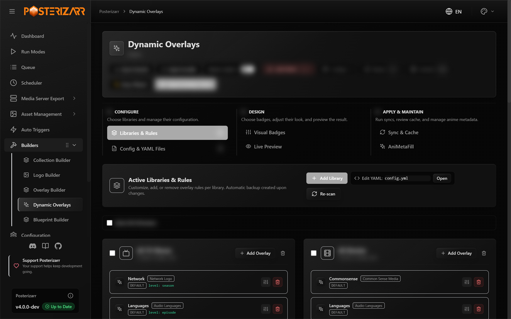
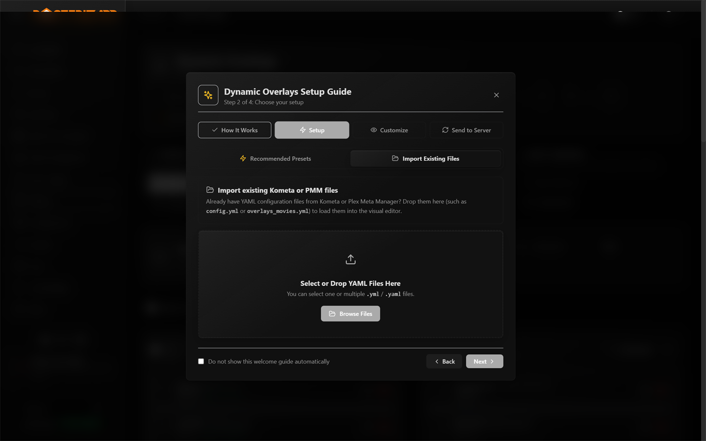
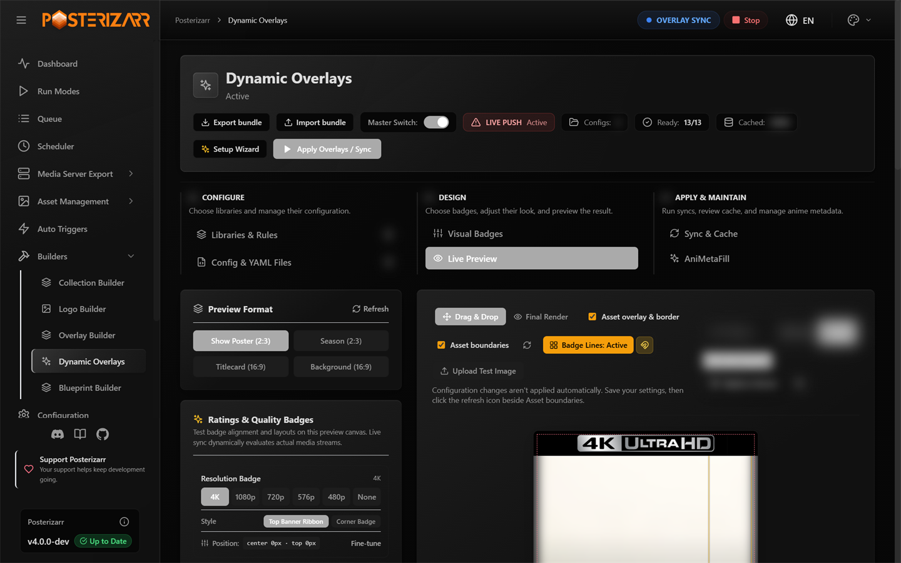
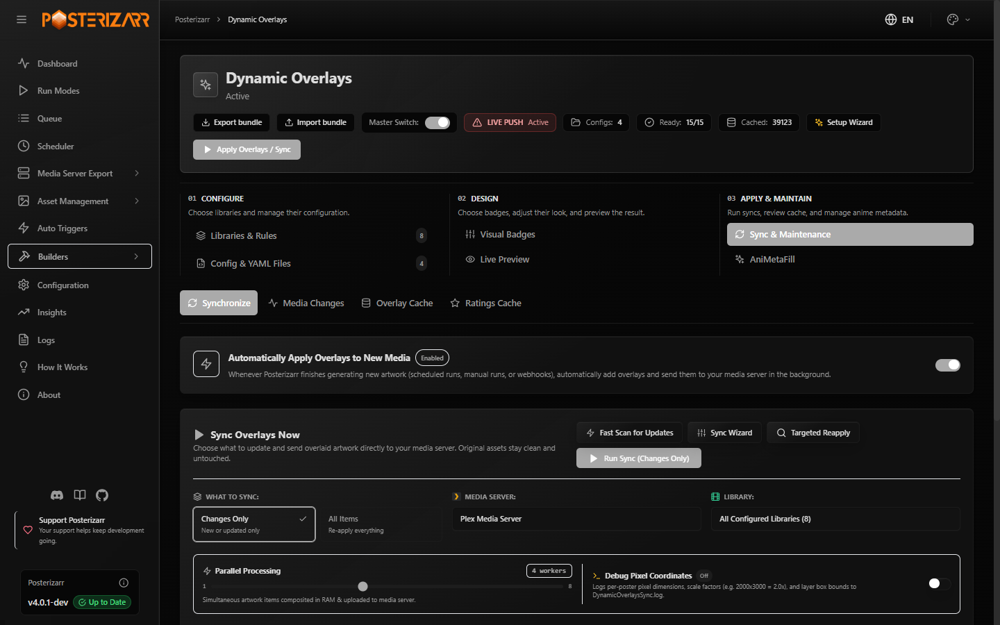
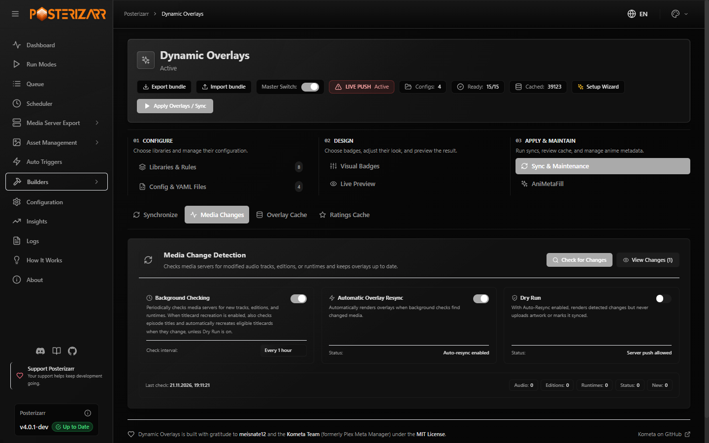
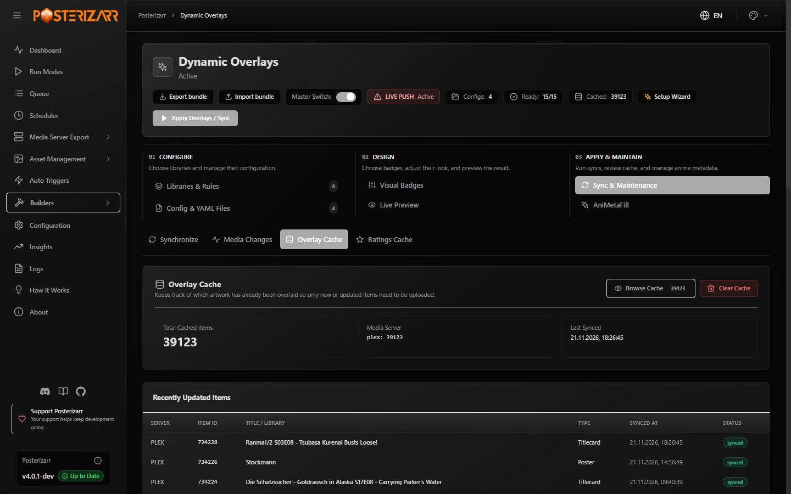

# Dynamic Overlays (Kometa-Compatible)

**Posterizarr's native in-memory dynamic overlay engine.**
It uses a Pillow (`PIL`) compositor and can read a supported subset of Kometa-compatible configuration and assets. It does not run Kometa.

!!! tip "Just getting started? Need deep YAML or dataset specs?"
    - **First time?** Follow the **[5-Minute Quickstart](quickstart.md)** to go from a fresh install to your first live overlaid poster in minutes.
    - **Deep dive?** See **[Dynamic Overlays Reference](dynamic_overlays_reference.md)** for Overlay Bundles, Kometa YAML imports, Local IMDb Dataset, SIMKL/MAL anime ratings, OMDb guards, flag styles, cache internals, and security architecture.

---

## Overview

Kometa (formerly Plex Meta Manager) is a separate application. Posterizarr's Dynamic Overlays provides a native alternative for supported overlay rules, without requiring a Kometa container or routing artwork through Plex:

1. **In-Memory Compositing (Clean Assets Preserved):**
   Clean posters, seasons, backgrounds, and titlecards stored in `/assets` remain **100% untouched and clean on disk**. Compositing happens entirely in RAM before pushing directly to the media server API. *(Dynamic Overlays requires an existing clean base file in `/assets` for each item; items without a local base file are skipped.)*
2. **True Multi-Media Server Support:**
   Pushes overlaid artwork directly to **Plex**, **Jellyfin**, and **Emby** via their respective REST APIs. See [Jellyfin / Emby Box Sets](dynamic_overlays_reference.md#jellyfin-emby-box-sets) for box-set discovery details.
3. **Change-Detection Fingerprint Cache:**
   Tracks clean artwork, metadata, overlay recipes, and verified artwork identity in SQLite to avoid unnecessary renders and uploads.
4. **Predictable File Layout:**
   Configurations, downloaded defaults, and custom overlay assets are stored under `Overlayfiles/dynamic_overlays/` in the writable application data directory (`/config/Overlayfiles/dynamic_overlays/` in Docker).

---

## Quick Start From the Web UI

The general first-run wizard includes an optional **Dynamic Overlays** step. If enabled there, Posterizarr saves Dynamic Overlays as enabled with **Dry Run** on, then opens the dedicated Setup Wizard after initial setup finishes. Leave it off if you prefer to configure overlays later from **Builders**.



*Expand **Builders** and choose **Dynamic Overlays** in the sidebar to reach setup, configuration, preview, synchronization, and cache tools.*



*Choose **Setup Wizard** at the top of Dynamic Overlays. If the feature is off, **Turn On & Launch Setup Wizard** enables it and opens the guide.*

The four steps are:

| Step | What it covers | What happens |
|---|---|---|
| **How It Works** | Clean source artwork, in-memory compositing, supported servers, and turning overlays off later. | Information only. |
| **Choose your setup** | **Recommended Presets** or **Import Existing Files**. Presets cover movie ratings/runtime/age/resolution, show status/network, titlecard runtime/resolution, and background ratings. Import accepts multiple `.yml` / `.yaml` files such as `config.yml` and `overlays_movies.yml`. | **Apply Presets** changes the overlay configuration immediately. Selecting or dropping YAML uploads those files immediately, extracts recognized API keys, and may translate `config.yml` into the visual configuration. Neither action uploads artwork. |
| **Customize** | Drag-and-drop placement, grid/alignment guides, sliders, and artwork formats. | Guidance only; edit and save layouts in **Visual Badges** or **Live Preview**. |
| **Send to Server** | **Changes Only** versus Full Sync and scheduled updates. | Guidance only. **Finish & Open Live Preview** closes the guide and opens the preview; it does not run a sync. |

You can reopen the guide from **Setup Wizard** at any time.

!!! warning "Preset and import actions take effect immediately"
    Do not click **Apply Presets** or upload YAML just to inspect the wizard.
    Presets update overlay rules immediately; YAML imports write files and may
    save API keys found in the YAML (creating `.bak` backups of overwritten
    files). Neither action uploads artwork — keep **Dry Run** enabled while
    testing.

After the wizard, use this safe setup path:

1. Keep **Dry Run** enabled. Confirm the **Master Switch** and which libraries
   and artwork formats are in scope before syncing.
2. In **Libraries & Rules** (and **Config & YAML Files**), review imported rules
   and fetch any required templates, fonts, or images via readiness checks.
3. Open **Visual Badges** or **Live Preview**, choose your library and format,
   and adjust badge styles or placement. Click **Save Layout** to persist
   changes (previewing alone does not upload artwork).
4. Run a dry-run sync under **Sync & Maintenance > Synchronize** and check
   `DynamicOverlaysSync.log` to verify matching and rendering safely.
5. Test on a single item first with **Targeted Reapply** (or **Select Movie /
   Show**) rather than a full library. Only turn **Dry Run** off under **Media
   Changes** once previews and logs look right.



*Use **Live Preview** to inspect sample artwork, check asset title/border reservation guides, and drag badges into place.*

!!! warning "Kometa compatibility is selective"
    Importing a syntactically valid Kometa configuration does not mean every
    Kometa builder, collection rule, or overlay is implemented. Review imported
    rules and readiness before applying them. Posterizarr renders supported
    overlays itself; it does not start Kometa.

---

## Supported Overlay Types

| Overlay Type | Target Level | Source Metadata | Description |
|---|---|---|---|
| **4K Quality Banner** | Movie Posters & Titlecards | Stream video resolution (`width >= 3840` or `4K`) | Diagonal top banner on posters or corner badge on episode cards. |
| **Audience Rating** | Movies & Shows | Audience / critic score (IMDb, TMDb, Rotten Tomatoes, Trakt, Metacritic, Letterboxd, SIMKL, MAL) | Color-tiered badge (High ≥ 6.5, Mid 4.5–6.4, Low < 4.5) or multi-provider score pills. |
| **Series Status** | Shows | Series status (`Airing`, `Returning`, `Ended`, `Canceled`) | Optical centered status banner with status colors (`Colus-Regular.ttf`). |
| **Runtime** | Movies & Titlecards | Stream duration (`RunTimeTicks` / `duration`) | Clean duration badge (e.g. `124 min`, `24 min`). |
| **Audio Languages** | Movies & Titlecards (plus optional Show/Season) | Audio streams present in media item | Square badges or flags (`round`, `square`, `half`) for audio languages (e.g. `de`, `en`, `ja`). |
| **Subtitle Languages** | Movies & Titlecards | Subtitle streams reported by the media server | Reuses audio-language flag images with independent placement and language selection. |
| **Aspect Ratio** | Movies & Titlecards | Video display aspect ratio, or video width/height fallback | Kometa aspect badges such as `1.78` and `2.35`; unknown ratios receive no badge. |
| **Audio Codec** | Movies & Titlecards; Shows & Seasons with aggregation | Audio codec, stream profile, track title, filename | Dolby Atmos, TrueHD, DTS-HD MA, DTS:X, AAC, and other codec badges. |
| **Video Source** | Movies & Titlecards | Media filename/path | WEB-DL/WEBRip, Blu-ray, Remux, HDTV, DVD, and similar source labels. |
| **Studio Logos** | Movies & Shows | Studio metadata reported by the media server | Studio branding using `default: studio`. |
| **Streaming Services** | Movies & Shows; optionally Seasons & Titlecards | Regional TMDb / JustWatch availability | Subscription/availability service logos, separate from studios and networks. |
| **Anime Filler Tag** | Anime Episodes | `anime_overlays.yml` episode regex match | "Canon" (Green), "Filler" (Red), or "Mixed" (Orange) badge via **AniMetaFill**. |
| **Network Logos** | Seasons | Studio / TV Network | Official network logo (e.g., Netflix, HBO, Disney+, Apple TV+). |
| **Common Sense Media** | Movies | Common Sense Media age rating | Age rating badge (e.g., `10+`, `14+`, `18+`). |
| **Custom PNG Images** | Any Library (Movies, Shows, Seasons, Titlecards, Backdrops) | Custom uploaded PNG/JPG/WebP or **Overlay Builder** PNGs | One-click per-library corner badge or full-poster frame via **+ Add Overlay > Custom PNG Image** without writing YAML. |

---

## Web UI Features

Navigate to **Builders > Dynamic Overlays** in the Posterizarr Web UI:

### Sync & Maintenance Views

| View | Contents | Direct Link |
|---|---|---|
| **Synchronize** | Sync controls, automatic application to new media, Targeted Reapply, sync log | `/dynamic-overlays?tab=sync` |
| **Media Changes** | Metadata monitoring, detected changes, intervals, Dry Run | `/dynamic-overlays?tab=media-changes` |
| **Overlay Cache** | Cache statistics, browser, cleanup, recently updated artwork | `/dynamic-overlays?tab=overlay-cache` |
| **Ratings Cache** | Ratings cache, refresh controls, Local IMDb Dataset | `/dynamic-overlays?tab=ratings-cache` |

The selected view is retained in the URL and local preference. The legacy
`tab=cache` link opens Overlay Cache, and `tab=episode-titles` redirects to the
standalone **Asset Management > Asset Title Review** view (`/asset-title-review`).
Changing views does not stop running jobs.



*The Synchronize view contains sync controls, automatic application to new
media, Targeted Reapply, and the sync log.*

### Background Change Detection & Dry Run



*Open **Sync & Maintenance > Media Changes** for Background Checking, its check
interval, Automatic Overlay Resync, and Dry Run. Title-change monitoring has its
own standalone page and settings under **Asset Management > Asset Title Review**
(`/asset-title-review`).*

- **Background Checking** controls whether media metadata is periodically checked for changes; it is enabled by default and checks hourly.
- **Automatic Overlay Resync** controls whether detected changes start the overlay render pipeline.
- **Dry Run** is enabled by default. Syncs still evaluate rules and render changed artwork, but never upload it to a media server or mark it synced in the cache.
- Turn off **Background Checking** as well to stop periodic change scans entirely.
- The **Master Switch** is the hard stop: when disabled, background detection and overlay sync processing do not run. Switching it off also stops the detector and cancels active sync work before any subsequent upload.

#### Recreate Artwork When Titles Change (Asset Title Review)

**Asset Management > Asset Title Review** (`/asset-title-review`) is a standalone
feature that works even when Dynamic Overlays is off, with its own check
interval and Dry Run switch. When Dynamic Overlays is enabled, recreated artwork
is automatically passed through targeted overlay sync before upload; otherwise
it uploads directly to Plex, Jellyfin, or Emby. Read the full **[Asset Title
Review guide](asset_title_review.md)**.

### Overlay Cache & Ratings Cache



*Open **Sync & Maintenance > Overlay Cache** to inspect cache statistics,
**Browse Cache**, and recently updated artwork. For offline IMDb scoring and
episode/season mapping, see [Local IMDb Dataset](dynamic_overlays_reference.md#local-imdb-dataset).*

---

## Advanced Topics & Reference

Everything beyond everyday setup lives in **[Dynamic Overlays Reference](dynamic_overlays_reference.md)**:

- [Share a Complete Overlay Bundle](dynamic_overlays_reference.md#share-a-complete-overlay-bundle) — portable ZIP export/import across servers and libraries
- [Importing an Existing Configuration](dynamic_overlays_reference.md#importing-an-existing-configuration) & [Folder Layout](dynamic_overlays_reference.md#folder-layout)
- [Provider Ratings and Score Layout](dynamic_overlays_reference.md#provider-ratings-and-score-layout), [SIMKL Catalog Ratings](dynamic_overlays_reference.md#simkl-catalog-ratings), [Local IMDb Dataset](dynamic_overlays_reference.md#local-imdb-dataset), and [Anime Season Ratings](dynamic_overlays_reference.md#anime-season-ratings)
- [OMDb Run Protection](dynamic_overlays_reference.md#omdb-run-protection) & [Automatic Retry Schedule](dynamic_overlays_reference.md#automatic-retry-schedule)
- [Rule Artwork Targets](dynamic_overlays_reference.md#rule-artwork-targets), [Episode Ratings](dynamic_overlays_reference.md#episode-ratings), [Language Priority and Parent Video Formats](dynamic_overlays_reference.md#language-priority-and-parent-video-formats), and [Jellyfin / Emby Box Sets](dynamic_overlays_reference.md#jellyfin-emby-box-sets)
- [Live Preview, Template Variables, and Flag Styles](dynamic_overlays_reference.md#live-preview-template-variables-and-flag-styles) & [Detailed Web UI Controls & Technical Notes](dynamic_overlays_reference.md#detailed-web-ui-controls-technical-notes)
- [Security Architecture](dynamic_overlays_reference.md#security-architecture)

---

## Open Source Attribution & License

The coordinate placement and text/backdrop rendering algorithms in [`webui/backend/overlay_engine.py`](https://github.com/fscorrupt/posterizarr/blob/main/webui/backend/overlay_engine.py) are adapted from [Kometa's `modules/overlay.py`](https://github.com/Kometa-Team/Kometa/blob/master/modules/overlay.py), by **meisnate12** and the Kometa team, under the **MIT License**. See the complete source map in [Kometa Compatibility and Attribution](dynamic_overlays_reference.md#kometa-compatibility-and-attribution).

```text
MIT License
Copyright (c) 2026 meisnate12
```
