# Dynamic Overlays (Kometa-Compatible)

**Posterizarr's native in-memory dynamic overlay engine.**
It uses a Pillow (`PIL`) compositor and can read a supported subset of Kometa-compatible configuration and assets. It does not run Kometa.

---

## Overview

Kometa (formerly Plex Meta Manager) is a separate application. Posterizarr's Dynamic Overlays provides a native alternative for supported overlay rules, without requiring a Kometa container or routing artwork through Plex.

**Dynamic Overlays** in Posterizarr solves this natively:

1. **In-Memory Compositing (Clean Assets Preserved):**
   Clean posters and titlecards stored in `/assets` remain **100% untouched and clean on disk**. Compositing happens entirely in RAM before pushing directly to the media server API.
2. **True Multi-Media Server Support:**
   Pushes overlaid artwork directly to **Plex**, **Jellyfin**, and **Emby** via their respective REST APIs.
3. **Change-Detection Fingerprint Cache:**
   Tracks clean artwork, metadata, overlay recipes, and verified artwork identity to avoid unnecessary renders and uploads. Incremental runs still enumerate items, evaluate rules, and may perform media-server verification requests. Changed metadata, rules, artwork selection, and explicit full/forced runs can require rendering or uploads.
4. **Predictable File Layout:**
   Configurations, downloaded defaults, and custom overlay assets are stored under `Overlayfiles/dynamic_overlays/` in the writable application data directory.

---

## Quick Start From the Web UI

The general first-run wizard now includes an optional **Dynamic Overlays**
step. If enabled there, Posterizarr saves the feature as enabled with **Dry Run**
on, then opens this dedicated Setup Wizard after the general setup finishes. The
finish action itself does not sync or upload artwork. Leave the option off to
set up overlays later from **Builders**.

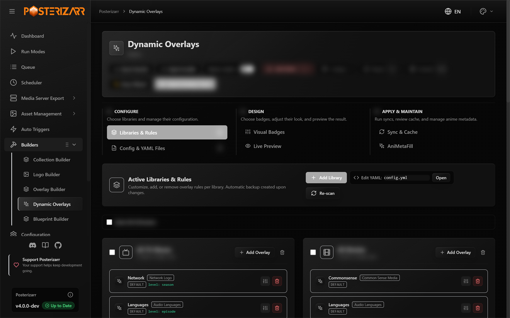

*Expand **Builders** and choose **Dynamic Overlays** in the sidebar to reach setup, configuration, preview, synchronization, and cache tools.*

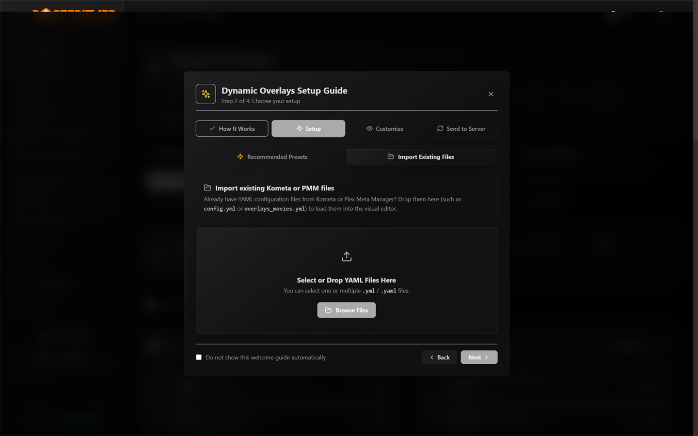

*Choose **Setup Wizard** at the top of Dynamic Overlays. If the feature is off, **Turn On & Launch Setup Wizard** enables it and opens the guide.*

The four steps are:

| Step | What it covers | What happens |
|---|---|---|
| **How It Works** | Clean source artwork, in-memory compositing, supported servers, and turning overlays off later. | Information only. |
| **Choose your setup** | **Recommended Presets** or **Import Existing Files**. Presets cover movie ratings/runtime/age/resolution, show status/network, titlecard runtime/resolution, and background ratings. Import accepts multiple `.yml` / `.yaml` files such as `config.yml` and `overlays_movies.yml`. | **Apply Presets** changes the overlay configuration immediately. Selecting or dropping YAML uploads those files immediately, extracts and saves recognized API keys, and may translate `config.yml` into the visual configuration. Neither action uploads artwork. |
| **Customize** | Drag-and-drop placement, grid/alignment guides, sliders, and artwork formats. | Guidance only; edit and save layouts in **Visual Badges** or **Live Preview**. |
| **Send to Server** | **Changes Only** versus Full Sync and scheduled updates. | Guidance only. **Finish & Open Live Preview** closes the guide and opens the preview; it does not run a sync. |

The **Do not show this welcome guide automatically** checkbox controls the
welcome banner after finishing. You can reopen the guide from **Setup Wizard**
at any time.

!!! warning "Preset and import actions take effect immediately"
    Do not select **Apply Presets** or upload YAML just to inspect the wizard.
   Presets change overlay rules. YAML imports write files and may save API keys
   found in the YAML to Dynamic Overlays settings; importing `config.yml` can
   also update the visual configuration. Inspect the files and trust their
   source before importing. Existing same-name files are backed up as `.bak`.
   These actions do not upload artwork. Keep **Dry Run** enabled for sync testing.

After the guide, use this safe setup path:

1. Keep **Dry Run** enabled. Check the Master Switch and confirm which libraries
   and artwork formats are in scope before running a sync.
2. In **Libraries & Rules**, review the imported rules. Check readiness and fetch
   any required official templates, fonts, or images before previewing.
3. Open **Visual Badges** or **Live Preview**, choose the library and format, and
   adjust badges. **Save Layout** persists the layout; previewing alone does not
   update media-server artwork.
4. Run a dry-run sync in **Sync & Maintenance > Synchronize** and review its log and cache results.
   Turn off Dry Run only when you intend to upload artwork to the selected server.

For a selected library, **Live Preview** uses its configured rules and respects
`builder_level` and `artwork_type`. Episode-only flags are not inherited by show
or season posters. Preview controls do not create missing library rules or widen
their scope. **Drag & Drop** and **Final Render** use the same positions; dragging
retains the configured anchor, which can be changed explicitly in the position controls.

Audio and subtitle flags have independent **Flag Style** selectors in Live Preview.
Choose **Round**, **Square**, or **Half**, then use **Save Layout** to persist the
selection. Missing local flags are resolved within the requested style rather than
substituting another shape. Without an explicit style, the template default is
`round`; `half` uses square flag artwork with a rounded label background.
In **Libraries & Rules > Edit Template Variables**, additional default and optional
variables from downloaded template YAMLs are editable alongside existing overrides.
Unchanged inherited values remain inherited; the JSON editor also accepts custom keys.
5. For a smaller test, use **Select Movie / Show** in **Sync & Maintenance > Synchronize** instead of
   processing an entire library. Avoid **Force Reapply** unless you deliberately
   want to reapply artwork.

*Development-build screenshot with example library names. The artwork and badge
metadata are preview samples, not the result of a media-server sync. The visible
configuration is an example, not the installation defaults.*

!!! warning "Kometa compatibility is selective"
    Importing a syntactically valid Kometa configuration does not mean every
    Kometa builder, collection rule, or overlay is implemented. Review imported
    rules and readiness before applying them. Posterizarr renders supported
    overlays itself; it does not start Kometa.

### Share a Complete Overlay Bundle

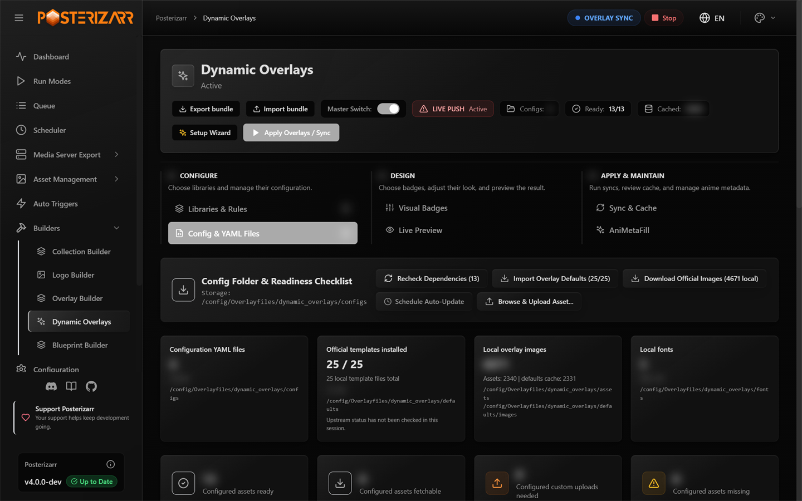

*Navigate to **Builders > Dynamic Overlays > Config & YAML Files** to manage YAML, assets, fonts, and readiness.*

Use **Export bundle** in the Dynamic Overlays header to download
`posterizarr-overlays.zip`. This is separate from Blueprint exports and raw
YAML uploads. It contains custom overlay YAML, required custom images (including
resolution badges), fonts, visual layouts, rating-source selections, and portable
feature settings such as AniMetaFill styling and enablement. Required custom
resources are collected from the active overlay directory and shared
`Overlayfiles`, `overlays`, and `fonts` folders. Unused asset catalogs, caches,
backups, and temporary previews are excluded.

Official Kometa files are identified against the public repository's file
checksums. Byte-identical, downloadable defaults, images, and fonts are recorded
as dependencies rather than copied into the ZIP. Locally modified files remain
included even if they use a standard filename. Export needs access to GitHub
to verify the official catalog; it does not download the default asset files.
After import, use readiness checks to download missing official dependencies
before syncing.

API keys, tokens, passwords, media-server connections, and the main application
configuration are not exported. Import does not replace existing provider keys
with blank, null, or masked values and does not change the destination media server.
Credentials required by imported features must already be configured locally.
Known credential values found in ordinary exported text are replaced with
`[REDACTED]` instead of aborting the export. Binary assets are never blindly
rewritten; an asset containing credential data still requires metadata cleanup.

To import a bundle:

1. Select **Import bundle** and choose the ZIP. Inspection alone changes nothing.
2. Map each source profile to an existing library on the destination server, or
   leave it at **Skip this profile**. Foreign library names are never created
   automatically; movie/show types must match.
3. Choose **AniMetaFill** and **Season ratings** for the mapped show libraries.
   **Restore feature settings** also restores the exported rating sources,
   styles, and enabled states. Leave it off to import layouts/assets without
   replacing shared feature preferences.
4. Review any conflicting shared YAML/assets. Replacing them requires explicit
   confirmation and can affect other libraries using those same files. Changed
   files are backed up under `dynamic_overlays/bundle_backups/`; each backup has
   an `index.json` recording its original destination paths.
5. Confirm **Import bundle**. Review the imported layout in preview and Dry Run
   before deliberately enabling uploads. The import itself uploads no artwork
   and always sets change detection to **Dry Run**, including when shared
   feature settings are not restored.

The import review preserves the local server selection and only lists libraries
available from that server. Refresh the server's library list first if it is
empty. An active overlay or AniMetaFill run blocks imports.

!!! note "Portable settings, not a database clone"
    Ratings caches, IMDb indexes, server item IDs, and manual episode/season
    mappings are not transferred. The local IMDb feature flag can be restored,
    but its datasets must be downloaded separately. AniMetaFill classification
    can be regenerated against the mapped local libraries. Remote-only or missing
    dependencies are not downloaded during export; use readiness checks after
    import. Only share fonts and artwork you have permission to redistribute,
    and only import bundles from sources you trust.

Bundles are limited to 128 MiB compressed, 256 MiB expanded, and 2,048 files.
Archive paths, checksums, file types, and library mappings are validated before
files are written. A failed file-replacement step restores the prior files.

### Importing an Existing Configuration

Upload `config.yml` or `config.yaml` together with any referenced custom overlay
YAML files. Readiness reports missing dependencies separately from YAML syntax
errors. Blank optional `libraries`, `overlay_files`, and `template_variables`
sections are accepted by the current importer as empty containers. Existing
nonempty values are retained, and uploading does not rewrite the YAML bytes.

If an older build reports `argument of type 'NoneType' is not iterable`, upgrade
the backend. As a workaround for a blank variables block, use
`template_variables: {}`. Never replace a populated variables block with an empty
one; its values define the overlay's behavior.

### Provider Ratings and Score Layout

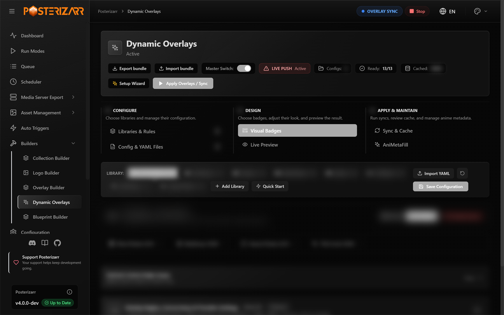

*Navigate to **Builders > Dynamic Overlays > Visual Badges** to choose rating sources and adjust badge layout.*

Provider badges support IMDb (`imdb`), Rotten Tomatoes critics (`tomatoes`),
Rotten Tomatoes audience (`tomatoesaudience`), TMDb (`tmdb`), Trakt (`trakt`),
Metacritic (`metacritic`), Letterboxd (`letterboxd`), SIMKL (`simkl`), and
MyAnimeList (`mal`). Choose providers in
**Visual Badges** or **Live Preview**. The initial IMDb/RT Critics/TMDb selection
is a default, not a three-provider limit. Cached ratings are independent of this
selection; cached values do not automatically enable their badges.
Live Preview uses sample values, not the selected item's cached ratings.
Incremental episode overlay syncs reuse unexpired ratings caches even when some
selected provider scores are missing. Missing scores alone do not trigger another
provider lookup or extend the cache expiry. Use **Ratings Cache & Refresh** to
explicitly fetch missing scores; automatic refresh keeps its existing candidate
selection and retry policy. Expired or absent caches and full syncs still resolve
ratings, reusing the episode's cached IMDb ID when native metadata omits it.
When provider ratings are available, the built-in provider layout suppresses the
legacy `rating_high` / `user_rating` audience badges from imported overlay files,
so the old audience score is not drawn a second time.

Provider score controls are saved with the library and artwork-format layout:

| Setting | Behavior |
|---|---|
| Automatic fixed slots (`score_size_mode: auto`) | Reserve provider-specific score space so changing scores does not move the logo. |
| Custom fixed width (`score_size_mode: fixed`) | Set `score_width` from 16 to 600 reference-canvas pixels; narrower slots shrink only the number to fit. |
| Fit score content (`score_size_mode: content`) | Fit the backdrop to the current score while keeping the logo anchored. |
| Number side (`score_position`) | Place the number to the `left` or `right` of its provider logo. |
| Number alignment (`score_alignment`) | Align the number `left`, `center`, or `right` within automatic/custom fixed slots. Not used in content mode. |
| Automatic logo size | Provider logos grow proportionally with `font_size`. Standard font sizes retain their existing logo proportions. Increasing pill width or padding alone does not enlarge the logo. |
| Fixed logo height (`scale_height`) | An explicit value in the rating rule's `template_variables` fixes the logo height in reference-canvas pixels. Remove this override to restore automatic sizing with the font. |

Widths scale from the portrait 1000 x 1500 or landscape 1920 x 1080 reference
canvas to the output artwork. These controls affect multi-provider badges, not
the compact single-score badge. Previewing and saving do not upload artwork;
existing configurations without the new fields retain their legacy rendering.
DynamicOverlaysSync.log.oldDynamicOverlaysSync.log.old
### SIMKL Catalog Ratings

Open **Visual Badges > Overlay Engine, Concurrency & Provider Settings** and
enter the optional **SIMKL Client ID** beside the MDBList/OMDb credentials.
Use **Test** to verify it. This setting is independent of AniMetaFill: no
AniMetaFill setup, user login, or OAuth token is required for these public
catalog lookups. The same Client ID used in AniMetaFill can be entered here,
but it is not copied automatically and entering it does not enable AniMetaFill.
Create a Client ID at [SIMKL developer settings](https://simkl.com/settings/developer/).

The resolver reads existing server ratings and TMDb/MDBList first, then uses
SIMKL for missing selected IMDb/SIMKL/MAL values before the OMDb fallback.
OMDb is queried only for selected missing scores it can supply. External IMDb,
TMDb, or TVDb IDs are resolved through SIMKL's `/redirect` without following
the HTML redirect, then the matching movie/TV/anime detail endpoint is read.
SIMKL does not replace valid scores already resolved in the same lookup.

Select **SIMKL** or **MyAnimeList** in the provider selectors to display those
distinct scores. A newly selected missing SIMKL/MAL value can be fetched even
when other scores are already cached. Scores and their SIMKL source link are
saved in the existing ratings cache; expired cached SIMKL/MAL sources are also
refreshed by the ratings-refresh job. Missing optional logo images use explicit
`SIMKL`/`MAL` text labels; custom image overrides remain available.
The MAL badge uses the official `rating/MAL.png` asset. After selecting
MyAnimeList, use **Config & YAML Files > Download All Available** if that logo
is listed as missing/fetchable. Existing custom `MyAnimeList.png` files are
also supported. With the logo present, the badge shows the logo and numerical
score separately; the logo follows the configured font size unless a fixed
`scale_height` overrides it.

SIMKL title ratings are never used as episode ratings. The documented TV/anime
episode-list responses do not contain rating fields. Missing title/provider
scores remain absent; zero or invalid scores are ignored. The cache browser
links to the specific SIMKL title for attribution. API calls identify Posterizarr
and do not log the Client ID or request URLs. Existing cache TTLs still apply;
refreshing cached scores does not itself upload artwork.

See [SIMKL ratings](https://api.simkl.org/api-reference/ratings.md),
[rate limits](https://api.simkl.org/resources/rate-limits.md), and
[API rules](https://api.simkl.org/api-rules.md).

### Local IMDb Dataset

Open **Builders > Dynamic Overlays > Sync & Maintenance > Ratings Cache > Browse Ratings** to open
**Ratings Cache & Refresh**. Enable **Local IMDb Dataset**,
then select **Download & Update** and confirm the import. This optional source is
disabled by default. It downloads the official `title.ratings.tsv.gz`,
`title.episode.tsv.gz`, and `title.basics.tsv.gz` files from
[IMDb](https://datasets.imdbws.com/). IMDb permits these datasets for
[non-commercial use only](https://data.imdb.com/non-commercial-datasets/).
Downloads can exceed 1 GB compressed; allow several GB of free disk space and
time for the initial indexing, especially on a NAS. Files are streamed to disk
and imported in bounded batches, not loaded entirely into RAM.

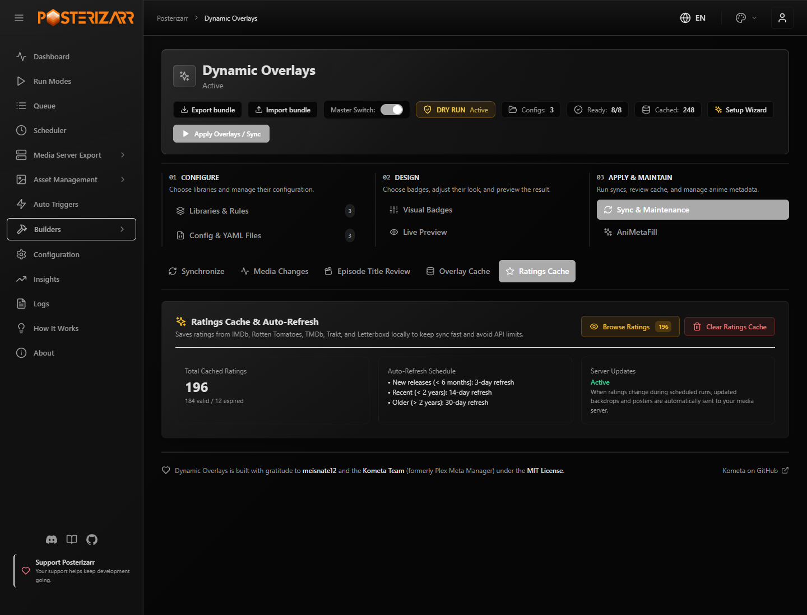

*Navigate to **Builders > Dynamic Overlays > Sync & Maintenance > Ratings Cache**, then choose **Browse Ratings** to open Local IMDb Dataset and the ratings cache.*

*Development-build screenshot with illustrative cache counts. The local IMDb
dataset controls are inside **Browse Ratings**, not on this overview. The counts
shown are example data, not download requirements or a performance benchmark.*

The index and explicit episode mappings are stored in
`database/imdb_dataset.db` under the normal application data directory. Only
rated episodes and series titles are indexed for matching; ratings are available
by IMDb ID for movies and shows too. Season lengths are additionally derived from
the complete episode list, including unrated episodes. Import runs in a background thread. A failed
import keeps the previous published index and manual choices. After the first
successful manual import, the background ratings scheduler checks for an update
every 24 hours while Dynamic Overlays and this source are enabled. Failed
automatic attempts wait 24 hours; **Download & Update** can retry sooner.

When IMDb is selected as a rating source, the resolver uses the local index
before external providers to fill a missing IMDb rating. A known episode IMDb
ID is preferred. Otherwise, matching is restricted to the identified IMDb
series and requires an exact normalized episode-title match (case and
punctuation ignored). A cached parent IMDb ID or a unique series title, optionally
qualified by the series year, identifies the series. TRaSH-style filenames such
as `One Piece (1999) - S21E83 - 974 - Oden Wouldnt Be Oden If It Wasnt Boiled! [German].mkv`
provide the English title and absolute number independently of the Plex display
language. For anime, include the absolute episode number in the filename; see the
[TRaSH Guides recommended anime naming scheme](https://trash-guides.info/Sonarr/Sonarr-recommended-naming-scheme/?h=naming#episode-format).
The year disambiguates same-name remakes. In the recognized TRaSH-style filename,
the resolver converts the absolute number across consecutive IMDb seasons using
the complete imported season lengths, so it does not depend on TVDB season order.
Specials are excluded from the absolute count. Before accepting a rated absolute
candidate, its normalized IMDb title must match the episode title or filename
title. Articles may differ anywhere in the title, but all other words must match
in the same order. A content-word conflict or translated title is
shown for manual review instead of being used as a confirmed rating. If the
absolute number does not point to a rated episode, the same conservative title
matching is still tried.
Ambiguous series/titles are not automatically assigned. This is not limited to
anime, but does not guarantee matches for every language or filename format.

For unclear cases, filter the cache to **Episodes** and select the row's
**Episode IMDb Mapping** sliders icon. Search the local index by episode title
or IMDb ID, review the candidate's series and IMDb numbering, and save a candidate
or enter a rated episode's IMDb ID. **Automatic** removes the manual override.
Saving updates only the row's IMDb ID/rating; other source scores and cache TTL
are retained. Explicit manual choices take precedence even during a forced
refresh. Search and save do not call rating-provider APIs or upload artwork.
An ordinary ratings refresh can collect missing filename/series context; an
overlay sync applies the updated ratings to artwork afterwards.
With this source enabled, completely scoreless episodes encountered by the
resolver receive an expired cache placeholder, so they can be corrected in the
same dialog without being presented as successfully refreshed. The dataset
panel and episode dialog both include an expandable **How matching works**
section explaining IMDb IDs, conservative title matching, absolute numbering,
and the precedence of manual choices.

For TVDB seasons that belong to a separate IMDb series (for example an anime
continuation), open an episode's mapping dialog and select **Entire season**.
Enable **Override IMDb series for this season**, enter the continuation's
**IMDb series ID**, and set its **IMDb season** and **Episode offset (+/-)**.
The target episode number is the local episode number plus the offset: local
episode 13 with an offset of -12 becomes IMDb episode 1. The dialog previews
the numbering for the selected episode. Refresh episode ratings first if the
series/season context is missing and the season option is disabled.

If one local season spans multiple IMDb seasons, enable **Continue across IMDb
seasons**. Numbering then continues through consecutive IMDb seasons starting
at the selected target season. For example, with 25 episodes in IMDb season 1
and an offset of 0, local S20E25 maps to S01E25 and S20E26 maps to S02E01;
the same rule can continue through S03 and later seasons. Specials (season 0)
are not included unless explicitly selected as the starting season. Missing
season boundaries or target episodes are not guessed. The local media-server
season number remains unchanged.

After updating from a version without this option, run **Download & Update**
once to populate complete season lengths, then enable continuation and save
the mapping again. Existing mappings remain fixed to their chosen target season
until continuation is enabled. The preview uses the same imported season lengths.

Saving updates IMDb IDs/ratings for already indexed episodes of that season
on the same server; future episode lookups use the saved rule too. Individual
episode overrides still take priority. Missing target episodes are not guessed
from another series. Disable the season override and save to return to automatic
matching. Rules survive dataset updates and restarts. Other rating sources,
cache expiry and artwork are unchanged; sync overlays to update artwork.

Successful local lookups avoid OMDb requests when IMDb is the only remaining
score needed. OMDb or other configured providers may still be used for missing
Rotten Tomatoes/Metacritic/etc. values or unresolved IMDb titles. Importing the
dataset does not rewrite every ratings-cache row or automatically resync artwork.

### OMDb Run Protection

Each ratings-refresh job and overlay-sync run has its own OMDb request guard,
shared across that run's items, servers, episodes, and parallel sync workers:

- A confirmed quota/limit response, an explicitly invalid/unauthorized API key,
   or HTTP 429 disables further OMDb requests for the remainder of that run.
- Otherwise, three consecutive technical failures (such as an unexplained HTTP
   401, HTTP 5xx, or transport failure) disable OMDb for the remainder of the run.
   A successful response resets this consecutive-error counter.
- A missing title or a response without usable scores does not open the guard.

Requests already in flight can finish; new OMDb requests are skipped once the
guard opens. Other providers and normal cache fallback continue. Skipped OMDb
requests remain visible in provider diagnostics rather than pretending that a
missing score was successfully refreshed. Failed lookups do not clear existing
scores or renew their expiry. A partial lookup can still save fresh values from
other providers using the normal cache behavior.

The next run starts with a fresh guard and retries OMDb; the block is neither a
persistent setting nor a permanent key rejection. `RatingsRefresh.log` records
the reason when OMDb is disabled. Refresh-job results contain an `omdb` summary
with `requests`, `skipped`, `suppressed`, and `reason`; the overlay-sync log also
includes an OMDb run summary. OMDb JSON error bodies are interpreted on HTTP
errors too, so a documented quota response is distinguishable from an invalid
key. Raw provider error messages and API keys are not written to these diagnostics.

### Anime Season Ratings

Season rules can display real SIMKL/MAL ratings for the corresponding native
anime entry. They do not synthesize a season average. For example:

First select the allowed libraries under **Visual Badges > Overlay Engine,
Concurrency & Provider Settings > Libraries for Anime Season Ratings**, next
to the SIMKL Client ID. This is a multi-selection and defaults to empty.
Entering a SIMKL Client ID alone does not enable season mapping. Names match
exactly, ignoring case and surrounding whitespace; selecting `Anime` does not
select `Anime Shows`. The same selected library name applies across configured
servers. Saved names remain visible so an old or renamed selection can be removed.
Show/episode ratings and inherited show-score fallbacks are independent of this
opt-in. Running jobs use their settings snapshot; selection changes apply to
subsequent jobs.

```yaml
- default: ratings
   template_variables:
      builder_level: season
      sources: [imdb, simkl, mal]
```

Automatic mapping uses the parent show's TVDb ID and compares the local season's
episode numbers with the anime's TVDb episode coordinates. It requires one
native anime entry covering exactly that whole season. Multiple cours, incomplete
episode coverage, missing mappings, or an incomplete catalog lookup do not result
in a guessed selection. This assumes the media server uses the corresponding
TVDb episode ordering; use a manual mapping when its ordering differs.

**Show scores remain as fallbacks per provider.** A confirmed MAL season value
replaces the inherited MAL value, but an IMDb show score remains until an actual
IMDb season source exists (this integration currently keeps the IMDb show fallback).
Missing season values never erase the inherited show
scores. The season ratings cache contains only the season's own SIMKL/MAL values,
not copies of the fallbacks used for rendering.

In **Sync & Maintenance > Ratings Cache > Browse Ratings**, select **Seasons**, then use the
row's **Season rating mapping** action. Choose a discovered anime/cour entry,
enter a positive **SIMKL Anime ID**, or restore **Automatic (exact season match)**.
The linked MAL ID is read from that anime entry. Saving starts a ratings-only
refresh; existing season values are invalidated when the choice changes so scores
from different entries are not mixed. Mapping changes are refused while a sync or
ratings-refresh job is active. The next appropriate overlay sync applies the
updated values to artwork; saving the mapping itself does not upload images.

Mappings and selected SIMKL/MAL IDs survive restarts, separately from the ratings
cache. With a configured SIMKL Client ID and an explicitly selected library,
hourly ratings refresh includes expired season entries, missing season entries already represented in the overlay cache,
and season entries with incomplete SIMKL/MAL scores. Related-title catalog data is
reused within a run. Discovery is limited to 32 anime entries; an unfinished lookup
requires manual selection rather than guessing. A provider outage preserves any
previously confirmed season scores and their expiry instead of renewing or
deleting them.

### Automatic Retry Schedule

While a ratings-refresh job is active, the desktop navbar shows **RATINGS REFRESH**.
Click the badge to open `RatingsRefresh.log`, or use its **Stop** action to cancel
only that refresh job. The badge disappears after completion or cancellation.
This status is independent of the main Posterizarr script and does not change
startup scheduling. The existing navbar polling checks every 15 seconds when
idle and every 5 seconds while a task is active.

The hourly ratings-refresh job selects candidates locally before querying media
servers or external providers. It does not retry every unavailable score on every
run:

| Situation | Automatic retry |
|---|---|
| Episode aired within the last 14 days, with missing selected IMDb/TMDb scores | Next hourly run, when the server reports its release date. |
| Older episode, unknown release date, unavailable scores, missing title/IDs, or metadata HTTP 404 | No sooner than 24 hours after the attempt. |
| Missing/incomplete/unavailable anime season mapping | No sooner than 24 hours after the attempt, and only in opted-in libraries. |
| Ambiguous season/cour mapping | Wait for manual selection or relevant locally recorded metadata/mapping changes. |
| Complete, unexpired scores | Existing score-cache expiry rules apply. |

The retry schedule is stored separately from scores in `ratings_refresh_retry`
and survives backend restarts without renewing score timestamps or expiry.
Relevant locally cached metadata changes, mapping-choice changes, or credentials
for providers used by that media type can release a hold. Selecting another anime
library does not restart unrelated episode retries. Provider credentials are
represented only by a hash in retry fingerprints, never stored in the retry record.
Automatic jobs report a **Deferred** count and log retry decisions.

Explicit manual refreshes, including **Refresh ratings now** and the manual bulk
action, bypass retry holds; **Mark expired** also clears the item's hold. Library
opt-in is still required for manual season refresh/mapping changes. Refreshing or
changing a mapping does not itself upload artwork. Old failed entries without a
saved retry decision can be checked once after upgrading before their hold is
recorded. Normal overlay-sync provider lookups are separate; an explicitly forced
sync can still query providers.

When the media server itself returns metadata HTTP 404, Posterizarr removes that
server/item's ratings, retry and season-mapping records, all cached overlay assets,
orphaned layer snapshots, and skipped-item record across `overlay_cache.db` and
`imagechoices.db`. Provider-side 404 responses do not trigger this cleanup.
Media-export history and provider caches keyed by shared TMDb IDs are retained.

### Rule Artwork Targets

In the rule's **Visual Settings**, use **Artwork Type** to choose **Both**,
**Posters / Titlecards Only**, or **Backgrounds Only**. This applies to native
`default:` rules and custom `file:` rules. In YAML, set `artwork_type` in
`template_variables`:

```yaml
overlay_files:
   - file: config/network_logos.yml
      template_variables:
         builder_level: show
         artwork_type: backdrop
   - file: config/format_badges.yml
      template_variables:
         builder_level: show
         artwork_type: poster
```

Allowed values are `both` (the default), `poster`, and `backdrop`.
`builder_level` still selects the media item level independently; `poster`
includes episode titlecards when the builder level is `episode`. Legacy
`builder_level: backdrop` also works for background-only custom file rules.
The global background-overlays switch must still be enabled to sync backgrounds.

### Episode Ratings

Episode rules use episode ratings, never the parent show's scores. Plex sync
reads episode-detail metadata for provider-labeled ratings and episode IMDb IDs.
TMDb lookup uses the show's TMDb ID plus the episode's season and episode
numbers, not the show's rating. When an IMDb ID is missing, TMDb episode external
IDs can resolve it for OMDb lookup. OMDb requires its configured API key.
Jellyfin and Emby use the episode's own provider IDs for external lookup.

The movie/show MDBList lookup is not used for episodes. The separate
`mdblist_episode` source can request MDBList's episode score when configured.
An unavailable episode/provider score is omitted instead of substituting
a show score or labeling an unidentifiable server score as IMDb. Consequently,
not every episode has every selected provider badge. After updating, run a full
overlay sync for the affected show to replace previously rendered titlecards.

Selecting only IMDb does not use a TMDb score when IMDb is missing. Enable TMDb
as an additional provider to display its available episode scores under its own logo.

### Language Priority and Parent Video Formats

Movie and episode language flags follow the configured `languages` order before applying
`overlay_limit`. For example, `[de, ja, en]` with a limit of two selects German
and Japanese when all three audio languages are present. Imported language
templates use their explicit language codes rather than their English overlay names.

Across movie, episode, show, season, and background artwork, selected flags are
displayed in configured priority order from top to bottom, even when the group
is anchored at the bottom. For `[de, en, ja]`, German is above English, then
Japanese if all three are selected. Frequency or hybrid rules still decide which
languages fit the limit; this display ordering does not add or replace selected
languages. Group position and spacing are preserved. Horizontal queues retain
their existing layout.

Show and season flags default to **Preferred language, then frequency**. The
**Show / Season Flag Selection** control in the visual language editor can switch
back to **Most frequent**. The default behavior is also available explicitly in YAML:

```yaml
- default: languages
   template_variables:
      builder_level: episode
      aggregate_parent_streams: true
      languages: [de, en, ja]
      overlay_limit: 2
      parent_language_mode: preferred_then_frequency
```

This selection mode does not enable additional artwork targets. Show or season
flags must already be explicitly configured with `builder_level: show`,
`builder_level: season`, or `builder_level: all`. An episode rule can explicitly
include parent artwork with `aggregate_parent_streams: true`, as in the example.
Episode-only rules without that opt-in remain episode-only, even when the hybrid
selection mode is enabled or other rules aggregate episode metadata.
The first configured language gets the first flag slot as soon as at least one
episode has it. Remaining slots follow frequency, then configured priority for
ties. With JA:40, EN:20, DE:1, the result is DE + JA; with DE:0 it displays EN + JA;
with JA:40, EN:40, DE:1 it is DE + EN. A flag means the language is available on
at least one episode, not necessarily the complete season or show. Missing
preferred languages are never fabricated. Omitting the option enables this hybrid
selection, including for existing rules. Set `parent_language_mode: frequency` to
disable the preference and rank by frequency, using configured priority for ties.
An explicitly saved `frequency` choice is preserved. Episode and background
selection rules are unchanged; their vertical display follows the same priority order.

Show and season resolution badges use the most common complete episode video
format: resolution, Dolby Vision, and HDR together. Each episode contributes one
format, so HDR-only and Dolby-Vision-only episodes do not create a combined badge.
Ties prefer the higher resolution, then Dolby Vision, then HDR. Corner badges use
the corresponding variant artwork when available, otherwise the plain resolution
artwork; portrait tier banners retain their existing resolution-only design.
Unrecognized Plex resolution labels fall back to reported video dimensions to
identify 4K, 1080p, 720p, or SD without depending on the codec/profile description.
After updating, run a full overlay sync for the affected shows and seasons.

## Folder Layout

The canonical location is `Overlayfiles/dynamic_overlays/` under the writable application data directory. In Docker this is normally `/config/Overlayfiles/dynamic_overlays/`; local installations use the application data/project root.

```text
Overlayfiles/
├── (asset-creation fonts and frame overlays, when configured)
└── dynamic_overlays/
   ├── configs/        # YAML configuration files (config.yml, anime_overlays.yml, etc.)
   ├── defaults/       # Downloaded Kometa-compatible YAML templates
   │   └── images/     # Images downloaded for those templates
   ├── assets/         # Custom/local overlay images
   └── fonts/          # Custom/local overlay fonts
```

Place Dynamic Overlays configuration and assets in `Overlayfiles/dynamic_overlays/`.

## Kometa Compatibility and Attribution

**Is Kometa built into Posterizarr as a plugin? No.** Dynamic Overlays is implemented and run by Posterizarr. It does not embed, launch, or require Kometa, and it is not a Kometa plugin. Posterizarr parses supported Kometa-style YAML itself and renders overlays through its own code. This is compatibility with selected configuration formats and rendering behavior, not full Kometa feature parity.

| Area | Posterizarr implementation | Kometa source / relationship |
|---|---|---|
| Coordinate placement and text/backdrop composition | [`overlay_engine.py`](https://github.com/fscorrupt/posterizarr/blob/main/webui/backend/overlay_engine.py) (`get_coordinates`, `draw_backdrop_and_text`) | Adapted from the coordinate and backdrop-rendering methods in [Kometa `modules/overlay.py`](https://github.com/Kometa-Team/Kometa/blob/master/modules/overlay.py). The Posterizarr module is an adaptation, not Kometa's runtime or a copy of the complete module. |
| Kometa-style config and defaults | [`overlay_resolver.py`](https://github.com/fscorrupt/posterizarr/blob/main/webui/backend/overlay_resolver.py) | Posterizarr reads and validates YAML itself. Downloaded default templates are upstream data from [Kometa `defaults/overlays`](https://github.com/Kometa-Team/Kometa/tree/master/defaults/overlays); they are not executable Kometa code. |
| Default overlay artwork and fonts | [`overlay_resolver.py`](https://github.com/fscorrupt/posterizarr/blob/main/webui/backend/overlay_resolver.py), [`overlay_engine.py`](https://github.com/fscorrupt/posterizarr/blob/main/webui/backend/overlay_engine.py) | Images and official fonts may be fetched from [Kometa's overlay images](https://github.com/Kometa-Team/Kometa/tree/master/defaults/overlays/images) and [fonts directory](https://github.com/Kometa-Team/Kometa/tree/master/fonts). Custom assets remain supported. |
| Sync, media-server APIs, preview, and cache | [`overlay_sync_service.py`](https://github.com/fscorrupt/posterizarr/blob/main/webui/backend/overlay_sync_service.py), [`overlay_preview.py`](https://github.com/fscorrupt/posterizarr/blob/main/webui/backend/overlay_preview.py), [`overlay_cache.py`](https://github.com/fscorrupt/posterizarr/blob/main/webui/backend/overlay_cache.py) | Posterizarr-native code; it renders and uploads directly to configured Plex, Jellyfin, and Emby servers. It does not call Kometa to perform these operations. |

The rendering adaptations are attributed under the MIT License below. Upstream templates, images, and fonts remain Kometa project assets; see their source repository for the applicable project license and notices.

---

## Supported Overlay Types

| Overlay Type | Target Level | Source Metadata | Description |
|---|---|---|---|
| **4K Quality Banner** | Movie Posters & Titlecards | Stream video resolution (`width >= 3840` or `4K`) | Diagonal top banner on posters or corner badge on episode cards. |
| **Audience Rating** | Movies & Shows | Audience / critic score (IMDb, TMDb, Plex) | Color-tiered badge (High $\ge 6.5$, Mid $4.5-6.4$, Low $<4.5$) + formatted score text. |
| **Series Status** | Shows | Series status (`Airing`, `Returning`, `Ended`, `Canceled`) | Optical centered status banner with status colors (`Colus-Regular.ttf`). |
| **Runtime** | Movies & Titlecards | Stream duration (`RunTimeTicks` / `duration`) | Clean duration badge (e.g. `124 min`, `24 min`). |
| **Audio Languages** | Movies & Titlecards | Audio streams present in media item | Square badges or flags for audio languages (e.g. `de`, `en`, `ja`). |
| **Subtitle Languages** | Movies & Titlecards | Subtitle streams reported by the media server | Reuses the audio-language flag images, with independent placement and language selection. |
| **Aspect Ratio** | Movies & Titlecards | Video display aspect ratio, or video width/height as a fallback | Kometa aspect badges such as `1.78` and `2.35`; unknown ratios do not receive a badge. |
| **Audio Codec** | Movies & Titlecards; Shows & Seasons with parent stream aggregation | Audio codec, stream profile, track title, and filename | Dolby Atmos, TrueHD, DTS-HD MA, DTS:X, AAC, and other codec badges. |
| **Video Source** | Movies & Titlecards | Media filename/path | WEB-DL/WEBRip, Blu-ray, Remux, HDTV, DVD, and similar source labels. This is separate from resolution and HDR. |
| **Studio Logos** | Movies & Shows | Studio metadata reported by the media server | Studio branding using `default: studio`. |
| **Streaming Services** | Movies & Shows; optionally Seasons & Titlecards | Regional TMDb / JustWatch availability | Multiple service logos, separate from studios and networks. Subscription availability is the default. |
| **Anime Filler Tag** | Anime Episodes | `anime_overlays.yml` episode regex match | "Canon" (Green), "Filler" (Red), or "Mixed" (Orange) badge on episode titlecards. |
| **Network Logos** | Seasons | Studio / TV Network | Official network logo (e.g., Netflix, HBO, Disney+, Apple TV+). |
| **Common Sense Media**| Movies | Common Sense Media age rating | Age rating badge (e.g., 10+, 14+, 18+). |

Generated AniMetaFill episode regexes include a numeric boundary so an episode such as `S21E16` cannot accidentally match `S21E161`. After upgrading a version that fixes older generated regexes, run AniMetaFill sync to regenerate `anime_overlays.yml`, then run Dynamic Overlays sync to update existing titlecards.

---

## Web UI Features

Navigate to **Builders $\to$ Dynamic Overlays** in the Posterizarr Web UI:

### Sync & Maintenance Views
The former **Sync & Cache** page is split into **Sync & Maintenance** views:

| View | Contents | Direct Link |
| --- | --- | --- |
| **Synchronize** | Sync controls, automatic application to new media, sync log | `/dynamic-overlays?tab=sync` |
| **Media Changes** | Metadata monitoring, detected changes, intervals, Dry Run | `/dynamic-overlays?tab=media-changes` |
| **Episode Title Review** | Historical title comparison, optional title automation, recreation through the queue | `/dynamic-overlays?tab=episode-titles` |
| **Overlay Cache** | Cache statistics, browser, cleanup, recently updated artwork | `/dynamic-overlays?tab=overlay-cache` |
| **Ratings Cache** | Ratings cache, refresh controls, Local IMDb Dataset | `/dynamic-overlays?tab=ratings-cache` |

The selected view is retained in the URL and local preference. The legacy
`tab=cache` link opens Overlay Cache. Changing views does not stop running jobs.

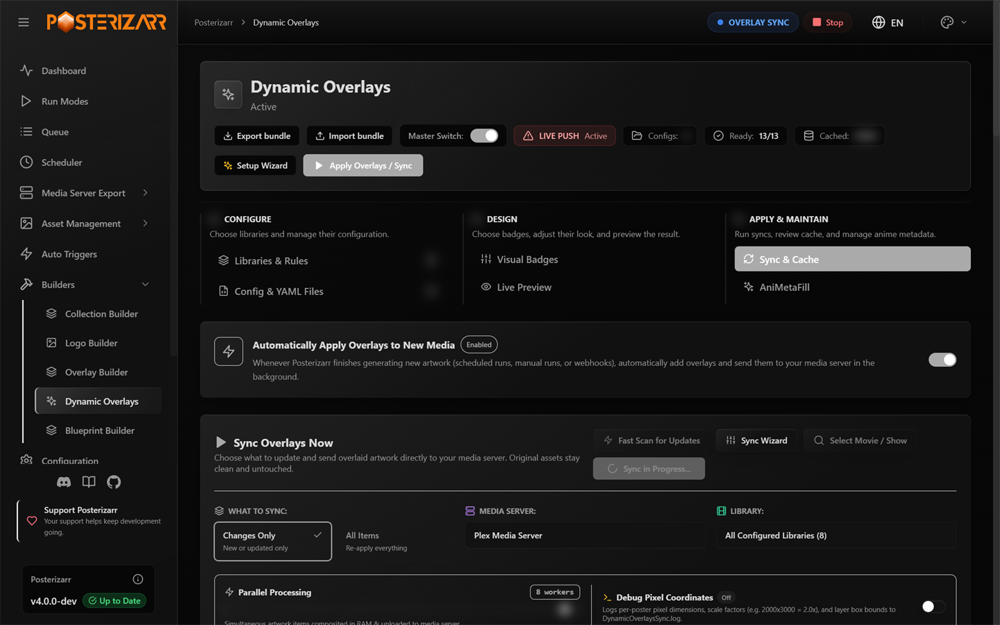

*The Synchronize view contains sync controls, automatic application to new
media, and the sync log. These development-build screenshots use illustrative
libraries and counts; no live artwork jobs were run to create them.*

#### Background Change Detection & Dry Run

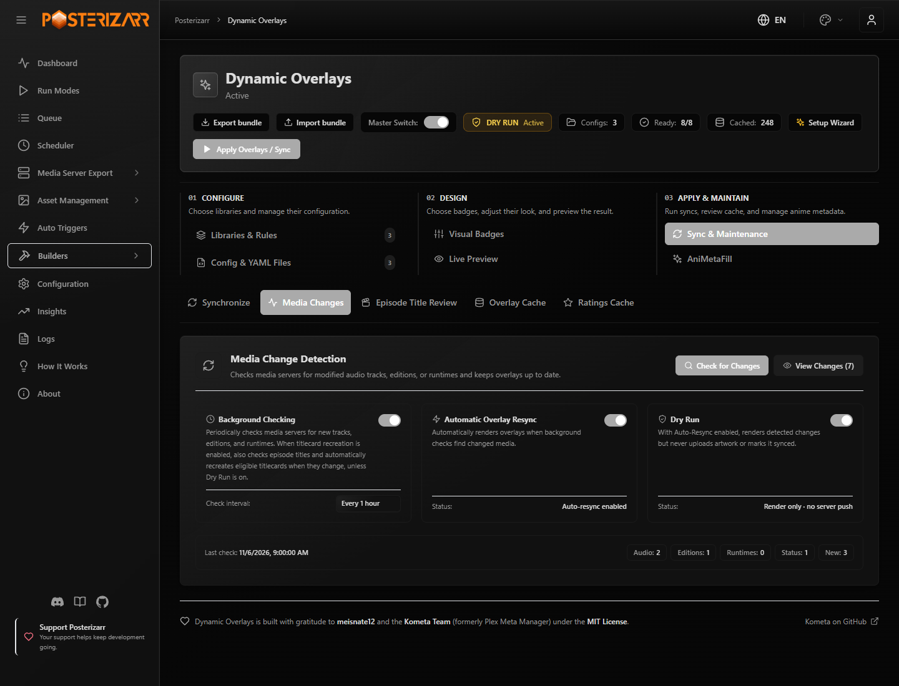

*Open **Sync & Maintenance > Media Changes** for Background Checking, its check
interval, Automatic Overlay Resync, and Dry Run. The background-check description
also covers optional episode-titlecard recreation.*

- **Background Checking** controls whether media metadata is periodically checked for changes; it is enabled by default and checks hourly.
- **Automatic Overlay Resync** controls whether detected changes start the overlay render pipeline.
- **Dry Run** is enabled by default. Syncs still evaluate rules and render changed artwork, but never upload it to a media server or mark it synced in the cache. This applies to automatic and manual syncs.
- Turn off **Background Checking** as well to stop periodic change scans entirely.
- The **Master Switch** is the hard stop: when disabled, background detection and sync processing do not run. Switching it off also stops the detector and cancels active sync work before any subsequent upload.

#### Recreate Episode Titlecards When Titles Change

**Sync & Maintenance > Episode Title Review > Recreate episode titlecards when titles change** is
optional and off by default. With the Master Switch and Background Checking on,
it compares titles at the configured background-check interval. The default
interval is 60 minutes, and the first check waits for that interval. Automatic
recreation applies to later title changes; existing historical review candidates
remain manual. It is independent of **Automatic Overlay Resync**. Keep **Dry Run**
on to log eligible changes without recreating files or uploading artwork; turn it
off to apply changes.

The monitor supports only existing episode titlecards on Plex, Jellyfin, and
Emby. Movie/show posters, season posters, backgrounds, and collection posters
are excluded from this title-change automation. Their normal generation and
overlay workflows are unchanged. The monitor uses stable episode IDs after the
initial match, so a title change does not rename asset folders. Initial matching
uses the library, season and episode together with the media server's show-folder
name or provider IDs, including tags such as `[tvdb-452595]` in asset folder names.
Plex show locations are fetched when bulk listings omit them; different mount
prefixes and localized display titles do not prevent folder matching. Ambiguous
matches are skipped. No previous overlay sync is required. The first
successful scan also compares the episode title recorded in ImageChoices with
the current server title. Existing differences become historical review
candidates, including when an older version already established a baseline.
The scan itself never recreates historical titlecards automatically.

Open **Sync & Maintenance > Episode Title Review** and select **Compare titles** for
an initial, read-only artwork audit. The table shows the existing image, series,
episode number, previous title, current title, and eligibility. Historical rows
are explicitly review candidates: ImageChoices is not an exact rendering log,
and unknown or truncated historical text cannot be safely recreated automatically.
Missing sources, textful sources, and placeholder titles remain visible with a
blocking reason. Unmatched episodes and missing image files are not guessed.
Use the status, blocking-reason, and review-type filters together with the search
field to narrow results across all pages. The eligible count and bulk actions use
the active filters, not only the rows currently visible on screen.

Images originally taken from a media server are never reused for recreation,
even when their URL is public or their stored language is Textless. The server
may now return a titlecard with existing overlays rather than the original image.
These rows show **Original was taken from a media server** and are excluded from
normal, bulk, automatic, force, and resumed-queue recreation. The backend logs
that a provider original is required; it does not fetch another media-server
thumbnail or silently perform a provider search.

For **media-server source** and **missing-source** entries, use the row's
**Choose a provider image in Asset Replacer** action. It opens the existing
Asset Replacer on its provider tab with the series, library, folder, season,
episode, and current episode title prefilled. Available series provider IDs
are carried into an automatic, read-only provider lookup when opened from this
review. The provider previews and modal header show the target `SxxExx` coordinates
as UI labels only; they are not added to the image. Choose a result to continue
with the modal's normal replacement or queue workflow. The original media-server
URL is never preselected as the new source.
Opening or queueing a replacement does not acknowledge the review entry as
completed. The Master Switch must be on and Dry Run off to open this replacement
workflow from the review.
Use **Hide this review entry** on a media-server-source row to dismiss it when no
provider original exists. The dismissal persists across scans for that same title
and source; a later title or source change can create a new review entry.

If only the previous image text is unknown, the row can offer **Force recreate
this episode titlecard**. This explicit action requires a stored
HTTP(S) source marked **Textless** and a current non-placeholder episode title.
Its separate warning confirms that the old text cannot be verified and that the
existing titlecard will be replaced. It does not bypass missing/textful sources,
Dry Run, the Master Switch, or episode/server validation. Unknown-text rows remain
excluded from automatic recreation and ordinary selected/all-eligible actions.
Enable **Include uncertain previous text** to include safe unknown-text rows in
page selection and bulk processing. Both Queue and Fast actions support selected
episodes or all matching candidates across pages, respecting the current search
and filters. A separate bulk warning confirms replacement despite uncertain old
text. Missing, textful, media-server sources and placeholder titles stay blocked.
For uncertain rows that cannot safely be forced, the status also shows the
additional blocking reason. Their action opens **Choose a provider image in
Asset Replacer** instead of leaving a disabled recreate button. This allows an
explicit replacement with a new original without reusing an unsafe source.
Titles such as `Folge 7` and `Episode 2` remain placeholders for automatic and
forced source reuse. Comparison and recreation diagnostics are recorded in the
dedicated `EpisodeTitleChanges.log`, not the backend/browser UI logs.
The explicit override is retained in the existing queue if the job is resumed.
After updating from an earlier version, run **Compare titles** once to refresh
source eligibility for already cached review entries.

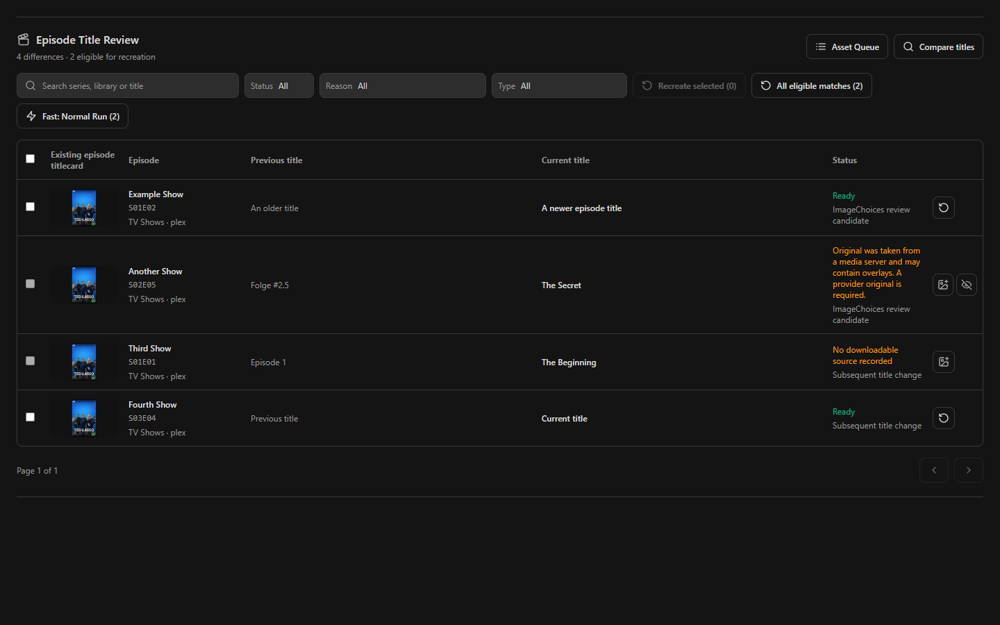

*Illustrative review records show two historical candidates and one
media-server-source block. Artwork thumbnails are existing published showcase
examples, not results from a live title scan.*

Title comparisons ignore uppercase/lowercase differences, including accented
characters. Existing case-only candidates are hidden and removed by the next
successful scan without rendering or uploading artwork. Displayed titles and
the original text in ImageChoices are preserved; actual wording changes still
remain review candidates.

Use the row's recreate action for one episode, select several entries with the
checkboxes, or choose **All eligible matches**. The all action includes every
eligible result of the current search, not just the current page. Each action
requires confirmation. Manual recreation does not require the automatic title
option or Background Checking, but the Master Switch must be on and Dry Run off.

For a one-time bulk rebuild, **Fast: Normal Run** temporarily backs up and removes
the eligible local titlecard files matching the current search, then starts the
ordinary parallel Normal Mode. Artwork on the media server is not deleted. The
normal run scans configured libraries, so it may also create other missing assets.
If the run fails or does not generate a replacement file, the previous local
titlecard is restored. The existing queue action remains available for slower,
per-episode processing without a full Normal Mode run.
While it runs, the review shows preparation, Normal Mode, and local-file
finalization phases with elapsed time. Normal Mode does not report per-review-item
progress, so the display uses an indeterminate bar and does not invent an ETA.
The fast-run status ends after local generation and restoration; it does not wait
for separately triggered Dynamic Overlay Sync jobs to finish.
When **Auto Overlay Sync** is enabled, the ImageChoices watcher batches generated
rows after a short quiet period and flushes pending rows at run completion. A long
run can therefore produce multiple overlay-sync batches rather than one sync for
the entire set. With Auto Overlay Sync disabled, that follow-up sync is not started.

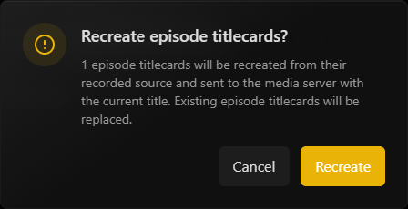

*With Dry Run off, single, selected, and all-eligible recreation actions require
confirmation. This screenshot shows the dialog only; the example job was cancelled.*

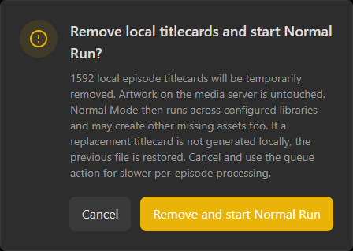

*The fast action is limited to eligible local review assets. Media-server artwork
is retained; the normal run may process other missing assets in configured libraries.*

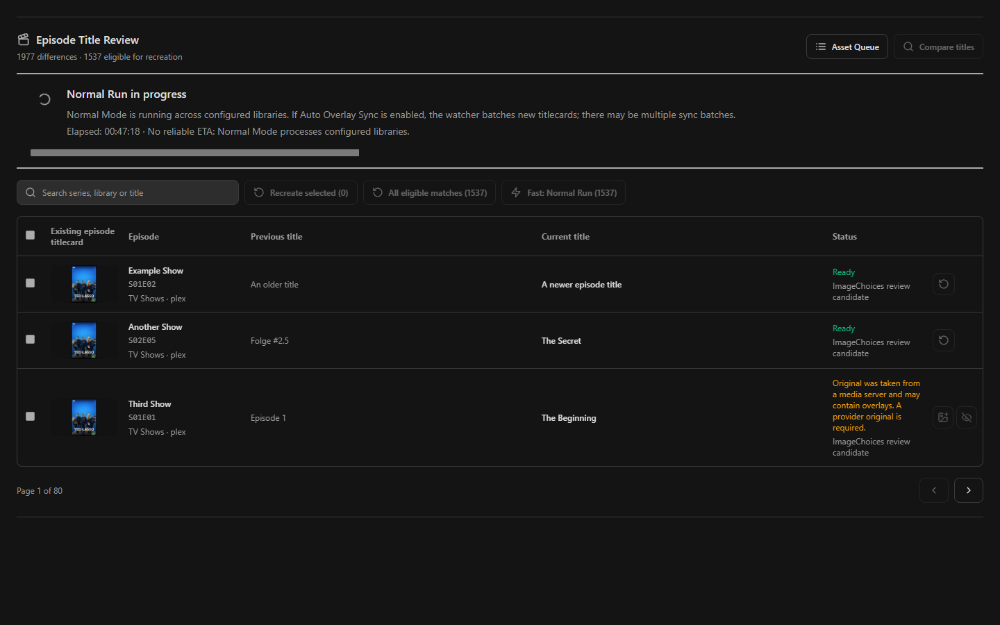

*The status reports elapsed time and the current phase. Normal Mode does not expose
per-episode progress; final counts report recreated titlecards and local originals restored.*

Confirmed recreation uses the existing **Asset Queue** and queue processor,
not a separate rendering worker. The queue contains a dedicated episode-title
operation referencing the persisted review candidate. Pending/processing
duplicates are reused. Only the selected queue IDs are started; unrelated
pending replacements are not processed. Progress and failures are visible in
the review and the ordinary queue. Cancelling stops before the next episode;
remaining queue entries stay pending and can be resumed from the queue. Failed
entries retain their review candidate for retry. A successful render and server
upload acknowledge the new title and remove its review entry.

Queue-owned title recreation also owns its overlay handoff. Its runtime metadata
marks that ownership and identifies the completed ImageChoices CSV, so the log
watcher still imports/broadcasts the generated asset but does not start a second
competing sync, including delayed file notifications. Ordinary manual runs keep
their existing automatic overlay handoff.

Only title metadata is stored in `overlay_cache.db`; no additional original-image
cache or image backup is created. For an eligible change, the existing manual
generator downloads the recorded `DownloadSource` again and uses the current
rendering settings. The source must be a public provider HTTP(S) URL recorded as
**Textless** in ImageChoices. Missing/local sources, sources with existing text,
ambiguous matches, and missing asset files are skipped. This is not a new artwork
search and cannot translate text already baked into a provider image. Custom
per-asset edits or previously used one-off blueprint overrides are not restored;
the current generator configuration governs the rebuilt asset.

Generic episode placeholders such as `Episode 2`, `Folge #2.2`, `TBA`, and
`Untitled` are not treated as finished replacement titles. Titlecards that were
never created still need the ordinary generation workflow. Only the affected
episode titlecard is rebuilt and passed to a targeted overlay sync. If the
library has no dynamic-overlay rules, the titlecard is sent directly to its
exact episode item. A failed generation or upload leaves the title change pending.
Historical candidates remain manual-only across subsequent scans; only later
title changes on otherwise reconciled episodes qualify for the optional automatic
workflow. A series-title change alone does not recreate its episodes.
The legacy setting key `regenerate_assets_on_title_change` is retained for
compatibility but now applies exclusively to episode titlecards.
Progress is logged under `[TitleChanges]` in the backend log;
rendering uses the existing manual-run log and targeted overlays use
`DynamicOverlaysSync.log`.

#### Overlay Cache View

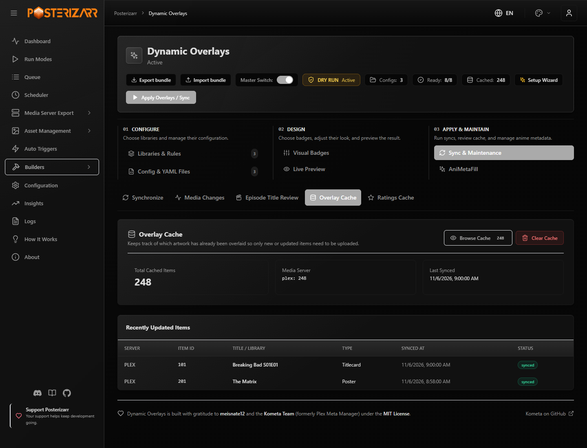

*Open **Sync & Maintenance > Overlay Cache** to inspect cache statistics,
**Browse Cache**, and recently updated artwork. Ratings use the separate
**Ratings Cache** view shown in the [Local IMDb Dataset](#local-imdb-dataset)
section. Counts and listed updates in these screenshots are illustrative.*

### 0. Guided Onboarding Setup Wizard
- **Zero Confusion Onboarding:** A friendly 4-step visual wizard guides new users through the engine's core concepts, eliminating manual reading.
- **1-Click Turnkey Configuration:** Instantly applies battle-tested overlay presets for Movies (4K badges, ratings, runtime, age ratings), TV Shows (status banners, network logos, episode runtimes), and 16:9 Backdrops.
- **Direct Multi-Config Upload:** Migrating from Kometa or PMM? Directly select or drag-and-drop multiple YAML config files at once (`config.yml`, `overlays_tv.yml`, `overlays_movies.yml`, `anime_overlays.yml`, etc.). Posterizarr automatically validates YAML syntax, imports API keys, and maps rules to your media libraries.
- **Interactive Visual Studio Tour:** Introduces the live preview canvas, drag-and-drop badge movement, rule-of-thirds guides, and per-format customization (keeping show posters and episode titlecard resolution badges safely isolated).
- **Always Accessible:** Reopenable anytime via the **Setup Wizard** button on the Dynamic Overlays header.

### 1. Importer & Pre-flight Validator
- **Config Scanner:** Detects YAML files in `Overlayfiles/dynamic_overlays/configs/`.
- **Readiness Checklist:** Automatically lists every font, image, and template required by your YAML files.
- **1-Click Remote Fetch:** Automatically downloads missing templates and badges from official GitHub repositories.
- **Import Kometa Defaults (from GitHub):** Download official Kometa default overlay templates directly from GitHub into `Overlayfiles/dynamic_overlays/defaults/`.
- **Scheduled Auto-Updates (GitHub Sync):** Automatically keeps templates up to date via the Scheduler (`kometadefaults` run mode). The scheduler queries GitHub's API to discover newly added defaults and updates existing templates with upstream improvements. Can be scheduled on daily, weekly, or custom cron intervals, or enabled via 1-click Quick Schedule directly from the Dynamic Overlays page.
- **Direct Asset Uploader:** Easily drop custom fonts (`.ttf`, `.otf`) or badge PNGs directly into the UI.
- **Per-variant Asset Overrides:** Select a local image for a Kometa default and variant key (for example `resolution / 1080p` or `audio_codec / truehd_atmos`). Existing `file_<key>` values are imported from Kometa YAML; selections are written back to Kometa-compatible YAML and the Visual Config. The picker lists local assets from `assets/` and `defaults/images/`; import official images or upload custom artwork first. Custom/default names can also be entered for imported or hand-written rules.

### 2. Active Libraries & Rules
- **Interactive Rule Management:** View, add, edit, or remove overlay rules directly on each library card.
- **Add Library:** Click **+ Add Library** on the toolbar to register new server libraries (e.g., *Anime Shows*, *4K Movies*, *Kids TV*) into `config.yml`.
- **Remove Library / Rules:** One-click removal with confirmation and automated `.bak` backup generation.
- **Visual Variable Editor:** Customize `builder_level` (Movie, Show, Season, Titlecard), horizontal/vertical offsets, alignments, and transparent/solid back colors without writing code.
- **Raw JSON & YAML Mode:** Switch tabs to edit raw template variables, or click **Edit Raw config.yml** to modify the complete YAML configuration with instant syntax validation.

#### Recommended Defaults & Level Guide

| Overlay Need | Recommended Source | Target `builder_level` | Purpose / Appearance |
| :--- | :--- | :--- | :--- |
| **Media Runtime** | `default: runtimes` | `episode` or `movie` | Display duration badge (e.g., `124 min`, `24 min`). |
| **Audio Languages** | `default: languages` | `episode` or `movie` | Language stream flags / pills (e.g., `DE`, `EN`, `JA`). |
| **Subtitle Languages** | `default: languages`, `use_subtitles: true` | `episode` or `movie` | Separate subtitle flags using the same flag artwork as audio languages. |
| **Aspect Ratio** | `default: aspect` | `episode` or `movie` | Display aspect ratio, separate from pixel resolution. |
| **Studio Logo** | `default: studio` | `movie` or `show` | Studio branding, separate from TV network logos. |
| **Ratings** | `default: ratings` | `movie` or `show` | Audience / Critic ratings (IMDb, RT, TMDB, Metacritic). |
| **TV Network** | `default: network` | `season` | Network logo on season posters (HBO, Netflix, Disney+). |
| **Series Status** | `default: status` | `show` | Airing, Returning, Ended, or Canceled banner on shows. |
| **Common Sense Media** | `default: commonsense` | `movie` | Age rating badge (e.g., `10+`, `14+`, `18+`). |
| **4K Quality Ribbon** | `default: resolution` or `file: config/overlays_movies.yml` | `movie` or `episode` | 4K UHD, 1080p, HDR badges/ribbons. |
| **Anime Filler Tag** | `file: config/anime_overlays.yml` | `episode` | Canon / Filler / Mixed tag on anime episode titlecards. |
| **Corner Ribbon** | `default: ribbon` | `movie` | Corner ribbon badge for resolution or editions. |
| **Streaming Platform**| `default: streaming` | `show` or `movie` | Streaming service badge (Netflix, Prime, Max, etc.). |
| **Audio Codec** | `default: audio_codec` | `movie` or `episode` | Audio codec badge (Dolby Atmos, TrueHD, DTS:X). |

### 3. Live Preview
- Live, interactive canvas preview for both Movie Posters (1000 $\times$ 1500) and Titlecards / Backdrops (1920 $\times$ 1080).
- Real-time adjustment of ratings, resolution, series status, runtimes, and anime tags.
- **Runtime text:** Duration-only is the default. The Label field can add an optional prefix, while Format selects hours/minutes or total minutes. These values are also available in Visual Badges and survive Save Layout, including for new libraries.
- **Language text:** Audio and subtitle flags each have a separate Show Language Codes checkbox. Flags-only is the default; enable codes to add EN/DE/etc. Language-to-country flag aliases are resolved for both local files and on-demand downloads.
- **Optional badges:** Subtitle flags, aspect ratio, studio, and streaming services have explicit enable checkboxes. Enabling one creates a temporary preview rule even if the selected library has not saved that badge yet. Save Layout persists the rule.
- **Resolution style:** The top-banner choice is part of the production recipe. Portrait banners use matching local `4K_banner.png`, `1080p_banner.png`, `720p_banner.png`, `576p_banner.png`, or `480p_banner.png` artwork when present; otherwise they render a full-width tier label. Variant asset overrides can select another local image. Landscape/titlecard formats retain corner badges. The banner can coexist with single-score/provider ratings and audio-codec badges.
- **Corner badge sizing:** Resolution images fit proportionally inside their configured pill/container instead of allowing wide quality/HDR artwork to extend outside it or be clipped at an edge. Positions remain configurable; this does not automatically resolve overlaps caused by custom positions of separate badges. Imported YAML resolution images do not receive an extra backdrop unless one is configured.
- Banner and corner styles are mutually exclusive, including when legacy movie/TV overlay files are configured. Full-poster transparent banner artwork keeps its original canvas positioning instead of being centered inside the small corner-badge box. Corner badges use the separate resolution badge assets and the displayed contrast settings. Saving an explicit style retains its native rule without re-enabling the competing legacy banner or overwriting another format's rule. A number such as `8.4` is a separately enabled rating overlay, not part of the resolution image.
- Subtitle languages, aspect ratio, and studio have separate sample values and position controls. Audio and subtitle flags use independent queues. Their metadata must be available at the chosen target level; a show poster does not automatically aggregate streams from all episodes.
- Positions, alignments, offsets, fonts, sizes, and supported template/background variables can be tuned per rule and format. An exact match to another poster still depends on its artwork, fonts, and layout; templates are not an automatic recreation of an arbitrary reference image.
- **Incremental sync impact:** Changing an asset override changes the rendered layer and its recipe hash when that default variant is used. The next incremental sync may re-render and upload those affected items; unrelated variants remain unchanged.
- **AniMetaFill titlecards:** When AniMetaFill is enabled, selecting one of its target libraries and the Titlecard format automatically shows a sample Canon badge using its saved label, color, font, size, and placement. The anime controls can preview Filler, Mixed, or Off. This is sample classification data, not a lookup of a particular episode; unrelated libraries and other asset formats do not receive the automatic badge.
- **Matching badge artwork:** Drag & Drop uses transparent PNG layers rendered by the same Pillow compositor and recipe builder used for media-server uploads. Badge sizes, fonts, plates, shadows, and overlapping layer order are no longer approximated with HTML/CSS. Drag handles and alignment guides use the rendered pixel bounds, including compound badges such as a rating plate plus score.
- **Preview request isolation:** Preview and sample-image rendering run in FastAPI worker threads, not on the API event loop, so blocking image processing or asset loading does not directly stall unrelated asynchronous API requests. Sprite-only requests skip loading, processing, and encoding the background image. Individual render time still depends on hardware, artwork, fonts, and asset availability; this is not a fixed preview-latency guarantee.
- Select the target library to preview its saved upload recipe. Without a selected library, the renderer uses standard default rules. Preview metadata (ratings, status, languages, etc.) is sample data; actual item metadata and filters can select different badges during sync. Upload the generated clean asset as custom test artwork to compare against the same base image. Missing required assets or fonts produce an error instead of a visually different fallback badge.
- Without a selected library, all five preview formats are available: movie poster, show poster, season poster, titlecard, and background. Existing libraries retain their movie/TV-specific format choices.
- **Asset boundaries:** Enabled by default in both Drag & Drop and Final Render. Dashed, shaded boxes show the configured title/logo reservation, season title, optional show title on season posters, and separate episode title and season/episode text areas. A dashed rose outline marks the inner border edge when borders are enabled.
- **Legend:** Shown below the canvas in both preview modes and updated for the selected format and visible guides. Yellow dashed boxes reserve the primary title/logo area; cyan dashed boxes reserve the additional show title or season/episode text area. The rose/red dashed outline marks the border's inner edge. Solid amber lines mark badge alignment; green lines mark magnetic snapping while dragging.
- Boundaries use the saved asset-creation configuration (`MaxWidth`, `MaxHeight`, `text_offset`, and `borderwidth`), scaled from 2000 $\times$ 3000 posters or 3840 $\times$ 2160 landscape assets. As in testing mode, text-box reservations remain visible for textless assets.
- Use the refresh icon beside **Asset boundaries** after saving configuration changes. Guides are preview-only: they do not move badges automatically, change saved layouts, or appear in uploaded artwork. They show reserved boxes rather than exact font, logo, or static-overlay rendering; upload a generated asset as custom artwork to inspect those details.

### 4. 16:9 Backdrop & Multi-Source Ratings Overlays
- **Rating mode:** Preview explicitly selects Single Score or Provider Scores. Single Score saves a `single_rating` rule and produces one score badge; Provider Scores saves a `ratings` rule and displays the selected providers. Embedded audience-rating rules in custom movie/TV files are disabled when saving an explicit mode to prevent duplicates. Disabled sections are accepted by the save API.
- **One provider-rating recipe:** Visual Badges and the live preview use the same provider sources, theme, orientation, spacing, and saved position. Provider ratings also work when no other overlays are enabled.
- **Rating themes:** `dark` uses the contrast-box setting; `brand` uses provider colors; `score` colors badges green, yellow, or red by score. Set **Badge Theme** in Visual Badges or preview. Save Layout retains the provider theme and geometry, including for a new library.
- **Stable provider alignment:** Provider logos and scores use reserved score slots with left-aligned contents, so decimal digits and percentage widths do not shift the whole badge. Vertical provider rows share a width. Single-score badges retain compact sizing; preview existing custom layouts after an upgrade because provider row widths can change.
- **Backdrop Overlay Pipeline:** Overlays dynamic rating badges directly onto 16:9 movie/show background fanart and uploads to Plex (`/library/metadata/{id}/arts`) or Jellyfin/Emby (`/Items/{id}/Images/Backdrop`).
- **Pristine Clean Assets Protected:** Original `background.jpg` / `fanart.jpg` on disk remain 100% untouched.
- **Supported Rating Providers:**
  - **IMDb** (`IMDb.png`)
  - **Rotten Tomatoes Critics** (`RT-Crit-Fresh.png` / `RT-Crit-Rotten.png`)
  - **Rotten Tomatoes Audience** (`RT-Aud-Fresh.png` / `RT-Aud-Rotten.png`)
  - **TMDb** (`TMDb.png`)
  - **Trakt** (`Trakt.png`)
  - **Letterboxd** (`Letterboxd.png`)
  - **Metacritic** (`Metacritic.png`)
- **Zero-Quota Native Resolution:** Transparently reads Plex `<Rating>` XML tags and local TMDb token first, eliminating external quota burn.
- **Optional External APIs:** MDBList and OMDb API keys are strictly optional.
- **Tiered Auto-Update TTL (SQLite):**
  - Media released < 180 days: **3-day refresh**
  - Media released < 2 years: **14-day refresh**
  - Classic media (> 2 years): **30-day refresh**
  - When ratings change during scheduled syncs, updated backdrops are automatically re-rendered and pushed to media servers.

### 5. Cache & Sync
- **Automatic newly created artwork:** automatic targets retain their artwork scope. A new episode titlecard such as `S38E05` selects only that episode, not the show's poster, backgrounds, season posters, or other titlecards. Batched events process the union of their explicit artwork targets. A newly created season poster selects only that season poster; a newly created background selects only the background. Manual movie/show scans retain the broader behavior described below.
- **Sync log rotation:** output is written to `UILogs/DynamicOverlaysSync.log`. When the previous active log exceeds 10 MiB, it is moved to `DynamicOverlaysSync.log.old` before opening the new active writer. The `.old` file is the previous log, not the current run's output.
- **Targeted Reapply:** in **Sync & Maintenance > Synchronize**, choose **Targeted Reapply**, then select one movie/show or all matching items, a server, library scope, and asset type (posters, backgrounds, season posters, or episode titlecards). Force Reapply bypasses cache checks only for the selected asset type; other artwork on each show is left untouched. Season-only reapply can find a show's asset folder from its season posters even if the show poster is missing. **Scan Selected Item** remains available for a non-forced scan. The usual sync queue, progress, logs, stop controls, and clean-asset requirements still apply. Item search is server-backed (not cache-only), bounded to 30 results, and respects configured/excluded libraries.
- **Ratings Cache & Refresh:** use **Refresh Missing & Expired** to refresh expired movie/show/episode ratings and backfill missing ratings for posters and episode titlecards already in the overlay cache. Episodes with missing selected IMDb/TMDb scores are retried even when another provider's cached score is still valid. The action applies across all servers, independently of the table filters and overlay rules. A row's **Refresh ratings now** action forces just that entry. Both run in the background without rendering, uploading, or selecting artwork; overlay artwork is updated by the next appropriate overlay sync. The cache browser includes an **Episodes** type filter.
- **Automatic ratings refresh:** while Dynamic Overlays is enabled, **Ratings Cache & Refresh** checks expired movie/show/episode ratings independently of the overlay scheduler and rule configuration. It also picks up uncached episode titlecards already in the overlay cache and retries missing selected IMDb/TMDb episode scores. When an episode is due and **MDBList Episodes** is selected, supporter accounts use MDBList's show endpoint with `append_to_response=episode_ratings`; the per-season episode matrix is cached once per TMDb show for one day, then matched by season and episode number. The dedicated `mdblist_rating` field is not relabeled as IMDb or TMDb. MDBList's documented daily/short-window limits are respected with a 2-requests/second process-wide pacer; a 429 stops further MDBList calls for the run, and three consecutive server errors open a run-level circuit breaker. Provider quota/rate/server failures receive a daily retry cooldown. Valid episodes missing only optional MDBList scores are not all bulk-queried immediately; they are checked on expiry or by a manual bulk refresh, avoiding a large first-run request burst. Missing movie/show poster entries still require the manual bulk action. Episode metadata supplies the episode IMDb ID and season/episode numbers; the parent show's TMDb ID is used only for the TMDb episode endpoint or MDBList's episode matrix, never to substitute the show's score. SIMKL/MAL are series/season sources, not episode sources. Refreshes are sequential, with parent metadata reused within each refresh job to limit provider traffic. Automatic refresh is enabled by default and can be disabled or configured for 1-8,760 hours (1 hour, 24 hours daily, 168 hours weekly, or 720 hours per 30 days are common choices). The first run waits for the selected interval after backend startup; an overdue run is deferred rather than triggered immediately on container restart. The interval and last automatic attempt persist across restarts. Automatic refresh does not render or upload artwork. Only one ratings refresh job runs at a time. Cancel stops further processing; completed items remain saved.
- **Episode cache context:** episode rows display the titlecard cache's full series/season/episode title and library name when available, alongside the rating-cache item title.
- **Refresh results:** the cache browser shows job progress, trigger, completion time, success/partial/failure counts, and the latest 20 issues. Each rating row stores its last attempt time, status, and sanitized per-provider results. These diagnostics survive backend restarts; interrupted jobs are marked interrupted. **Logs > RatingsRefresh.log** contains `[Ratings]` provider outcomes and `[RatingsRefresh]` job summaries. The file is stored at `UILogs/RatingsRefresh.log` (normally `/config/UILogs/RatingsRefresh.log` in Docker), appends across backend restarts, and rotates at 10 MiB with one backup, `RatingsRefresh.log.1`. It records INFO-level ratings diagnostics independently of the global backend log level, without request URLs or API keys. The usual `BackendServer.log` output is retained at the configured global level.
- **Expiry is not provider health:** a successful refresh means fresh scores were saved, not that every score changed. Partial means some fresh scores were saved but another attempted provider failed or returned no scores. Failed lookups preserve existing scores, `cached_at`, and expiry, allowing stale scores to remain usable. A valid TTL alone does not prove every configured provider succeeded. The table's **Refresh list** button only reloads records; **Mark expired** does not immediately fetch them. Custom Plex audience-rating overlays still read Plex metadata directly; rendering them does not by itself populate the multi-source cache.
- **Provider cache fallback during full sync:** fresh scores take priority, but provider values already cached for the same item remain available to artwork rendering when that provider cannot refresh, including a partial forced/full refresh where another provider succeeds. For example, a fresh TMDb score does not hide a cached IMDb show badge after an OMDb quota failure. The refresh status still reflects the actual provider failures; cached values are not reported as freshly fetched. No episode-to-show score substitution is performed, and missing values without a cache entry are not invented. Keep the existing ratings cache when updating for this behavior.
- Repeated uploads can leave old alternatives in Plex's metadata directory. The separate [scheduled Plex Image Cleanup](plex_image_cleanup.md) task can report, quarantine, or remove old unselected uploads. It is never invoked automatically by overlay sync or preview.
- View cached items in `database/overlay_cache.db` (`media_ratings_cache` table and fingerprint tables).
- Movie and episode cache rows store the server-reported video file in `media_file_path`; `clean_asset_path` remains the original poster/titlecard image path. Filename-derived `detected_video_source` stores labels such as `WEB`, `BLU-RAY`, and `REMUX`, independently of `detected_resolution`. The legacy `detected_video_format` field retains the server-provided codec profile when available; it is not the video source.
- These columns are added automatically to existing databases and filled as items are evaluated or successfully synced. Matching cached items can refresh these diagnostic fields without uploading artwork or changing the last-upload timestamp. Detection uses the video filename, not source-like words in parent directory names.
- Resolved layer definitions are stored once in `overlay_layer_snapshots`; per-item attribute snapshots refer to them through `_overlay_layers_ref`. Older inline snapshots migrate automatically without changing recipe hashes, artwork identities, or upload timestamps. A one-time database compaction follows migration, and unused definitions are pruned after sync; SQLite can still retain reusable space or temporary WAL files during normal operation.
- Font recipe hashes use the font file's SHA-256 contents rather than its absolute path. Identical files in different directories produce the same recipe; changed contents invalidate it even when the filename is unchanged. Digests are held in a bounded cache keyed by file identity, size, and high-resolution modification/change times, avoiding repeated font reads for each episode. Render layers and diagnostic snapshots retain their actual paths.
- **First-run font migration:** existing entries migrate lazily during normal evaluation, for posters, season posters, titlecards, and backgrounds on every supported server. If the clean artwork, metadata, and original path-based recipe still match, only the recipe hash and layer snapshot are updated. Migration itself does not render or upload artwork and preserves the last-upload timestamp and artwork identity. Font hashes use the renderer's local candidate order: the requested file first, then valid same-name files in its font directories. Missing or corrupt preferred files can therefore use the same local font as the renderer, without downloading or repairing files during hashing. A prior path change can also migrate when its saved recipe is verifiable and both old/current requests resolve to byte-identical valid fonts. Unresolvable or different fonts do not qualify, and the cache-miss reason identifies unresolved fonts. Failed database migrations fail the item rather than falling through to an upload. Do not clear the cache for this upgrade.
- Legacy recipes did not record historical font contents. An unchanged legacy recipe therefore establishes the currently installed font as its initial content baseline; a font replacement that happened before this first migration cannot be identified retrospectively from that recipe alone. After migration, font content changes are detected normally. Real artwork, metadata, rule, or selection changes still use the normal sync workflow; full/forced runs retain their explicit reapply behavior.
- Metadata-only refreshes preserve the saved layer reference and verified artwork identity, so an up-to-date poster check does not erase the previous recipe diagnostics. Incremental Plex movie/show poster processing also compares rendered bytes with the selected upload before uploading; an identical selected image refreshes fingerprints without another upload. Full/forced sync continues to upload explicitly requested artwork.
- Plex movie/show poster cache hits verify the actual item thumbnail bytes, not just the recipe hash or the poster list's `selected` flag. This also applies when the thumbnail URL is unchanged, including separate library entries for the same movie. If the displayed poster already matches the rendered bytes, fingerprints are refreshed without uploading. Successful poster uploads always issue an explicit selection request for the target item, then verify its displayed thumbnail before the cache is marked synced. Pre-upload verification failures leave server artwork untouched; an upload whose selection cannot be confirmed is not marked synced.
- Verified Plex episode stream metadata is reused on incremental runs only when the episode timestamp and media path still match. The first run builds this metadata cache; full/targeted runs and changed or incomplete metadata still perform fresh detail queries. Artwork-selection verification and overlay-rule evaluation remain active.
- Show/season audio-codec badges use the same image resolver as other artwork, including imported `defaults/images/audio_codec/...` files and explicit `file_dts` / `file_ma` image overrides. They are not limited to `assets/audio_codec/...`. Parent audio-codec rules also accept `builder_level: [show, season]` or `builder_level: "show, season"` as well as a single level. An existing image in the defaults directory does not need to be downloaded or copied again.
- Parent audio-codec aggregation retains the selected/default episode audio stream's profile and track title. This distinguishes a `dts`/`dca` base codec with a DTS-HD MA profile from plain DTS on show and season posters. Codec/profile variants are counted separately when selecting the common format, and stale parent track-title aliases are cleared when the aggregate is applied. Existing DTS/DCA stream-cache entries without profile fields are reread once; unrelated verified codec entries remain reusable. No cache clear is required. The audio-codec rule must target `show`, `season`, or `all`, or explicitly opt into `aggregate_parent_streams`; the matching badge image must be available.
- After updating the backend, a normal targeted sync of an affected show reevaluates its show and season codec badges; Force Apply and cache clearing are not required for the DTS-MA profile handoff fix. The selected aggregate codec, profile, and both track-title fields are applied together to show metadata before poster recipes are built. A codec present only in a minority of selected/default episode streams may not be the common show or season format; forcing does not override that selection or enable an unconfigured badge.
- Incremental sync still enumerates media-server items, checks clean source files, evaluates recipes, and verifies artwork where required; an `Up-to-date` result is not just a database lookup. A bounded candidate cache excludes overlay rules restricted to other show titles, while retaining per-episode filters and queue/group processing. Candidate keys include expanded rule inputs and title, so template, variable, and YAML changes invalidate them. This optimization does not change recipe hashes or require a cache reset.
- Explicit font requests never silently substitute another font family. Font directories created after engine initialization are discovered on subsequent evaluations; a missing required custom font fails rendering instead of uploading a differently styled image. Existing images previously rendered with a substitute font may require one corrective sync to the configured font.
- Missing or corrupt official fonts are repaired with size-limited downloads that Pillow validates before atomic replacement. Concurrent render workers share a repair lock, and failed repairs have a short retry cooldown; HTML/error responses are never installed as fonts. Invalid custom fonts require a valid replacement from the user. Legacy cache migration runs in bounded batches, with cache initialization offloaded from the async event loop.
- Inspect recently synchronized media items across Plex, Jellyfin, and Emby.
- Clear rating or asset caches on demand.
- **Plex titlecard confirmation:** A successful upload HTTP response is not sufficient. Sync locates the uploaded image by its content hash, explicitly selects it for the target item, and verifies the selection before recording success. Missing/unselected uploads remain failed and are retried on a later sync.
- **Plex episode artwork drift:** When a thumbnail URL changes, incremental sync checks the selected upload identity before deciding that artwork was replaced. An already-selected, byte-identical rendered titlecard can refresh its cache without uploading again, including legacy rows. Plex shows with titlecards enumerate their children rather than trusting only the parent show timestamp.
- **Generated-asset targets:** Season and episode CSV rows resolve to their parent show using TVDb/TMDb/IMDb IDs, including IDs in asset-folder tags. Decorated season/episode titles are not treated as parent-show titles. Older rows without IDs use exact parent-title or root-folder matching rather than broad substring matching.
- **Overlapping triggers:** Targeted Arr/Tautulli and automatic asset-creation requests are queued while another overlay sync is active. Compatible pending batches are merged and identical targets deduplicated; each batch runs serially after the active sync. Stop cancels pending batches. This queue is in memory and does not survive a backend restart. Manual untargeted full-sync requests are still rejected while busy.
- **Compound rating previews:** A separate rating plate and score are moved as one group, preserving their original internal alignment and transparency when changing badge alignment or dragging.

### 6. Regional Streaming Availability
- Enable **Streaming Services** in Visual Badges, or add `default: streaming`. A configured TMDb API key/read token and a TMDb ID for the movie/show are required.
- Select the two-letter country code, such as `US`, `DE`, or `GB`. Availability is regional and is not inferred from the studio, network, filename, or the user's subscriptions.
- `availability_types` defaults to `[flatrate]` (subscription). Optional values are `free`, `ads`, `rent`, and `buy`. An empty list produces no logos. Multiple matching services can be displayed with configurable count, spacing, direction, position, and color/white artwork.
- Successful provider responses, including empty availability, are cached for 24 hours in the overlay database. Failed requests do not overwrite the cache; expired data is reused after an API failure when available. Without cached data, lookup failures leave that item's artwork untouched and report a failure.
- Preview streaming values are sample provider keys, such as `netflix,disney,hulu`, not a live availability lookup. Season/titlecard rules use their parent show's availability, not individual episode purchase availability.
- Availability data is supplied by TMDb / [JustWatch](https://www.justwatch.com/). Playback progress bars and media-client status icons are not generated by this overlay engine.

---

## Security Architecture

Posterizarr enforces strict security controls for dynamic overlay file operations. The active root is `Overlayfiles/dynamic_overlays/`:

- **Path Traversal Mitigation:** Configuration and asset file operations are confined to the active overlay root. Traversal patterns (`..`, `~`), null bytes (`\x00`), and path escapes are blocked.
- **Strict Extension Whitelisting:** Only safe configuration (`.yml`, `.yaml`), image (`.png`, `.jpg`, `.jpeg`, `.webp`), and font (`.ttf`, `.otf`) extensions are permitted.
- **SSRF Mitigation:** All remote asset downloads strictly enforce HTTPS, resolve hostnames against public IP ranges, and block loopback (`127.0.0.1`), link-local (`169.254.x.x`), private IP ranges, and multicast targets.

---

## Open Source Attribution & License

The coordinate placement and text/backdrop rendering algorithms in [`webui/backend/overlay_engine.py`](https://github.com/fscorrupt/posterizarr/blob/main/webui/backend/overlay_engine.py) are adapted from [Kometa's `modules/overlay.py`](https://github.com/Kometa-Team/Kometa/blob/master/modules/overlay.py), by **meisnate12** and the Kometa team, under the **MIT License**. Posterizarr's YAML handling, media-server integration, preview, sync, and cache are separate Posterizarr implementations; see the source map above.

```text
MIT License
Copyright (c) 2026 meisnate12
```

Posterizarr's maintainer thanks the Kometa community for its contributions to media server automation.
