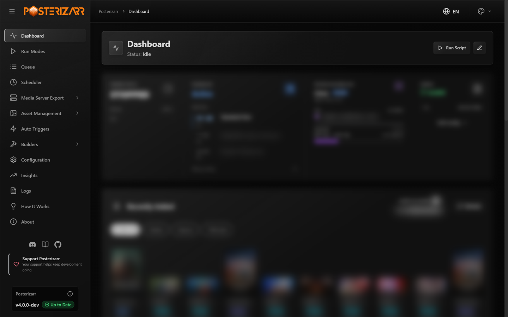
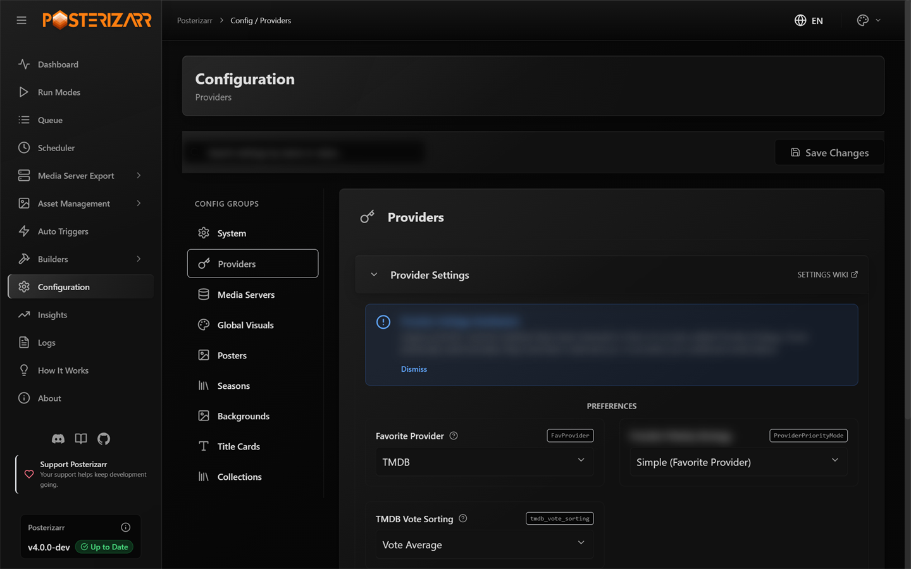
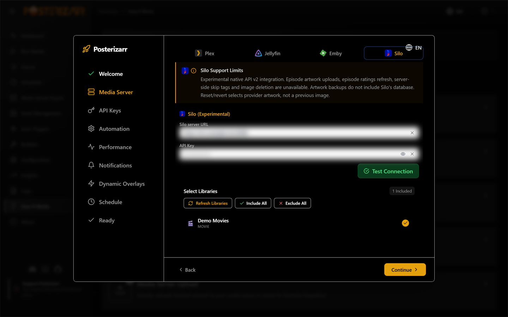
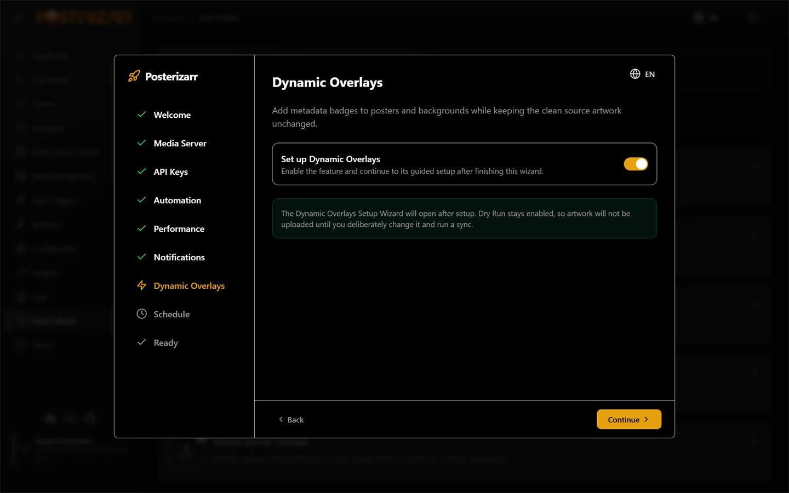
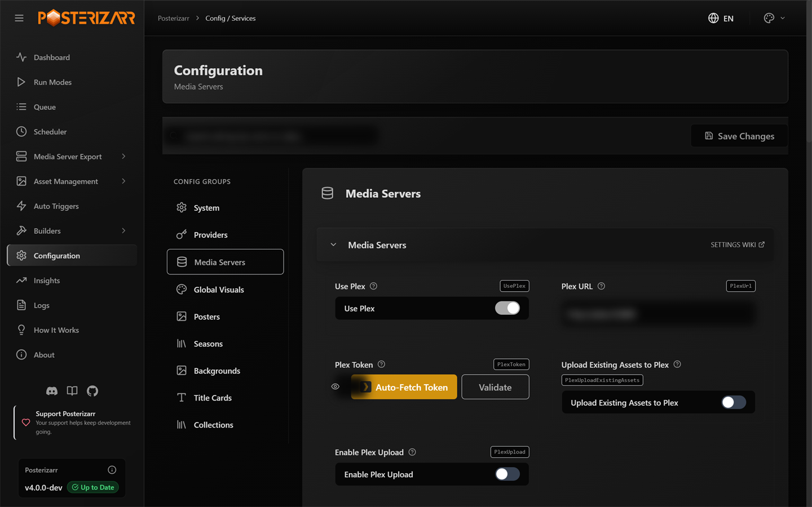

# First-time setup

This guide is for someone opening Posterizarr for the first time. Follow it in
order; you do not need to understand every setting before getting started.

*After opening the Web UI, start at **Dashboard** in the left sidebar. The sidebar remains the main route to configuration, runs, assets, builders, and automation.*

## 1. Choose how to install

- **Docker:** the recommended route for most home servers. Start with
  [Choose an installation method](installation.md#recommended-for-most-users-docker).
- **Unraid:** install the Community Apps version, then check the
  [Unraid notes](platformandtools.md#unraid).
- **Windows or Linux without Docker:** use the
  [manual PowerShell walkthrough](walkthrough.md).

The separate [Web UI from source guide](uiinstallation.md) is for development or
manual UI setups, not the normal Docker or Unraid installation.

## 2. Gather only what you plan to use

Have your media-server address and API credentials ready. Add artwork-provider
credentials for the providers you want to search. Start with the
[requirements checklist](requirements.md); optional services can be configured
later.

*Open **Configuration > Providers** to enter only the artwork-provider keys you plan to use.*

Keep API keys private. Do not paste them into screenshots, support posts, or
public configuration files.

## 3. Start Posterizarr and open the Web UI

After installation, open the Web UI from the same machine or network as the
server. Docker's default published port is `8000`, so the local address is
usually `http://localhost:8000`; replace `localhost` with the server address
when opening it from another device. If it is not reachable, see
[Networking](networking.md).

If the first-run setup appears, use it to connect your media server and choose
the libraries Posterizarr should manage. Otherwise, open the configuration area
in the Web UI and check the same items there. Do not enable every library just
to get through setup; begin with one test library.

### Automatic First-Run Wizard

*The wizard appears automatically while the initial configuration is incomplete. Choose a primary server, validate its connection, and select libraries before continuing.*

The wizard is a nine-step modal, not a sidebar page. It opens automatically
when Posterizarr has not recorded setup as complete. **Finish Setup** saves its
configuration; before then, form edits remain in the wizard. Continue is gated
on a validated server/library selection and on entering all three provider
keys.

| Step | What it configures |
|---|---|
| Welcome | Introduces the guided setup. |
| Media Server | Choose Plex, Jellyfin, Emby, or experimental  Silo; enter credentials, test the connection, and select libraries. Plex users can optionally configure a secondary Jellyfin or Emby sync. |
| API Keys | Enter a TMDb Read Access Token, TheTVDB Project API key, and Fanart.tv personal key. These three fields are required to continue in this wizard; the Test buttons are available for each provider. |
| Automation | Choose whether to clean unused assets, skip Japanese/Chinese titles, and skip TBA title cards. Leave cleanup off until library scope and exclusions are correct. |
| Performance | Set Image Processing, output quality, retained logs, and parallel jobs. Lower parallel jobs on memory-limited NAS devices. |
| Notifications | Choose none, Discord, or Apprise; Uptime Kuma can be configured separately. |
| Dynamic Overlays | Optional. Enable the feature and continue into its dedicated Setup Wizard after finishing. It starts in Dry Run. |
| Schedule | Optional. Choose a run mode and daily, weekly, monthly, or interval schedule. Logo Updater also exposes library, force-replace, EXIF-check, and revert options. |
| Ready | Save the configuration and complete onboarding. If scheduling was enabled, the wizard enables the scheduler and creates the selected job. If Dynamic Overlays was enabled, its Setup Wizard opens; otherwise the wizard opens **How It Works**. |

*Enable Dynamic Overlays here to open its guided setup after finishing. The first-run choice keeps Dry Run on and does not upload artwork.*

For Docker, set `RUN_TIME=disabled` before enabling a schedule here so the
container timer does not compete with the Web UI Scheduler. If you leave the
schedule switch off, no onboarding schedule is created.

*Open **Configuration > Media Servers** to validate the server URL/key and choose the first library.*

## 4. Check what Posterizarr will create

There are two different test workflows, both available in the Web UI:

- **Artwork styling:** open **Run Modes > Testing Mode**. It creates sample
  images using your current settings and opens the results in **Test Gallery**.
  It does not upload artwork to a live media server. See
  [Testing Mode](modes.md#test-mode).
- **Dynamic Overlays:** open **Builders > Dynamic Overlays**, use its Setup
  Wizard, select one library, and keep **Dry Run** enabled while checking rules
  and previews. Dynamic Overlay Dry Run renders changes but does not upload
  artwork. See the [Dynamic Overlays guide](dynamic_overlays.md).

These are separate checks: Testing Mode checks generated artwork styling, while
Dynamic Overlays Dry Run checks overlay rules and placement.

## 5. Run a small first job

Start with one library or a targeted item. Before a normal run, review whether
direct upload is enabled for your media server and where generated assets will
be stored. The [configuration reference](configuration.md) explains those
settings. If you use Dynamic Overlays, keep Dry Run enabled until the preview,
library scope, and logs look right.

## 6. Automate only after checking the result

Once the artwork looks right and the destination is correct, configure a
schedule or an integration such as Sonarr, Radarr, or Tautulli. See
[Run modes and automation](modes.md). You can return to
[Posterizarr's main features](capabilities.md), browse the
[artwork showcase](showcase.md), or open the guide for a specific task from
**Use Posterizarr** in the navigation.