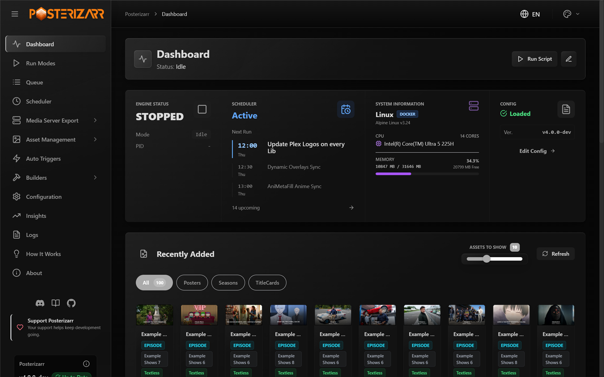
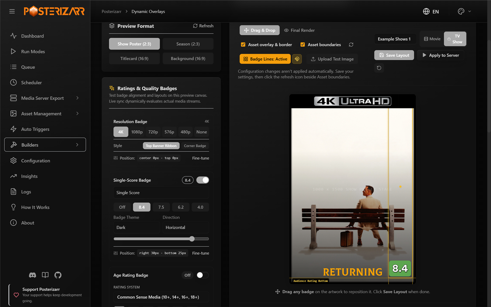
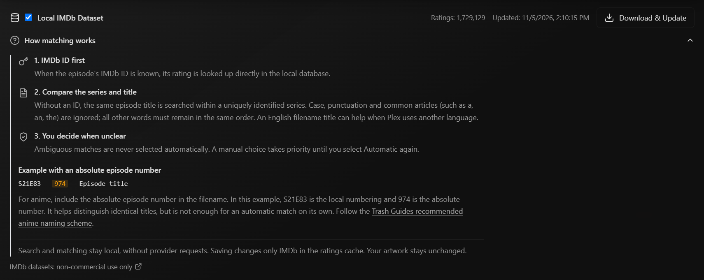
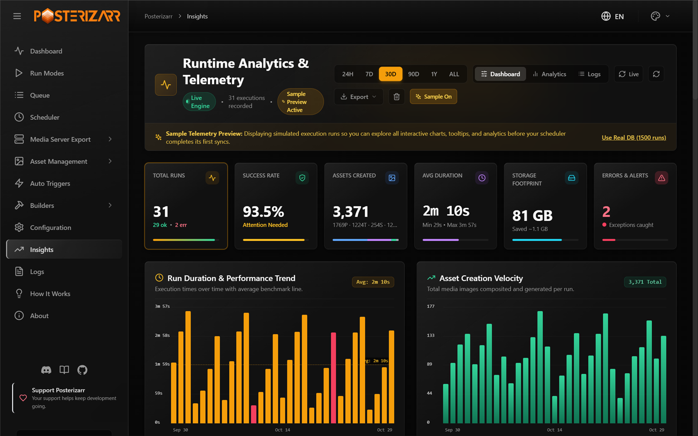

  
ARTWORK AUTOMATION · PLEX · JELLYFIN · EMBY · SILO (EXPERIMENTAL)

  <h1>Make your library feel like yours.</h1>
  
Choose the look for each artwork type once. Posterizarr keeps generating matching posters, seasons, backgrounds, and title cards. Add Dynamic Overlays on top for ratings, resolution, language flags, and more.

  

    <a class="pz-button" href="getting_started.md">Start with the setup guide</a>
    <a class="pz-text-link" href="showcase.md">Explore real artwork</a>
  

<a href="https://ko-fi.com/R6R81S6SC">Support Posterizarr on Ko-fi</a> · <a href="https://discord.gg/fYyJQSGt54">Join the Discord community</a>

--8<-- "docs/includes/artwork-gallery.md"

## New to Posterizarr?

Start with the short setup path. It helps you choose an installation method,
connect your media server, and test the result before enabling automation.

-   **I am new to Posterizarr**

  Choose an install path, connect one library, and test before automating.

  [Start the setup guide](getting_started.md)

-   **I already installed it**

  Jump to everyday tasks: run modes, Action Center, overlays, or recipes.

  [Browse user guides](modes.md)

-   **I want to understand the settings**

  Look up a specific configuration field or provider behavior.

  [Open the configuration reference](configuration.md)

See real examples in the [artwork showcase](showcase.md), or learn
[what Posterizarr can do](capabilities.md) before setting it up.

## Manage Your Artwork From the Web UI

Posterizarr creates and manages artwork for Plex, Jellyfin, and Emby, with
experimental support for Silo. Silo does not yet have full feature parity with
the other servers. Use the
dashboard to check engine status, upcoming schedules, and recently generated
artwork. Open **Action Center** to review assets that need attention, or
**Insights** to explore execution history and runtime statistics.

- [Install Posterizarr](installation.md) for a new setup.
- [Review assets in Action Center](action_center.md) to resolve artwork issues.
- [Create reusable Blueprints](blueprints.md) for asset-generation recipes.
- [Configure automation](modes.md) for scheduled and externally triggered runs.

## Native Dynamic Overlays

**Builders > Dynamic Overlays** previews and composites supported badges for
posters, titlecards, and backgrounds. Choose a library and format, adjust badge
placement, check required assets, and sync directly to Plex, Jellyfin, or Emby.
Clean source artwork stays unchanged on disk.

Start with **Dry Run** to evaluate and render changes without uploading artwork.
Supported Kometa-style YAML can be imported, but Posterizarr does not run Kometa
and does not implement every Kometa feature.

[Open the Dynamic Overlays setup guide](dynamic_overlays.md)

## Import IMDb Ratings Locally

Posterizarr can import IMDb's official ratings, episode, and title datasets into
a local index. Missing IMDb scores can then be resolved locally, without an
API call for each successful lookup. Episode matching and manual episode/season
mapping help with alternate numbering and anime.

Open **Builders > Dynamic Overlays > Sync & Cache > Browse Ratings** for
**Local IMDb Dataset** and **Download & Update**. The download and indexing
require disk space and time; IMDb's datasets are for non-commercial use only.

[Read the IMDb import and matching guide](dynamic_overlays.md#local-imdb-dataset).

## Explore Run History

Insights brings run counts, success/error filters, durations, artwork totals,
storage figures, and interactive charts into one view. Its optional **Demo**
mode lets you explore the interface using simulated runs.

!!! note "About these screenshots"
    These are development-build captures from a local, read-only documentation
    preview. Library and title names are replaced with examples. The Insights
    image uses built-in simulated telemetry; overlay previews use sample metadata.
    They illustrate the UI, not benchmark results, default configuration, or a
    completed media-server sync.
