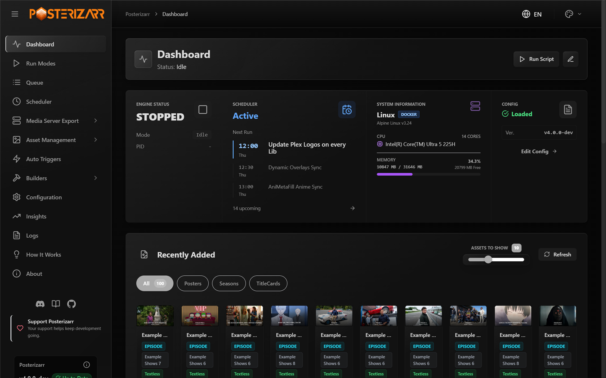
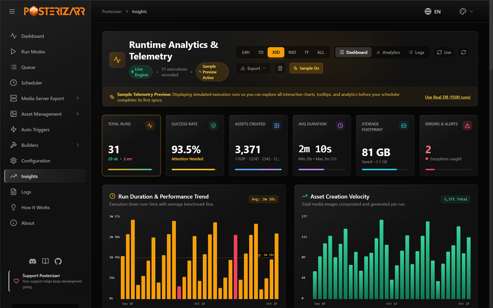

  

  <h1 align="center">Welcome to Posterizarr</h1>

  

    Automate the creation of beautiful assets for your Plex, Jellyfin, or Emby library.
  

  
   
  

   
  

  Posterizarr is free to use. If it saves you time, <a href="https://ko-fi.com/R6R81S6SC">your support helps keep development going</a>.
   
  <a href="https://discord.gg/fYyJQSGt54">Join our Discord</a>

## Manage Your Artwork From the Web UI

Posterizarr creates and manages artwork for Plex, Jellyfin, and Emby. Use the
dashboard to check engine status, upcoming schedules, and recently generated
artwork. Open **Action Center** to review assets that need attention, or
**Insights** to explore execution history and runtime statistics.

- [Install Posterizarr](installation.md) for a new setup.
- [Review assets in Action Center](action_center.md) to resolve artwork issues.
- [Create reusable Blueprints](blueprints.md) for asset-generation recipes.
- [Configure automation](modes.md) for scheduled and externally triggered runs.

## Native Dynamic Overlays

**Builders > Dynamic Overlays** previews and composites supported badges for
posters, titlecards, and backgrounds. Choose a library and format, adjust badge
placement, check required assets, and sync directly to Plex, Jellyfin, or Emby.
Clean source artwork stays unchanged on disk.

Start with **Dry Run** to evaluate and render changes without uploading artwork.
Supported Kometa-style YAML can be imported, but Posterizarr does not run Kometa
and does not implement every Kometa feature.

[Open the Dynamic Overlays setup guide](dynamic_overlays.md)

## Explore Run History

Insights brings run counts, success/error filters, durations, artwork totals,
storage figures, and interactive charts into one view. Its optional **Demo**
mode lets you explore the interface using simulated runs.

!!! note "About these screenshots"
    These are development-build captures from a local, read-only documentation
    preview. Library and title names are replaced with examples. The Insights
    image uses built-in simulated telemetry; overlay previews use sample metadata.
    They illustrate the UI, not benchmark results, default configuration, or a
    completed media-server sync.
