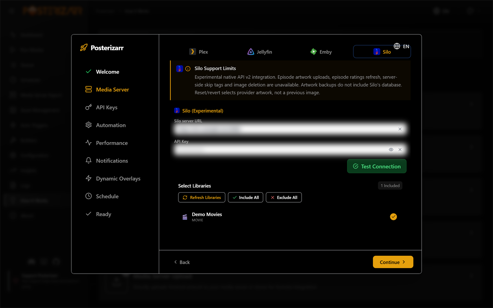
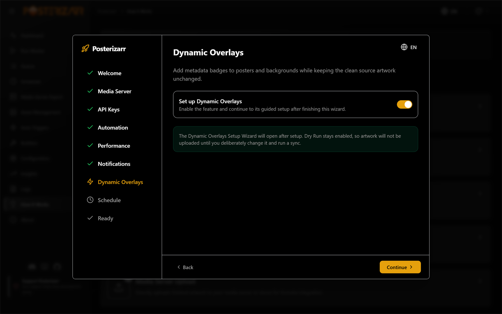
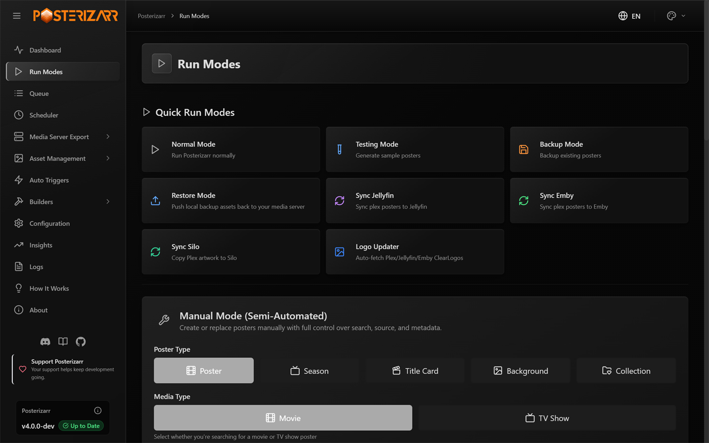
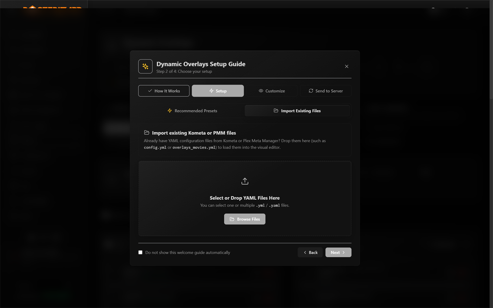
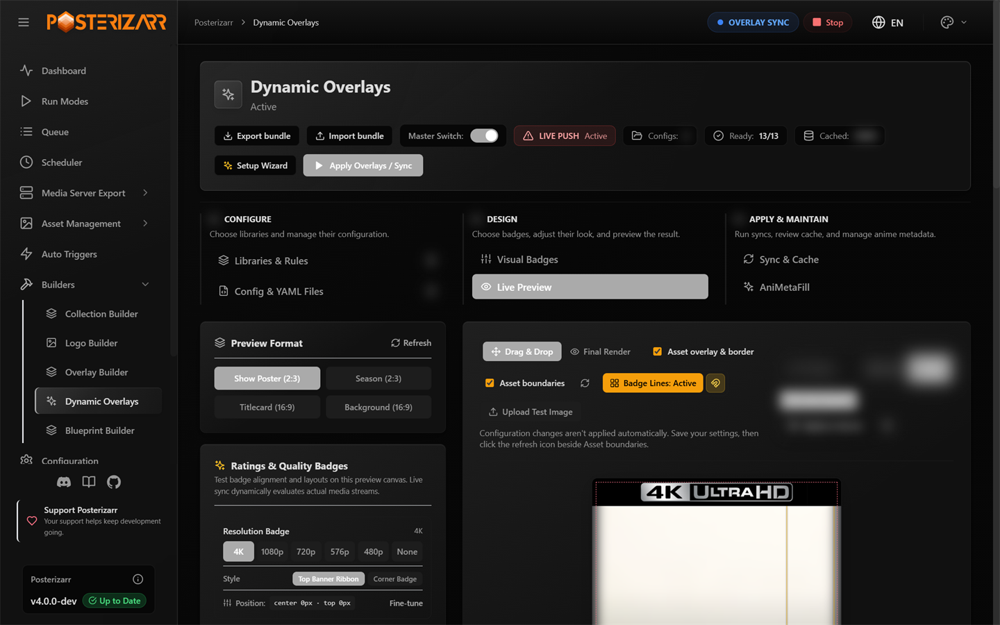
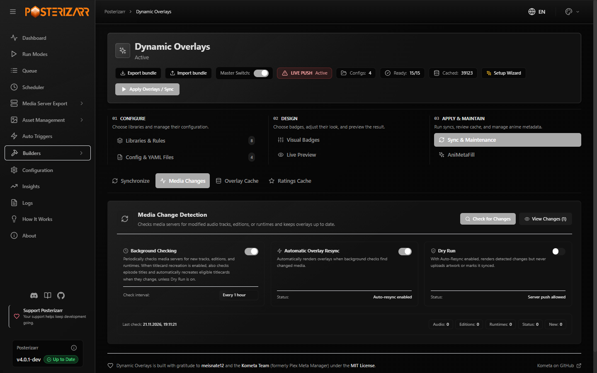

# 5-Minute Quickstart

Go from a fresh Posterizarr install to your first clean poster and your first
Dynamic Overlay in about five minutes — without touching your full library.

!!! tip "You do not need Kometa installed"
    Posterizarr renders supported Dynamic Overlays natively in memory. You do
    not need to read the full [Dynamic Overlays guide](dynamic_overlays.md) or
    [Reference](dynamic_overlays_reference.md) just to try it out.

## How Posterizarr Works in 30 Seconds

Posterizarr separates **base artwork** from **dynamic overlays** into two simple
layers:

1. **Base Artwork (`/assets`):** Posterizarr downloads textless/clean posters,
   season posters, backgrounds, and episode titlecards (and draws any title text,
   logos, or borders you configured) into `/assets`. These saved files stay
   100% clean on disk.
2. **Dynamic Overlays (optional, in RAM):** When enabled, Posterizarr loads a
   clean base image from `/assets`, composites badges (4K/HDR, ratings,
   runtime, audio/subtitle flags, series status, etc.) in memory, and uploads
   the final image directly to **Plex**, **Jellyfin**, or **Emby**.

!!! note "Switching from Kometa + BtttrPosters / TCM?"
    Dynamic Overlays composites onto **clean base files in Posterizarr's `/assets`
    folder** (items without a clean local base asset are skipped). In Step 2
    below, you generate a single test item first so you can verify everything end
    to end in minutes.

---

## Step 1: Complete the First-Run Wizard

Open the Posterizarr Web UI (usually `http://localhost:8000` in Docker). The
first-run wizard launches automatically:

1. **Media Server:** Choose **Plex**, **Jellyfin**, or **Emby**, validate the
   connection, and pick **one small test library** (do not enable every library
   yet).
2. **API Keys:** Enter a **TMDb Read Access Token** or **TheTVDB Project API
   key** (at least one is required) and test the connection.
3. **Dynamic Overlays step:** Turn on **Dynamic Overlays** here. It starts safely
   in **Dry Run**, so nothing is uploaded while you preview and test.
4. Click **Finish Setup**.

---

## Step 2: Generate Your First Clean Base Poster

Before applying overlays, verify your poster look and create at least one clean
base poster in `/assets`:

1. *(Optional style check)* Open **Run Modes** and run **Testing Mode** to
   generate sample images in **Test Gallery** without uploading anything to your
   media server.
2. Under **Run Modes > Manual Asset**, enter **one movie or TV show** from your
   test library and generate its clean base poster (or run your small test
   library once).

---

## Step 3: Apply a One-Click Overlay Preset

If the Dynamic Overlays Setup Wizard did not open automatically after Step 1, go
to **Builders > Dynamic Overlays** and click **Setup Wizard**:

1. In step **Choose your setup**, click **Apply Presets** (recommended for a
   first try — no YAML needed). This configures balanced defaults for movie
   ratings, resolution, runtime, age ratings, show status, network logos, and
   16:9 backdrops. *(Coming from Kometa? You can also import YAML files later.)*
2. Click through to **Finish & Open Live Preview**.

---

## Step 4: Preview & Dry-Run One Item

1. In **Live Preview**, select your library and format (Movie Poster, Show
   Poster, Titlecard, or Background), drag or adjust badges if desired, and
   click **Save Layout** if you made changes.
2. Open **Sync & Maintenance > Synchronize**, click **Targeted Reapply** (or
   **Select Movie / Show**), and pick the **single item** you generated in
   Step 2.
3. Run the sync while **Dry Run** is still **ON**, and confirm in
   `DynamicOverlaysSync.log` that Posterizarr matched the asset and rendered its
   overlays without errors.

---

## Step 5: Push Your First Live Overlaid Poster

When the preview and dry-run log look right:

1. Open **Sync & Maintenance > Media Changes** and turn **Dry Run** **OFF**
   (the header pill switches to **LIVE PUSH Active**).
2. Return to **Sync & Maintenance > Synchronize**, click **Targeted Reapply**,
   and run that **same single movie or show** again.
3. Refresh the item in Jellyfin, Plex, or Emby — your overlaid poster is now
   live, while your clean `/assets` original stays untouched on disk.

---

## Where to Go Next

- **Full onboarding details:** [First-time setup](getting_started.md) and [Web UI map](ui_guide.md)
- **Dynamic Overlays overview:** [Dynamic Overlays](dynamic_overlays.md) (setup flow, supported overlay types, sync tabs)
- **Deep dive (YAML, bundles, IMDb dataset, SIMKL, Anime):** [Dynamic Overlays Reference](dynamic_overlays_reference.md)
- **Keep renamed titles in sync:** [Asset Title Review](asset_title_review.md)
- **Schedules & webhooks (Sonarr / Radarr / Tautulli):** [Run modes and automation](modes.md)
