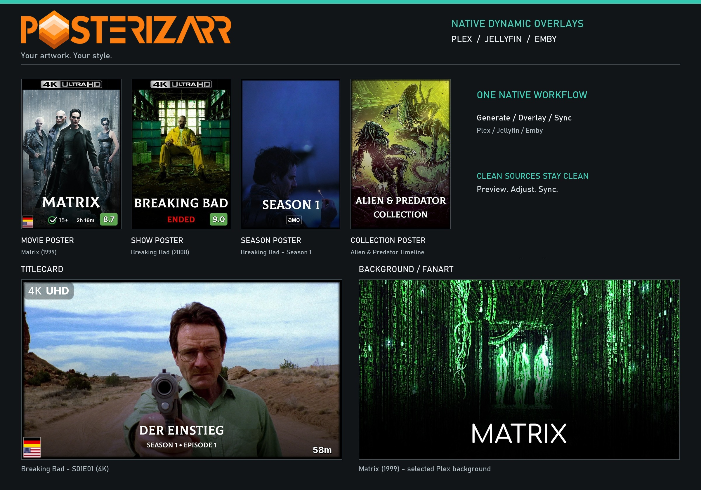
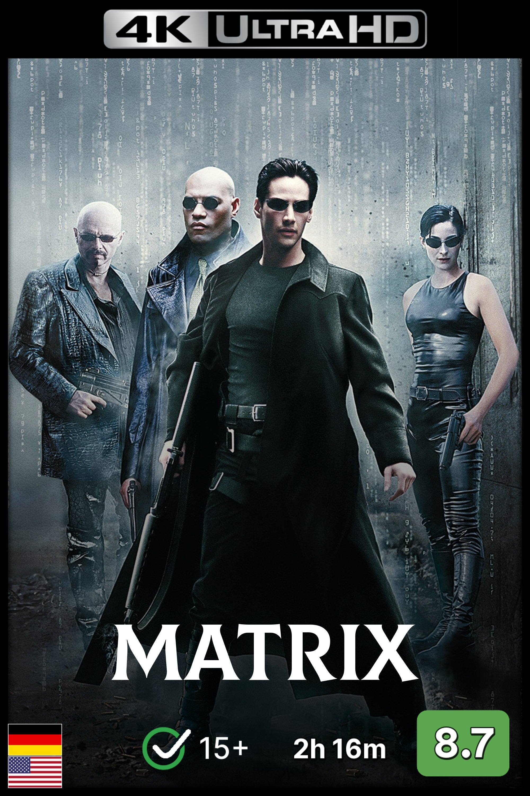
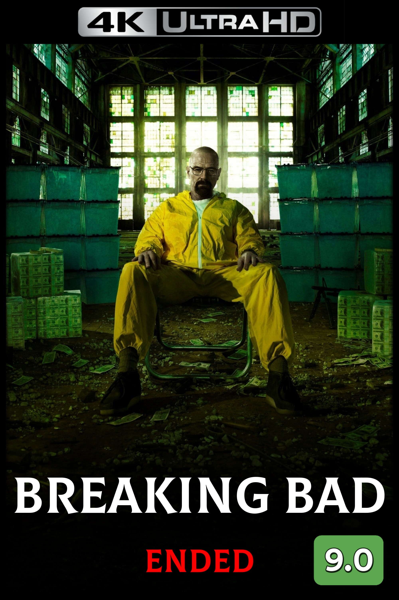
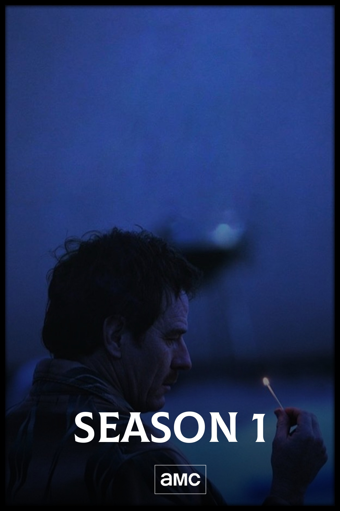
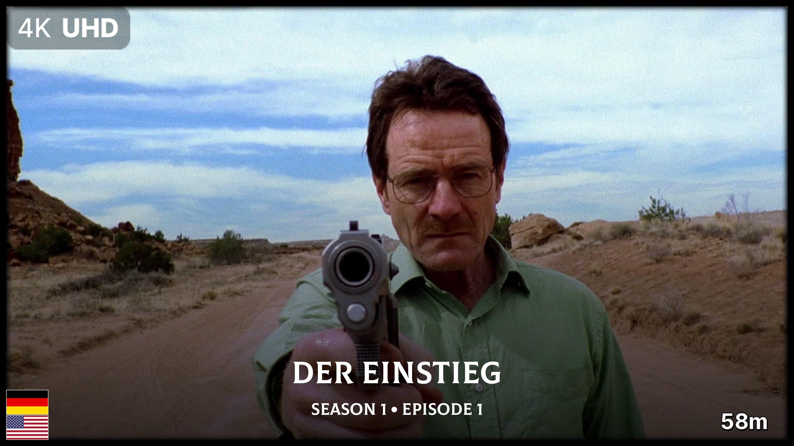
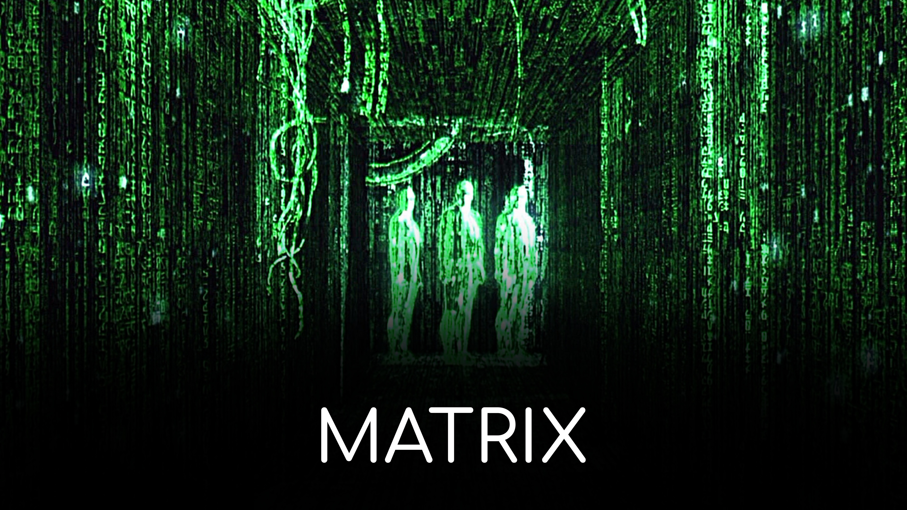
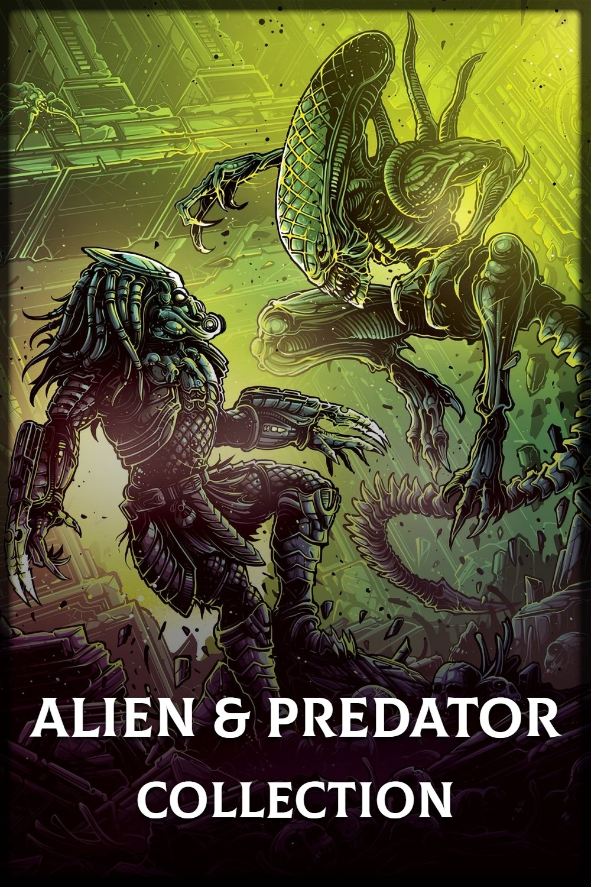

# Posterizarr Artwork Showcase

Posterizarr creates artwork and applies supported Dynamic Overlays natively,
with direct uploads to Plex, Jellyfin, and Emby. A separate overlay application
is not required for the native workflow.

## Posters

Movie and show posters share a portrait canvas but can use different badges.
Season artwork has its own format and rules. Layouts are configurable per library
and format; not every badge has metadata available at every level.

    
    
    

## Titlecards and Backgrounds

Landscape formats use their own placement. These images are the currently
selected Plex episode and background artwork, including any existing text,
borders, or badges. Available badges depend on the item's metadata and rules.

## Collections

Collection posters are an additional artwork format, not a Dynamic Overlay
target level. Use the collection designer for custom collection artwork.

    

!!! note "Artwork source"
    The six JPEG examples and their banner thumbnails were downloaded from the
    artwork currently selected in a real Plex installation. The movie example is
    Matrix (1999). The show, season, and titlecard all belong to Breaking Bad
    (2008), Season 1; the episode is S01E01. Its video metadata reports a 3840-pixel
    width, independently of the visible 4K badge. The collection is Alien & Predator
    Timeline. No mock titles or preview badges were added for this page.
    Captures used read-only requests; no server artwork or configuration
    was changed. These examples are not default layouts or performance benchmarks.

[Design your own native overlays](dynamic_overlays.md) or
[explore Blueprints and collection recipes](blueprints.md).

## Asset-Creation Styling

Posterizarr's base artwork-generation pipeline also supports fonts, gradients,
borders, and title/logo placement before any dynamic badges are applied.

### Colus-Regular.ttf

### Comfortaa-Medium.ttf

These base-styling examples use this
[Posterizarr configuration](https://github.com/fscorrupt/posterizarr/blob/main/MyPersonalConfig.json).

## Testing Mode

Use the [Testing Mode guide](modes.md#testing-mode) to check asset-generation
styling before processing a library. Dynamic Overlays has a separate preview and
Dry Run workflow; its sample metadata does not represent a particular server item.

## Discord Webhook

